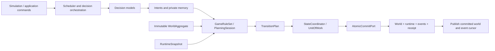

# Deeper object-oriented implementation

This is the implementation companion to the [approved P1–P7 proposal](DEEP_OOP_REFACTOR_PROPOSAL.md). Implementation and release verification are complete: all **544 acceptance cases** and all mandatory verification gates passed against the final source. The [final qualification](../artifacts/deep-oop-refactor/verification.json) records the evidence. The [earlier refactor report](OOP_REFACTOR.md) and its artifacts remain historical evidence.

## Start with the ownership boundaries

`Simulation` is the public entry point and execution orchestrator. `StateCoordinator` owns an immutable `WorldAggregate`. `RuntimeState` owns continuation facts: the exact clock, typed task queue, identity counters, private model memories, configuration and checkpoint cadence. Models receive detached local observations and private memory. They return proposals, not world mutations.

`GameRuleSet.plan()` creates an isolated `PlanningSession`, evaluates a request, and returns a `TransitionPlan`. The session has transaction-local drafts and a private runtime branch. It has no simulation, database connection, live store, history-query port or publisher. A plan contains typed replacements, immutable events, continuation state and the expected source revision. `StateCoordinator.begin()` checks the revision and cross-entity constraints. `UnitOfWork.commit()` sends the world/runtime/events/control-receipt bundle through the atomic persistence port. Publication follows a successful durable result or a reconciled transaction receipt.

`ScheduledBoundary` keeps the scheduler's queue removal, clock advance and completion preparation reversible until that transaction publishes. A failed commit restores the prior runtime owner and retains the failure status. A reconciled durable commit keeps its new runtime. Timing measurements remain diagnostic observations of work actually performed, outside semantic history.



The [whole-project class atlas](classes/index.html) contains attributes, methods, inheritance, ownership and source links. The [architecture guide](ARCHITECTURE.md) provides a smaller reading path. The [ontology mapping](ONTOLOGY_IMPLEMENTATION_MAP.md) connects invariants and actions to implementation and evidence.

## Domain model

An `Agent` has a run-scoped `AgentIdentity` and an immutable current `AgentState`. `HumanState` and `ZombieState` are state variants. Conversion replaces the state and retains identity. A dead human remains a terminal human state; remains are a separate environment entity. Old world views continue to expose their original state.

`RoleDefinition` has Human and Zombie branches and eight concrete role definitions. `RoleAssignment` is optional and carries per-agent facts. Two Spitters can share their immutable definition while owning separate reservoirs. Type, role, model assignment, health status and action status remain distinct. Profiles and capabilities are derived by typed policies, with immutable caches of derived values.

Environment objects include bounds, barriers, permanent obstacles, gates, barricades, shelters, stockpiles, remains, reservations, infection episodes and signals. Exact times retain rational values and their established wire spelling. Canonical state is held in named typed fields. Opaque JSON is limited to explicitly opaque payload/evidence fields. Record codecs reject unknown fields instead of silently discarding them.

All 29 actions have a concrete `ActionHandler`. `ActionLifecycle` owns shared admission, reservation, completion, cancellation and evidence behavior. Handlers compose damage, infection, death, conversion, resource, effect, geometry and signal rules. `ActionIntent`, `ActionOccurrence`, `ScheduledTask` and `DomainEvent` have separate meanings and codecs. A rejected proposal is retained as audit evidence; it does not become an admitted action.

## Inspect state in Python

```python
from zombie_sim import Simulation
from zombie_sim.domain_model import HumanState, ZombieState

with Simulation({"preset": "small"}, workers=1) as simulation:
    before = simulation.state_coordinator.current_world
    identity = next(iter(before.collections["agents"]))
    agent = before.agent(identity)
    print(agent.identity, type(agent.current_state).__name__)
    print(agent.current_state.status, agent.current_state.capabilities)

    simulation.advance_until(2, return_snapshot=False)
    after = simulation.state_coordinator.current_world
    print(before.revision, after.revision)
    # 'before' still represents its original committed revision.
    record = simulation.state       # detached compatibility dictionary
    record["agents"][identity]["life"] = 0  # changes this copy only
```

The public model SDK's `zombie_sim.ActionIntent` is the convenient policy proposal builder. The persistent domain record `zombie_sim.domain_model.ActionIntent` represents the admitted/rejected proposal recorded by the engine. They are distinct boundaries, not competing world owners.

Run `PYTHONPATH=src .runtimeenv/bin/python examples/deep_oop_inspect.py` for a complete example that checks conversion identity, retained historical state, action cancellation and dropped inventory, then lists all handler implementations.

For a new controller, continue using [the existing model SDK](MODELS.md) and `examples/oop_custom_model.py`. To change framework rules, use a handler/rule set and read the [extension migration guide](DEEP_OOP_EXTENSION_MIGRATION.md). Rule implementations must preserve the frozen action catalog; custom behavior is source-pinned and explicitly supplied on restoration. Unrecorded instance parameters are rejected.

## Storage and continuation

`PersistenceBundleFactory` supplies mutually compatible live-state, history-query, atomic-commit and checkpoint adapters. `MemoryStore` and `SQLiteStore` are independent implementations. Both production modes retain complete durable SQLite history. Application and research clients use named history queries; SQL is confined to persistence adapters. Workspace run metadata has its own catalog repository because it is not part of a game-world transaction.

The independent in-memory contract adapter demonstrates that planning, execution and research queries do not require a SQLite connection. It is intentionally nondurable and rejects portable checkpoint export. It is a test/research adapter, not a claim of process-crash durability without storage.

Runtime-v2 and journal-v2 encode explicit registered `RuntimeState` fields. Restoration uses a normal reconstruction constructor; it neither resamples agents nor replays an unrecorded policy. The reviewed default runtime-v1 importer preserves the original causal prefix. Unknown durable fields, incompatible model/engine/rule bindings, corrupted bundles and missing exact memory codecs produce explicit errors or the established replay-only capability. Legacy artifacts do not acquire invented historical engine hashes.

Rolling checkpoint publication stages and fsyncs a new history generation before replacing the JSON envelope, then promotes that generation to the usual adjacent `.history.sqlite` file. Failure before envelope publication preserves the previous pair. An interrupted promotion can recover the recorded generation after checksum validation; it cannot hide arbitrary corruption of an adjacent sidecar. Normal successful rolling checkpoints retain one canonical history file. Repeated abrupt crashes can leave unreferenced older generations; these are retained rather than removed by a broad file search. The migration guide describes copying and recovery details.

The [migration guide](DEEP_OOP_EXTENSION_MIGRATION.md) explains the intentional private-extension boundary: old hooks that mutated a live coordinator require migration. Existing public simulation, CLI, GUI, checkpoint and model workflows remain the compatibility targets. Functional React view components remain in place.

## Allocation and performance

World collections use persistent ordered maps, sharing unchanged entities and index branches across revisions. A `WorldDraft` materializes only records read by its request and freezes changes at the planning boundary. Automatic nested-change detection supplements explicit dirty markers. The swept-path spatial index is immutable and updated for changed agents; visibility still uses exact-time position and line-of-sight checks.

Equal immutable `ProfileValues` decoded from ordinary numeric records share a bounded pool of at most 2,048 entries. Profiles contain no agent identity, clock or mutable assignment state. The key preserves absent fields, integer/float distinctions and signed zero; custom numeric and profile subclasses bypass sharing. Exported dictionaries remain detached. Eviction removes only the pool's reference, leaving retained historical values valid.

Runtime configuration and private memories use immutable cells with branch-local copy-on-write containers. Unchanged memory cells are shared and are not serialized again at every action completion. Plugin/export boundaries materialize ordinary dictionaries and lists. Internal mapping wrappers refuse raw JSON serialization rather than silently emitting an empty object.

Each agent's private memory is an isolation unit. Exact built-in trees use structural cells; custom containers and graphs with shared references or cycles use owned deep copies, preserving their live Python types and within-memory relationships. Sharing mutable objects across different agents is not a private-memory contract. Live ownership support does not imply an exact persistence codec: unsupported memory retains the established replay-only declaration.

These mechanisms keep long historical action collections out of per-event copying. The full-world DTO and checkpoint APIs intentionally materialize their complete requested contents. Pilot throughput, memory and checkpoint costs are reported as measurements, separately from the required full baseline.

The [worker pilot evidence](../artifacts/deep-oop-refactor/final-performance-pilot/README.md) compares identical 1,000-agent, 10-second configurations with the preserved implementation. This matrix measured the refactor before its final profile-sharing optimization. Each run produced 3,945 revisions, 17,250 events, 4,556 decisions and 28 recorded draws. World/event/selected continuation comparisons matched; the separate differential gate compares all persisted runtime attributes.

| Workers | Preserved implementation execution | Refactored execution | Observed ratio |
| --- | ---: | ---: | ---: |
| 1 | 47.14 s | 112.70 s | 2.39× |
| 2 | 62.21 s | 128.93 s | 2.07× |
| 4 | 50.75 s | 129.39 s | 2.55× |

These are shared-host observations with concurrent verification work, not isolated benchmarks or evidence of parallel speedup. Profiling led to persistent indexes, unchanged-memory reuse and immutable profile caches; a material execution cost remains. Browser rendering thresholds are separate and have not been reduced. The complete baseline provides the long-run capacity and completion evidence.

The [paired profile-sharing comparison](../artifacts/deep-oop-refactor/profile-intern-prototype/IMMUTABILITY_REVIEW.md) then evaluated the memory optimization using actual 1,000-agent runs. Raw world, event history and every runtime attribute except the physical history path matched. Typed-world reachable memory fell from 244.95 to 118.61 MiB; live profile instances fell from 70,713 to 31. Elapsed execution was 110.40 versus 113.21 seconds, so this is a memory improvement, with no speedup claimed. This prototype measurement precedes the final signed-zero and path-spelling fixes; the final qualification separately covers those fixes. Sampling archived full-run occurrences estimates approximately 17.9 GiB less typed evidence storage; actual full-run peaks remain the capacity evidence.

The **completed 1,000-agent baseline** reached the exact 1,800-second horizon at revision **1,091,736**, retaining **3,130,668 events** and all 1,000 identities. The original acceptance gate, including final snapshot processing and history retention, took **37,781.70 seconds (10 h 29 min 42 s)** on this shared host with 23 configured workers. Its retained ledger is **27,000,614,912 bytes (25.15 GiB)**. The [completed-run audit](../artifacts/deep-oop-refactor/baseline_attempt_4/completion-audit/REPORT.md) verifies world/runtime revision and time, terminal conditions, transaction receipts, source identity, and an independently recomputed whole-file hash.

Full-run resource costs are substantial. The coordinator's greatest observed kernel lifetime high-water RSS was **96.19 GiB**, including final snapshot/status processing; the 20-second monitor observed **92.24 GiB** coordinator RSS and at least **72.00 GiB** of live run files. Minimum sampled host-available RAM was **10.51 GiB**. These are observations from a host with approximately 123 GiB RAM and swap, not a guaranteed memory ceiling or a hardware sizing recommendation. The acceptance adapter also holds detached data, so coordinator RSS alone is not total task memory. RSS includes shared pages, sampled disk/RSS peaks are lower bounds, and a process can exit between high-water samples. The final full-world export is materially more expensive than steady-state stepping.

Six automatic checkpoints published at simulation times 300, 600, 900, 1,200, 1,500 and 1,800. Their observed file-publication intervals were approximately **70, 134, 208, 268, 344 and 472 seconds**. These intervals exclude serialization and previous-envelope reading before a temporary sidecar appears; they are not full checkpoint durations. Raw progress, high-water observations and measurement limits remain in the [audit data](../artifacts/deep-oop-refactor/baseline_attempt_4/completion-audit/audit.json). The final state can include further transactions at the same horizon after the last checkpoint; the retained ledger includes the final revision.

## Evidence

All prior evidence is retained. The pre-change source, test fixtures, formal provenance and class atlas are archived under `artifacts/deep-oop-refactor/`. The original ten acceptance specification modules remain byte-identical. Five additive semantic cases bring the acceptance catalog to 544 cases; behavioral architecture tests are a separate suite.

The differential corpus contains explicit scenario witnesses before it qualifies as a reference: movement completion, actual conversion with preserved life/stamina and dropped inventory, role capacity changes, and model decisions. It compares full records, events, draws and continuation state across 1/2/4 workers and memory/SQLite. Its only metadata projection is the reviewed plan/ontology-manifest provenance refresh; raw captures and old ledgers remain intact.

Run named gates with `scripts/verify_deep_oop.py --list --gate all --output <new-directory>`. Actual execution requires an explicit full-baseline timeout and sufficient capacity. The tool records commands, source hashes, elapsed times, results and missing gates; a partial run is not a complete release.

The final source is recorded in [production-freeze-v4.json](../artifacts/deep-oop-refactor/production-freeze-v4.json). The [completed non-baseline qualification](../artifacts/deep-oop-refactor/qualified-final-v4/verified-summary.json) and [completed baseline qualification](../artifacts/deep-oop-refactor/baseline_attempt_4/full-baseline/qualification.json) are combined in the [final release qualification](../artifacts/deep-oop-refactor/verification.json). Earlier interrupted attempts and intermediate builds remain separate evidence and do not count as qualified passes.

| Gate | Current evidence |
| --- | --- |
| Complete acceptance catalog | **544 passed**, no failures, errors or skips: 494 core, 7 integration, 2 statistical, 38 browser, 2 rendering-performance, 1 training. The original 539 cases are retained, with five additive semantic cases. |
| Behavioral architecture contracts | **100 passed**, including actual storage failures, process deaths, memory isolation, scalar representations and continuation. |
| Harness checks | **58 passed**, plus **8 formal harness** checks. |
| Pre-refactor continuation comparisons | **78 passed** across checkpoint, journal and fresh-run paths; full runtime attributes and exact float representations compared. |
| Formal ontology package | **62/62 expectations passed**; normative sources unchanged. |
| Installed package | [Clean wheel verification](../artifacts/deep-oop-refactor/distribution-qualified/wheel_verification.json) and [isolated SDK/legacy continuation checks](../artifacts/deep-oop-refactor/distribution-qualified/isolated_sdk.json) passed. |
| Supplemental execution and recovery | [Qualification rollup](../artifacts/deep-oop-refactor/implementationchecks/qualification-summary.json) retains the final 28 checkpoint checks and all five real HTTP cancellation routes, with earlier stages explicitly distinguished. |
| Complete 1,000-agent, 1,800-second baseline | **Passed**, with source unchanged throughout. [Original acceptance result](../artifacts/deep-oop-refactor/baseline_attempt_4/full-baseline/baseline.json) and [independent retained-ledger audit](../artifacts/deep-oop-refactor/baseline_attempt_4/completion-audit/REPORT.md). |

The final aggregate report verifies all **544 distinct acceptance IDs** against the live catalog, all mandatory gates, the unchanged verification source map, and an installed package matching all **119 frozen production files**. It rehashes the wheel, binds the isolated SDK checks to that wheel, and requires the successful completed-ledger audit with full-file hash verification. Normative ontology and model SDK sources, the original acceptance specification modules, and prior audit history are preserved.
