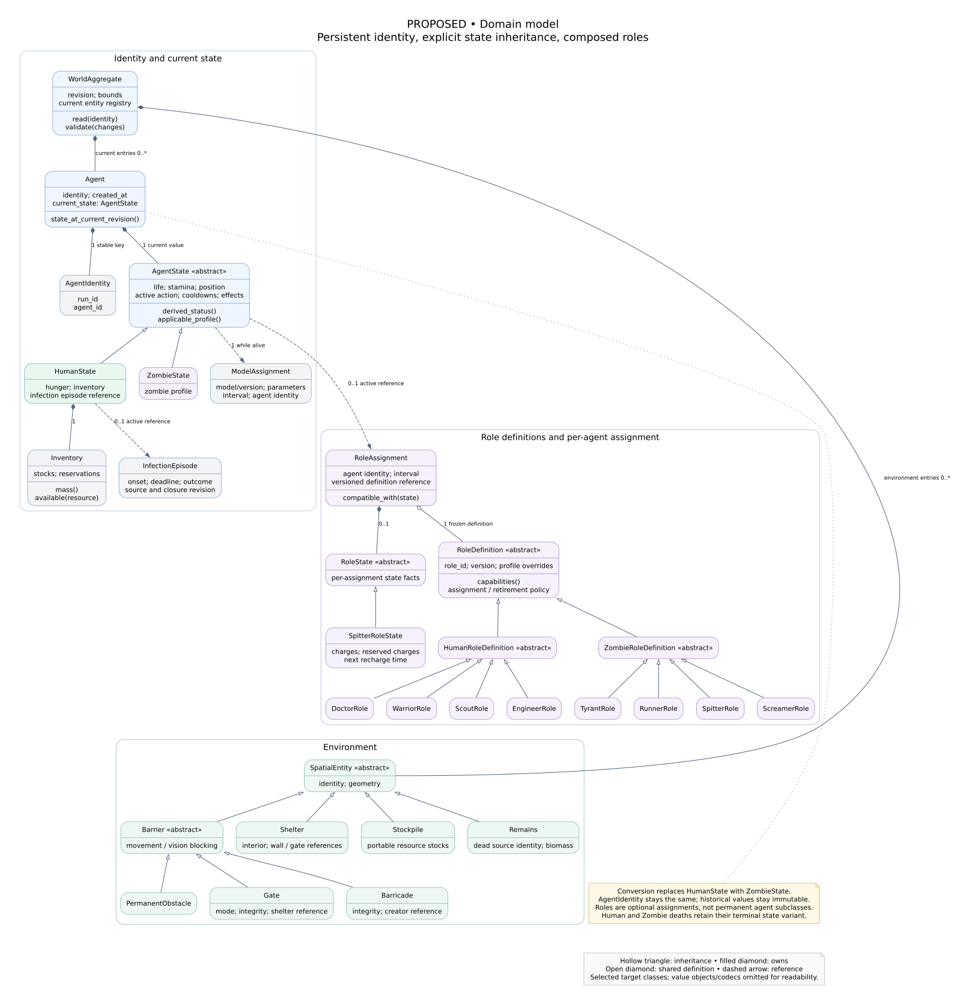
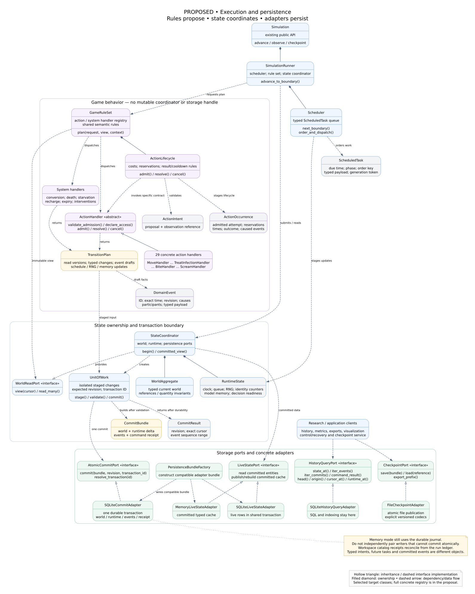

# Deeper OOP refactor — implementation proposal

**Status: approved P1–P7; retained design record.** Prepared against the current TASK 2 step on November 27, 2026. This document describes the approved target design. See the [implementation report](DEEP_OOP_REFACTOR.md) for current completion and verification evidence, and the [class atlas](classes/index.html) for the actual code.

The requested outcome is a framework in which agent types and roles have explicit models, all actions use a common lifecycle, game rules cannot directly write committed state, and state/history access does not depend on a particular storage implementation. The previous refactor established useful service objects and public views; it did not complete those deeper boundaries.

**Recommendation:** keep the game ontology unchanged, introduce authoritative typed domain objects and explicit state/storage contracts, and migrate behind the existing public simulation API. Strengthen the tests before replacing behavior. Preserve existing runs, audit evidence, and the user's choice of functional React views.

## Review in a few minutes

| Decision | Proposed choice | Why it matters |
|---|---|---|
| P1 — agent identity and types | A persistent `Agent` owns a current `AgentState`; `HumanState` and `ZombieState` inherit from `AgentState`. | Conversion changes the state variant while preserving identity. Permanent Human/Zombie identity subclasses would misrepresent the ontology. |
| P2 — roles | `RoleDefinition` has Human/Zombie branches and eight concrete role classes; agents reference an optional `RoleAssignment`. | Roles can change without replacing identity or creating a class for every type/status/role combination. |
| P3 — activities | One typed `ActionOccurrence` lifecycle and an `ActionHandler` contract for all 29 actions; typed scheduled tasks and recorded domain events remain distinct. | Admission, cancellation, reservations, and results are consistent without confusing a proposal with something that happened. |
| P4 — rules and state | Rules inspect immutable views and produce `TransitionPlan` objects. A state coordinator validates and atomically commits the changes. | A rule cannot bypass state ownership, history, resource conservation, or transaction boundaries. |
| P5 — persistence | Inject live-state, history-query, checkpoint, and atomic-commit ports. Supply memory and SQLite live adapters with a shared durable journal boundary. | Backend choice stops leaking into the engine, readers, and checkpoint code. Memory mode still records durable history. |
| P6 — compatibility | Preserve external record formats initially; use explicit versioned codecs and a reviewed legacy checkpoint importer. | Internal class layout can evolve without serializing arbitrary object attributes or rewriting old evidence. |
| P7 — evidence | Add behavioral architecture contracts, preserve existing semantic assertions, and rerun the full release gates, including the full baseline. | Class names and wrappers alone cannot demonstrate the requested separation. |

Read the [domain class diagram](deep-oop-proposal/domain.svg), the [execution and persistence class diagram](deep-oop-proposal/execution.svg), then the migration and verification sections below. Both diagrams are **proposed**, intentionally separate from the actual implementation atlas.

Editable Graphviz sources: [domain.dot](deep-oop-proposal/domain.dot) and [execution.dot](deep-oop-proposal/execution.dot). Open an SVG directly to zoom into its class members.

## 1. Findings and affected scope

The existing services, model SDK, application controllers, GUI controllers, and diagram tooling are useful foundations. The main causes of the remaining coupling are these:

| Current evidence | Consequence | Proposed correction |
|---|---|---|
| [`domain.py`](../src/zombie_sim/domain.py): `AgentFactory.create()` returns dictionaries; status/profile/capability helpers branch on string fields. [`entities.py`](../src/zombie_sim/entities.py) provides detached views, not authoritative entities. | Applicable fields and ownership remain implicit; a typed view does not prevent an internal invalid mutation. | Explicit state variants, role definitions, assignments, resources, effects, and aggregate validation. |
| [`core/ports.py`](../src/zombie_sim/core/ports.py): contexts expose shared dictionaries, queues, dirty sets and many private coordinator callbacks. | Extracted services remain coupled to a large mutable coordinator. | Narrow read/planning ports and explicit plans; remove whole-coordinator contexts from rules. |
| [`core/transactions.py`](../src/zombie_sim/core/transactions.py): rules have already mutated state before commit, and event publication queries `history.connection`. | Rollback, publication, and storage internals are entangled. | Isolated working changes, one commit result, and publication only after durability succeeds. |
| [`engine.py`](../src/zombie_sim/engine.py): construction selects concrete stores. [`storage.py`](../src/zombie_sim/storage.py): `SQLiteStore` inherits `MemoryStore`. | Backend substitution includes assumptions beyond the public store protocol. | Composition root selects independent adapters implementing the same contracts. |
| [`core/runtime_service.py`](../src/zombie_sim/core/runtime_service.py): checkpointing inspects `vars(sim)` and restores `__dict__`; concrete history paths/backends are embedded in restoration. | Adding an implementation attribute can accidentally change durable state; restoring bypasses normal construction. | Explicit `RuntimeState`, versioned DTOs/codecs, and an adapter-aware restore service. |
| [`application.py`](../src/zombie_sim/application.py), [`metrics.py`](../src/zombie_sim/metrics.py), [`timeline.py`](../src/zombie_sim/timeline.py), and [`history_sequence.py`](../src/zombie_sim/history_sequence.py) access SQLite details. | Replacing the live store alone leaves research/replay tied to SQLite. | History queries, exact cursors, streamed events, and control receipts become backend-neutral operations. SQL lives inside adapters. |
| Existing acceptance cases assert observable outcomes; OOP checks assert service dispatch and parity. | Shared mutable dictionaries can satisfy them without achieving the requested architecture. | Add ownership, dependency, adapter-substitution, and atomic-publication contracts with real transitions. |

Scope by layer:

- **Problem formulation:** unchanged agent-based game, observations, stochastic laws, continuous time, and research definitions. No new game mechanics.
- **Ontology:** review all definitions and mappings; preserve normative semantics and existing fixtures. Refresh reviewed provenance separately after approval.
- **Domain/rules/execution:** authoritative object model, all 29 action handlers, lifecycle, continuous evolution, observation building, scheduling and parallel proposal integration.
- **State/persistence:** world state, runtime state, transactions, live stores, journal/query adapters, codecs, checkpoints, restore/branch and command receipts.
- **Application/research:** replace concrete storage dependencies in run management, control/recovery, measurements, exports and visualization. Workspace metadata uses its own repository port; it is not part of a game-world transaction.
- **Models/learning/configuration:** preserve model strategy classes and policy semantics; adapt observations, assignments, factories, training adapters and scenario construction to typed internal objects through boundary codecs.
- **GUI/CLI:** preserve public workflows and functional React views; update their service adapters if necessary. The GUI never receives mutable domain objects or storage handles.
- **Documentation/distribution:** concise design comments, extension examples, current-state class diagrams, ontology-to-code/test mapping, installable package and user guides.

Pure geometry, arithmetic, serialization helpers, and thin executable entrypoints may remain functions. Success is defined by ownership and replaceable behavior, not by turning every function into a class.

## 2. Ontology assessment and constraints

**Verdict: no semantic ontology revision or reformalization is needed for this design.** Markdown §1, §14.1 and §16.1 explicitly leave processing and storage representation to TASK 2. The [formal package representation decisions](../ontology/formal_v0.1/README.md#representation-decisions) already distinguish persistent identity from Human/Zombie states.

The review covers the complete Markdown specification, `ontology.ttl`, `catalog.ttl`, `ontology.owl`, `shapes.ttl`, `baseline.ttl`, and their manifest, coverage and explanatory records. All example graphs were parsed; their expectation manifest and conversion identity example were examined directly. The [detailed ontology audit](deep-oop-proposal/ontology-review.md) distinguishes semantic-specification reading from supplemental fixture inspection. Read-only graph inspection confirmed that the RDF/XML represents the same 1,380-triple graph as the core/catalog union. This is not a new full HermiT/SHACL validation run.

| Semantic obligation | Target representation and enforcement | Verification |
|---|---|---|
| §2/§6: identity survives conversion; one current biological type | Stable `AgentIdentity(run_id, agent_id)` and persistent `Agent`; replace only its state variant at commit. References use identities, not pointers to an obsolete state. | V01/V03/V07; conversion followed by lookup, replay, checkpoint and branch. |
| §4–§6: health/action status is derived; death is terminal | `HumanState` owns human fields, `ZombieState` zombie fields. Life/episode/action facts determine status; no independently writable status field. Dead states retain their biological variant. | V03–V06/V18/V25; lethal-hit ordering and invalid revival tests. |
| §6.4: conversion is atomic and does not heal | A conversion plan preserves identity, position, life and stamina; closes the episode; cancels action/reservations; drops inventory; retires human role/model/effects/timers; starts fresh zombie model memory. | Independently inspect every required before/after field and the complete commit bundle. |
| §6.5: death is atomic | Terminal transition, exactly one remains entity, human inventory drop, all required retirement/cancellation. Remains are not agents. | V04/V13/V18/V21; repeated triggers and crash/retry cases. |
| §7: at most one compatible role; capabilities are not action choices | Optional `RoleAssignment` to a frozen versioned definition. Type capabilities plus role capabilities; model remains independent. | V08/V09; all eight roles, role-free agents, reassignment and retirement. |
| §8: dated local observations and private memory | Immutable observation DTOs built from a revision-bound read view; models receive no repository, global world, queue or other agent's memory. | V15; malicious mutation/probe and shared-model memory isolation tests. |
| §9–§13: intent, occurrence, outcome and effects differ | Typed intent and occurrence; common action lifecycle; domain events link causes and effects. | All 29 action families plus admission/resolution/cancellation and resource assertions. |
| §14: exact precedence, concurrency and fair arbitration | Typed schedule entries retain rational time and existing deterministic order keys; dependency plans retain seeded arbitration and serial fallback. | V16/V19/V22; equal-time, touching/overlapping interval, reordered worker and stale-plan tests. |
| §16: full evolution and causal history | Atomic world/runtime/event/receipt bundles; immutable historical records; exact cursor query ports and versioned codecs. | V24 plus replay, restart, interruption, corruption and crash-recovery tests. |
| §3/§15: geometry, quantities and baseline | Typed geometry/resources preserve current predicates, domains, totals and approved placement algorithm. | V02/V11–V14/V20/V23; initialization and complete baseline gates. |

Important limits:

- `HumanState` and `ZombieState` are disjoint **state classes**. Defining persistent `HumanAgent` and `ZombieAgent` identities as permanently disjoint would be wrong. The proposed inheritance is at the state layer; `DoctorState`-style formal classifications are derived from the current role, not a second permanent agent hierarchy.
- Role classes are implementation strategies for versioned role definitions. Their instances map to the existing named role individuals in RDF. We do not change RDF roles into OWL classes or invent a `NONE` role.
- The formal ontology declares `ActionOccurrence` and `Event` separately; it does not assert an inheritance, equivalence, or disjointness relation between them. The design preserves their different meanings without inventing such an axiom.
- All 29 actions have partial formal coverage. OWL consistency and SHACL conformance cannot establish complete temporal behavior, observation privacy, statistical correctness, or replay sufficiency. Behavioral tests remain necessary.
- The user's approved constrained-relocation placement approximation and corrected enclosing-shelter fixtures remain in force. No weaker geometry or spacing rules are introduced.

**Provenance maintenance:** the user-edited plan differs from the formal manifest and test-suite source pins; the Markdown ontology still matches its pinned hash. After approval, archive existing provenance/reports, review the exact changed plan and contract files, refresh only those known pins through the existing tooling, and rerun the corresponding validation. Preserve the previous evidence. A changed plan fingerprint is not a new game rule, and it must not be hidden by skipping checks.

If implementation reveals a genuine contradiction or a necessary new semantic rule, report that separately and obtain approval before changing the ontology. This proposal does not authorize relaxing it.

## 3. Authoritative domain objects



### 3.1 Identity, states, roles and models

`Agent` is the persistent domain entity. It contains identity, creation metadata and a current immutable `AgentState` value. `WorldAggregate` owns the current agent registry. Updating an agent creates a new state value in a transaction-local workspace; retained snapshots and previously issued observations never change. Historical records remain in the journal, rather than an ever-growing list on every live object.

`AgentState` defines common state and derived predicates. `HumanState` adds hunger, inventory and infection references. `ZombieState` contains the applicable zombie state/profile. Conversion installs a `ZombieState` with the same agent identity; death installs a terminal value of the existing variant. There is no Python `__class__` mutation and no `DeadAgent` replacement identity.

`RoleDefinition` is an abstract immutable definition with compatibility, profile overrides, capabilities and assignment/retirement policy. Its branches are:

- `HumanRoleDefinition`: `DoctorRole`, `WarriorRole`, `ScoutRole`, `EngineerRole`.
- `ZombieRoleDefinition`: `TyrantRole`, `RunnerRole`, `SpitterRole`, `ScreamerRole`.

Per-agent role state belongs to the assignment, not a shared definition. For example, `SpitterRoleState` owns current charges/reservations/recharge time; sharing a Spitter definition cannot share reservoirs. A `RoleRegistry` freezes definitions for each scenario. Role changes preserve life/stamina, cancel role-only actions, invalidate incompatible effects, and drop capacity overflow as required.

`ModelAssignment` references versioned strategy/parameters; `ModelMemoryStore` holds distinct per-agent private memory in the runtime state. Shared weights are allowed. New role/type definitions never silently select a policy or share memories.

### 3.2 Environment and value objects

Introduce explicit `WorldBounds`, `Point`, `Rectangle`, `Trajectory`, typed identities, exact time/revision, `Inventory`, `ResourceStock`, `Reservation`, `InfectionEpisode`, `TimedEffect`, `Signal`, and assignment records. Validate units, ranges and applicability at construction or at a clearly named trusted decode boundary.

Use a small spatial hierarchy where it has common behavior: `SpatialEntity`; `Barrier` with `PermanentObstacle`, `Gate`, and `Barricade`; separate `Shelter`, `Stockpile` and `Remains`. Do not put meaningless integrity or portable-inventory fields on every spatial entity. Geometry predicates and spatial indexes remain replaceable collaborators, with revision-aware invalidation.

Canonical fields are typed facts. Status, capabilities, effective speed/sensing/resistance, infection progress and inventory mass are derived by one profile/projection policy. Projection caches identify their source revision, exact evaluation time and transaction-local generation: hunger, rest and movement can differ within one revision. Dicts/JSON remain boundary formats, not the authoritative mutable model.

Avoid one deep copy of the entire world per event. Use immutable values and transaction-local replacement of changed entities; measure allocation, memory and query costs before selecting additional indexes or columnar adapters. The object model must not force a particular physical layout.

## 4. Unified action and event design

“Unified” means a common lifecycle and processing contract, while retaining these distinctions:

| Type | Meaning and responsibility |
|---|---|
| `ActionDefinition` | Frozen versioned contract, parameters, capability requirements and catalog mapping. |
| `ActionIntent` | Proposed actor/targets/parameters, proposal time and observation reference. A rejected intent creates no admitted occurrence. |
| `ActionOccurrence` | One admitted attempt, reservation references, start/planned-end/resolution times, final result and caused event IDs. |
| `ScheduledTask` | Future work with exact due time, precedence phase, stable order key, typed payload and cancellation/generation token. A stale task is not evidence that a transition occurred. |
| `DomainEvent` | Immutable recorded fact/outcome with ID, exact time, revision, actor/participants, causal references and typed payload. Zero-effect rejection/miss records are valid. |
| `StateChange` | Typed proposed mutation, such as replacing a state, transferring stock or updating a gate. This is not itself proof of a committed event. |
| `TimedEffect` | A bounded gameplay modifier with recipient, source, applicability and exclusive end; separate from a transaction's general changes. |

All 29 concrete action handlers implement `ActionHandler`: `validate_admission`, `declare_access`, `admit`, `resolve`, and `cancel`. Shared `ActionLifecycle` enforces single-active-action, positive duration, stamina payment, reservation handling, cooldown/result rules and evidence capture. Handlers provide the action-specific contract; they cannot bypass that lifecycle.

The handler registry must equal the frozen catalog exactly:

| Family | Required handlers, each named `<PascalCaseAction>Handler` |
|---|---|
| Common (4) | move, wait, rest, signal |
| Human (8) | melee, pickup, drop, transfer, eat, first_aid, open_gate, close_gate |
| Zombie (4) | claw, bite, feed, smash |
| Doctor (2) | treat_infection, prophylaxis |
| Warrior (2) | power_strike, guard |
| Scout (2) | recon, mark_target |
| Engineer (2) | build_barricade, repair_barrier |
| Tyrant (2) | rally, demolish |
| Runner / Spitter / Screamer (3) | dash, spit, scream |

`DamageRules`, `InfectionRules`, `ConversionRules`, `DeathRules`, `ResourceRules`, `EffectRules`, `GeometryRules` and `SignalRules` own reusable semantic behavior. They compose; action handlers do not duplicate damage/death or reservation logic. `ContinuousEvolution` evaluates trajectories, hunger and rest; system handlers handle conversion, starvation, recharge, expiry and authorized interventions. All produce the same `TransitionPlan` result type, but system work is not relabeled as an agent action.

The event envelope is shared, with typed payload variants such as action admitted/resolved/rejected, damage applied, infection started, agent converted/died, resource transferred, and barrier changed. Codecs preserve existing external event names/fields during migration. Registry entries include contract version, codecs and dependency declarations; registering a new meaning still requires an ontology/scenario extension.

## 5. Rules, state ownership and persistence



### 5.1 Responsibility boundaries

| Component | Owns | Must not do |
|---|---|---|
| `GameRuleSet` / action and system handlers | Eligibility, game arithmetic, lifecycle requirements, typed transition proposals | Write committed state, execute SQL, inspect a whole `Simulation`, publish an outcome before commit |
| `WorldAggregate` | Typed current agents, environment, occurrences, episodes and resource/assignment consistency | Choose actions, choose arbitration winners, open databases |
| `RuntimeState` | Schedule, clock, RNG state/keys, identity counters, decision readiness, model memory and execution control needed for exact continuation | Hold live service/socket/process objects or infer serialization from `vars()` |
| `StateCoordinator` + `UnitOfWork` | Revision-bound reads, working changes, invariant checks, atomic commit and safe publication | Reimplement attack/treatment probabilities or action selection |
| `SimulationRunner` + scheduler | Advance to semantic boundaries, dispatch handlers, order/arbitrate, submit plans | Reach into SQLite or mutate a returned read view |
| Storage/query/checkpoint adapters | Durable encoding, atomic write mechanics, indexing, streaming, corruption detection | Decide game eligibility or silently repair invalid domain data |
| Composition root | Construct rules, repositories, adapters, models, runner and application services | Hide a fallback backend or introduce mutable global per-run state |

State validation has two levels: generic structural/referential/quantity invariants in the aggregate, and ontology transition checks supplied by the rule set. This keeps state management useful without embedding Zombie Game action branches inside its storage code.

### 5.2 Proposed ports

These signatures specify responsibilities; final names may follow repository conventions without weakening the contracts.

```text
WorldReadPort.view(cursor) -> immutable WorldReadView
WorldReadPort.read_many(identities, cursor) -> typed entities

RuleHandler.plan(request, view, PlanningContext) -> TransitionPlan
ActionHandler.validate_admission / admit / resolve / cancel -> typed results

UnitOfWork.stage(plan) -> validated working changes
UnitOfWork.commit(command_receipt?) -> CommitResult
AtomicCommitPort.commit(CommitBundle, expected_revision, transaction_id) -> CommitResult
AtomicCommitPort.resolve_transaction(transaction_id) -> committed result / absent / unknown

LiveStatePort.read_committed(cursor, identities) -> typed entities
LiveStatePort.publish_or_rebuild(committed_cursor) -> committed read view

HistoryQueryPort.head() / origin() / cursor_at(exact_time) -> exact cursor
HistoryQueryPort.state_at(exact_cursor) -> canonical snapshot
HistoryQueryPort.runtime_at(revision) -> versioned runtime snapshot
HistoryQueryPort.iter_events(query, frontier, cancellation) -> ordered event pages
HistoryQueryPort.iter_commits(range, frontier) -> committed patches/anchors
HistoryQueryPort.command_result(command_id) -> durable receipt or absence

CheckpointPort.save(bundle) / load(reference) -> versioned checkpoint DTO
CheckpointPort.export_prefix(cursor, destination) -> verified immutable history prefix
RunRepositoryPort.load / list / submit_command / reconcile_receipt
```

`TransitionPlan` contains explicit reads/expected versions, ordered typed changes, event drafts, schedule additions/cancellations, random-draw evidence and model-memory updates where applicable. `PlanningContext` exposes only approved time/ID/random/planning services, never the live store or coordinator. Planning cannot publish or modify another task's state.

Within one transaction, an immutable **overlay view** exposes earlier staged changes to subsequent rule evaluations. Damage followed by death/exposure and successive item reservations must see those changes. Decision observations and admission before-state evidence retain their common pre-batch view. Preserve existing decision/admission-batch and reciprocal-combat commit boundaries; splitting one historical batch into arbitrary per-handler commits would change revisions and observable behavior.

`CommitBundle` contains the world delta, runtime delta, complete causal event batch and any applied control-command result. `CommitResult` supplies the committed revision, exact cursor and event sequence range, so publication does not query a connection. Exact query boundaries and cancellation are port-level semantics, including for long-running analysis.

### 5.3 One transaction, including failure recovery

1. Read a committed world/runtime revision and collect dependencies.
2. Plan in an isolated workspace, including RNG/ID allocation state needed for deterministic retry.
3. Validate current versions, invariants, references, reservations and event causality. A stale proposal is discarded/replanned in the existing canonical order; it cannot leak state or consume an extra externally visible draw.
4. Persist the world delta, runtime/scheduler/memory delta, events and applicable run-level command receipt in **one durable transaction**.
5. Only after success, publish the new committed view and notifications. Before-commit failure leaves the prior view intact. After-commit failure resolves the durable result by transaction ID; it does not apply the effects twice. Distinguish authoritative absence from `CommitOutcomeUnknown`; an unavailable result is not permission to retry a new transaction. The same transaction ID with a different bundle is rejected.
6. Rebuild a memory cache if publication failed after durability; readers never observe a speculative partially updated world.

The workspace command database and per-run ledger remain separate. An applied command receipt in the run ledger is authoritative for reconciliation; do not claim a cross-database atomic transaction. Preserve existing pending/applied/rejected recovery and idempotence semantics through repository methods.

### 5.4 Concrete backend combinations

| Configuration | Live state | Durable history/runtime/control | Atomicity |
|---|---|---|---|
| `memory` | `MemoryLiveStateAdapter`, a typed current-state cache | SQLite journal through `SQLiteCommitAdapter` | Journal commits first; publish/rebuild the memory cache from that committed revision. |
| `sqlite` | `SQLiteLiveStateAdapter` | SQLite journal through `SQLiteCommitAdapter` | Live rows and journal/runtime/events/receipt share the same database transaction. |
| Contract-test adapter | Isolated in-memory implementation of the storage ports | In-memory journal for substitution tests only | Same observable contract; explicitly not a durable production mode. |

Adapters share codecs and validation by composition; SQLite does not inherit the memory implementation. A `PersistenceBundleFactory` constructs compatible live/read/commit/checkpoint adapters. It rejects backend combinations that cannot provide the required commit guarantee.

PostgreSQL/distributed storage is an extension point, not an implementation promise for this refactor. A future adapter must pass the same contracts and demonstrate its durability boundary. State-storage interchangeability must also work through replay, metrics, exports and run-control readers, not only `Simulation.snapshot()`.

## 6. Serialization, compatibility and migration

1. **Retain all existing evidence and data.** Snapshot the current source, source hashes and representative checkpoint/journal bundles into a new refactor evidence directory. The existing OOP verification, historical baseline and class atlas remain identified as prior evidence.
2. **Keep current public DTOs initially.** `Simulation`, CLI/API commands, JSON event names, exact cursor fields and model observation/action formats remain supported. Typed objects convert at explicit boundary codecs; no caller receives a mutable domain registry. Moving old intents/occurrences out of live memory must still reconstruct them wherever existing full-snapshot/DTO contracts require them.
3. **Use explicit checkpoint schema v2.** Serialize `WorldSnapshot`, `RuntimeSnapshot`, model-memory envelopes, adapter/schema metadata and implementation manifests. Caches, connections, services, workers and UI objects are reconstructed by normal factories. Do not serialize arbitrary Python object graphs or class names supplied by data.
4. **Import legacy default checkpoints and runtime journals.** `LegacyCheckpointReader` validates existing schema/checksums/model pins, reads known attributes through an allowlist, and produces typed snapshots. Unknown durable attributes require a named extension codec or explicit rejection, never silent omission. Cover `restore_revision` without a named checkpoint and latest-ledger worker recovery. A versioned journal bridge must read old and new per-revision runtime layouts across the migration boundary. Continue into a fresh verified destination by default; permit existing in-place latest-ledger recovery only after validating its frontier. Preserve the source causal prefix; do not truncate or silently overwrite a newer history.
5. **Be honest about engine identity.** Current default checkpoints do not pin the entire built-in engine implementation. New checkpoints must record a truthful engine build/compatibility manifest. Migration records what was verified; it cannot retroactively make an old artifact code-pinned.
6. **Respect existing source pins.** `policies.py`, `learning.py`, and typed-model support files can be pinned by model artifacts; custom service bindings also pin their class/MRO sources. Keep pinned legacy implementations available through compatibility adapters where possible. Any changed policy/codec behavior gets a new explicit version and tested migration; never spoof a prior hash.
7. **Handle custom extensions explicitly.** Default-wiring checkpoints and existing public model examples are required migration gates. An arbitrary old custom core service may depend on mutable coordinator internals; automatic compatibility is not promised. Reject unsupported exact continuation with the precise dependency and migration requirement, retain read-only replay, and provide a documented port adapter path. Never substitute default behavior silently.
8. **Preserve deterministic evidence.** Compare old/new world state, occurrences, observations, decisions, random draws, events and normalized runtime state at every selected committed boundary. Exclude only explicitly listed nonsemantic paths/build metadata. Do not mask changed event order, IDs, revisions, probabilities or memory.
9. **Separate mechanical from semantic migration.** Legacy records stay readable and audit history stays immutable. Codec/adapter migration metadata belongs in a checkpoint/run provenance record; it does not rewrite past gameplay events or create fictitious world transitions.

New implementation packages can be `domain_model/`, `game_rules/`, `state_management/`, `persistence/`, and `execution/`. Existing module paths (`domain.py`, `engine.py`, `storage.py`, public SDK modules) remain facades/adapters until their clients are migrated. This avoids a mass file move that breaks imports before behavior has been verified.

## 7. Test-suite changes before implementation

The catalog currently contains **539 acceptance cases**: 489 core, 38 browser, 7 integration, 2 statistical, 2 performance and 1 training. The earlier refactor report records **538 executed passes**; `BASELINE_full_default_model_run` was not rerun. These are prior results, not evidence for this proposed redesign. Harness checks are separate from simulator conformance.

Preserve every existing semantic fixture and outcome assertion, including the previously approved shelter corrections. Add contracts and update adapter/documentation details; do not change expectations to match a new implementation. If a fixture needs a semantic change, explain and review it separately.

The proposed new contract families below have stable prefixes. Individual parameterized cases will enumerate every listed boundary and receive source/requirement mappings before the corresponding production change.

| Proposed family | Required observable assertions |
|---|---|
| `OOP_IDENTITY_*` | One stable identity across human infection, conversion, zombie actions and terminal death; no ID reuse; old snapshots remain unchanged; branch run scopes are distinct. |
| `OOP_STATE_TYPES_*` | Real Human/Zombie state variants and valid applicable fields; infected Human stays Human; dead states retain type; invalid mixed variants, writable derived fields and revival are rejected. |
| `OOP_ROLES_*` | All eight definitions inherit through the intended branches; role-free capabilities work; one compatible assignment; separate Spitter reservoirs; retirement cancels actions/effects/timers and records capacity overflow. |
| `OOP_ACTIVITY_*` | All 29 registry entries use the shared lifecycle; rejected intents have no occurrence; exactly-once admission; resolution failures/misses/cancellations are distinct; pending actions survive horizon/checkpoint. |
| `OOP_EVENT_CODEC_*` | Every scheduled-task/domain-event kind round-trips exact time, phase/order, references, causes and payload version; legacy decoding works; unknown kinds/versions fail; stale generation tokens cannot duplicate effects. |
| `OOP_RULE_BOUNDARY_*` | Execute real action/lifecycle rules using instrumented immutable read/planning ports without a Simulation or database; receive plans; committed inputs remain unchanged; undeclared access is caught. |
| `OOP_STATE_OWNERSHIP_*` | External mutation attempts fail; transaction-local changes are invisible until commit; two simulations cannot share mutable role, memory, registry or cache state. |
| `OOP_BACKEND_*` | Same contract suite against memory and SQLite, plus a non-SQL test adapter; initialization, read/query, transitions, checkpoints, metrics, exports and shutdown use injected ports. |
| `OOP_ATOMIC_*` | Inject failure before commit, during persistence, after commit/before publication and during receipt reconciliation; kill owned processes and discard volatile state for both backend crash cases. World/runtime/events/receipt expose either the old or new committed state; retry is idempotent; changed-payload transaction-ID reuse is rejected; uncertain outcomes reconcile safely. |
| `OOP_CONTINUATION_*` | Legacy/default and v2 checkpoints and runtime-journal-only recovery continue identically; crash after checkpoint rename/before registration reconciles; custom memory codec survives; unknown durable attributes or incompatible pins/schemas reject explicitly; missing private memory stays replay-only; corrupted bundles cannot be trusted. |
| `OOP_PARALLEL_*` | 1/2/4-worker equivalence; adversarial completion order, stale dependencies, reciprocal conflicts and reservation races; rejected plans do not leak RNG, IDs or effects. |
| `OOP_HISTORY_*` | Exact-time/revision lookup, failed-action records, historical assignment/episode validity, streaming pagination, cancellation and causal-prefix preservation through the query port. |
| `OOP_ARCHITECTURE_*` | Imports and runtime collaborators respect domain → rules/state ports → adapters boundaries; no concrete SQL/file connection or whole mutable coordinator is reachable by a rule. |

An import rule alone is insufficient: a facade could hide forbidden access. Pair structural checks with real execution through fake ports that fail on unexpected calls, then run the same flow with both production adapters. Inheritance tests are justified only where the hierarchy is an explicit modeling contract; most tests assert behavior.

Use independent expected arithmetic and explicit before/after assertions. Add generated sequences around conversion/death, reservations, expiry, starvation/recharge and role changes; record seeds and minimized failing sequences. Do not obtain expected state by calling the production reducer under test. Differential comparisons supplement ontology assertions because two implementations can share the same bug.

Test the two read contexts explicitly: staged damage must be visible to death/exposure rules, and staged reservations to later admissions, while every policy in one decision batch sees the unchanged pre-batch observation. Exercise continuous projections at two exact times within one revision to catch incorrectly keyed caches.

Update `tests/ADAPTER_CONTRACT.md`, `tests/README.md`, source mapping and coverage generation to describe the real connected simulator and new architecture contracts; their current “connect later” wording is historical. Keep test-oracle/harness validation independent of simulator tests.

## 8. Implementation sequence and gates

| Phase | Concrete work | Gate before proceeding |
|---|---|---|
| 0 — reviewed baseline | Record approved proposal, source/artifact hashes, current dependency graph and current test evidence. Archive prior provenance. Review and refresh changed plan pins; run formal validation without editing semantic rules. | Unchanged ontology semantics; explained provenance diff; reproducible baseline and migration fixtures. |
| 1 — contracts first | Author the new contract cases/oracles, backend and transaction harness, import/ownership checks, checkpoint comparison normalization, test documentation and traceability. | Harness validates its own negative cases; current implementation's architectural gaps are explicitly demonstrated, not called passes. |
| 2 — domain model | Implement identities, state variants, all eight role classes/assignments, environment/resources/effects and domain codecs. Adapt factories and projections. | Round-trip and applicability/identity tests; snapshots/observations retain semantic compatibility. |
| 3 — state and persistence | Implement WorldAggregate, RuntimeState, UnitOfWork, commit/read/checkpoint ports, memory/SQLite bundles and the non-SQL test adapter. Move reader SQL into adapters. | Real commit/fault/recovery/query contracts pass through both backends; no exposed speculative state. |
| 4 — rule migration | Extract shared lifecycle and rules; migrate common actions, resources/medicine, combat/lifecycle, geometry, then role actions. Use one authoritative path per action; remove the retired mutation path after each verified slice. | Each migrated family passes its original cases, new contracts and boundary-level differential comparison before the next family. |
| 5 — execution/continuation | Integrate typed schedule, continuous evolution, decisions, parallel plans, explicit codecs, legacy import, restore and branch. | Exact precedence/RNG/order; legacy checkpoints; real parallel and interruption tests; honest capability/version errors. |
| 6 — all clients | Route run control, history/research/export/visualization, CLI and learning through ports. Keep functional React views, update controllers/adapters only as required. | Model/privacy, training, service shutdown, exports, real-browser and packaging checks pass. |
| 7 — release evidence | Full acceptance run, formal traces, complete 1,000-agent/1,800-second baseline, performance/allocation evidence, ontology-to-code/test justification, updated examples and actual class atlas. | Every mandatory gate has recorded evidence. An unrun or failing gate remains incomplete. |

This sequence is incremental, but completion means the entire requested boundary redesign is integrated. Compatibility wrappers are temporary at internal mutation boundaries, not the final authoritative model.

### Verification commands and evidence

Use a new `artifacts/deep-oop-refactor/` directory; do not overwrite prior OOP or issue-specific reports. The approved implementation will provide a single verification entrypoint plus exact underlying commands. Existing reproducible gates include:

```bash
PYTHONDONTWRITEBYTECODE=1 .runtimeenv/bin/python -m unittest discover -s tests/harness -v
PYTHONDONTWRITEBYTECODE=1 .runtimeenv/bin/python -m tests.audit_suite
PYTHONPATH=src PYTHONDONTWRITEBYTECODE=1 .runtimeenv/bin/python -m tests.run_acceptance --adapter zombie_sim.testing:create_adapter --tier core --report artifacts/deep-oop-refactor/core.json
```

Run the remaining integration/statistical/browser/training/performance tiers with their real adapters, provisioned environments and sufficient per-case timeout. Run `BASELINE_full_default_model_run` with its unchanged 1,000 agents, 1,800-second horizon, seed `20261106`, default policies and independent acceptance validators. Use an explicit long timeout and record progress. Missing dependencies, timeout or an omitted long run do not count as a pass. Keep browser rendering throughput separate from engine throughput.

Capacity planning is material: the [historical refinement report](TESTING_REFINEMENT.md) records a roughly 26.42 GB completed ledger, approximately 10.15 GB peak coordinator RSS during a checkpoint stall, and a checkpoint that held advancement for at least 60 seconds. These are prior measurements, not estimates of the new implementation. Check capacity for the ledger **plus** WAL, checkpoints, comparison artifacts and recovery copies before the full run; a short pilot or the old baseline is not a replacement qualification.

Formal validation includes ontology graph equivalence/profile/consistency, existing positive/negative fixtures and trusted SHACL exports from the refactored simulator. Add trace exports for changed representation boundaries, preserving exact state/episode revisions. Do not claim formal completeness beyond the package's documented coverage.

Performance evidence compares the same hardware/configurations before and after: baseline execution, events per second, peak memory, history bytes, checkpoint/restart time, query latency and GUI rendering. Before changing the default path, investigate any material regression; do not silently weaken existing acceptance thresholds to accommodate object allocation costs.

## 9. Comments, diagrams and completion criteria

Add concise class/module docstrings explaining ownership, allowed dependencies and serialization responsibilities. Put short comments at non-obvious semantic boundaries: conversion identity, damage-before-infection, exclusive effect expiry, reservation release, durable commit before publication, and model-memory privacy. Reference the relevant ontology section where it explains the decision; avoid comments that merely repeat code.

After implementation, regenerate the actual whole-project UML atlas with the existing generator, including every new class/interface and source location. Add focused diagrams for agent/state/role relationships, action lifecycle, transaction durability and exact restore. Keep target-design diagrams marked historical proposals once an implementation replaces them.

The final report must show:

1. Typed authoritative agents, state variants, roles and environment objects with enforced applicability and immutable external views.
2. Every action using the common lifecycle, with distinct intents, occurrences, scheduled work and recorded events.
3. Game rules independent of committed-state mutation and concrete storage, verified by instrumented execution.
4. Backend-neutral reads/writes/replay/research, working memory and SQLite adapters, and tested commit/recovery semantics.
5. Explicit versioned snapshots and truthful compatibility behavior for old histories, checkpoints and custom models.
6. A reviewed mapping from all 25 invariants and 29 actions to the new classes and independent tests; full release evidence including the baseline.
7. Updated diagrams, examples, concise comments and extension documentation that match the final code.

## 10. Approval record

On November 27, 2026, the user approved P1–P7 and this implementation plan, explicitly authorizing implementation and rigorous verification while preserving the ontology and existing audit history. The approved pre-implementation document is archived in `artifacts/deep-oop-refactor/approved-plan.md`.

This approval covers the additive tests and reviewed provenance/codec maintenance described above. It does not authorize new gameplay rules or weakened acceptance assertions. The target diagrams remain proposals until the implemented class atlas is regenerated.
