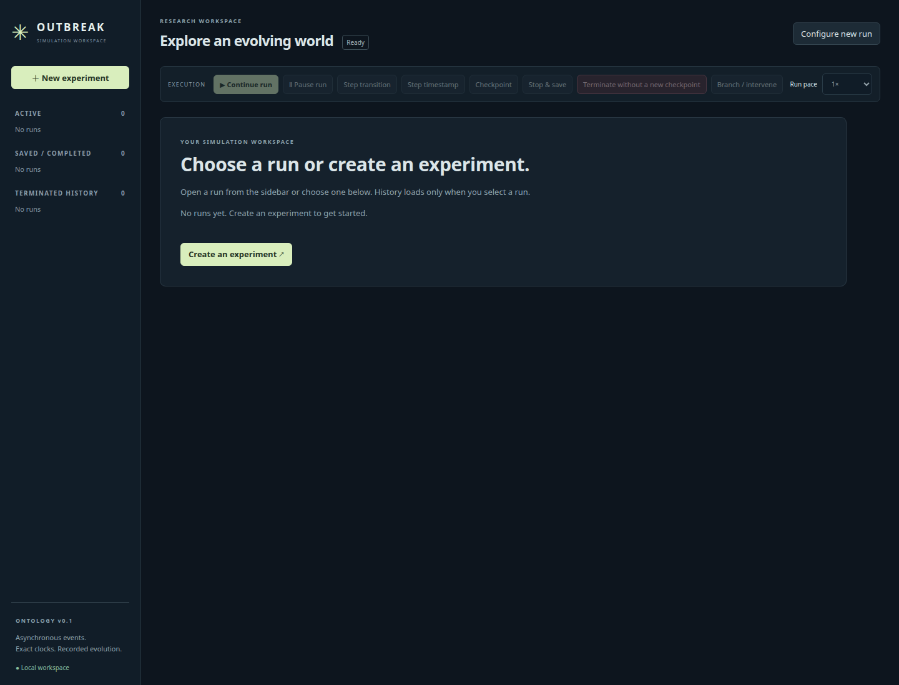
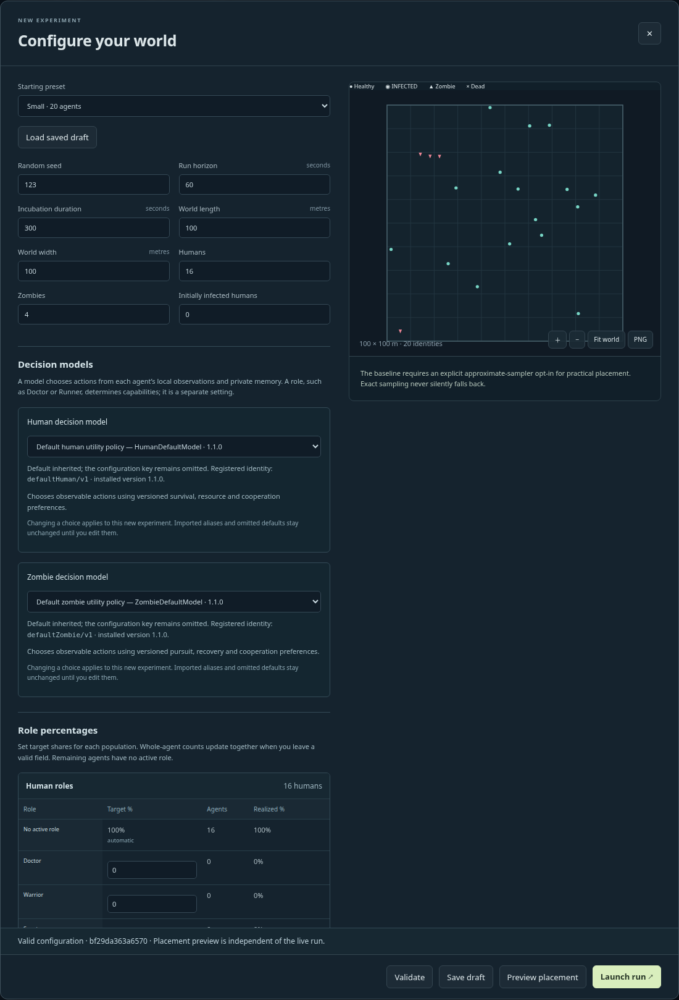
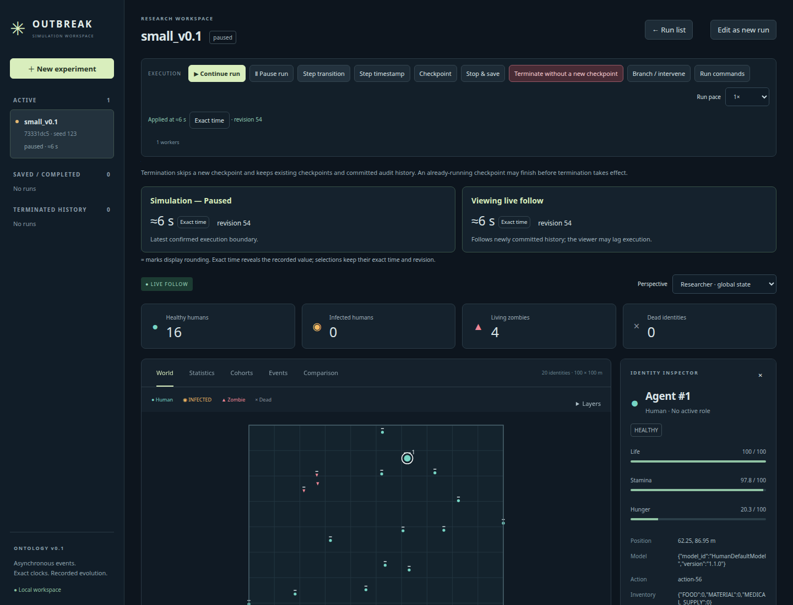
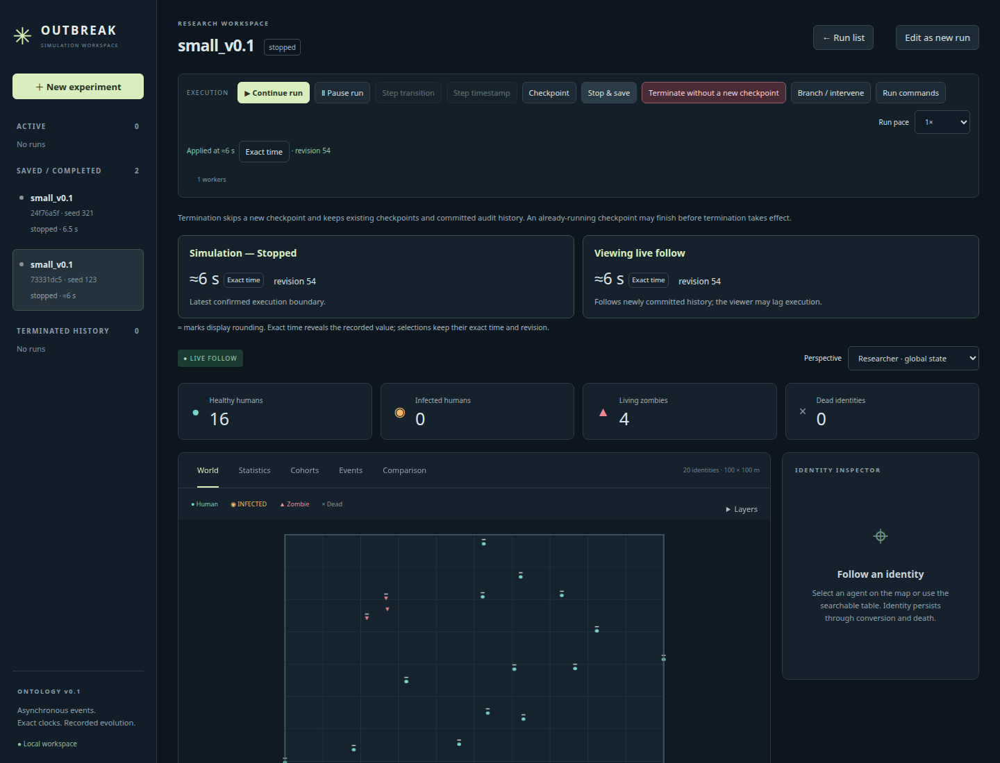
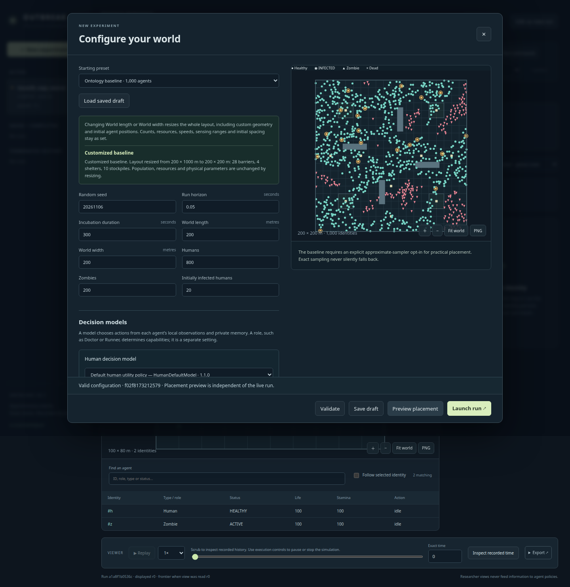
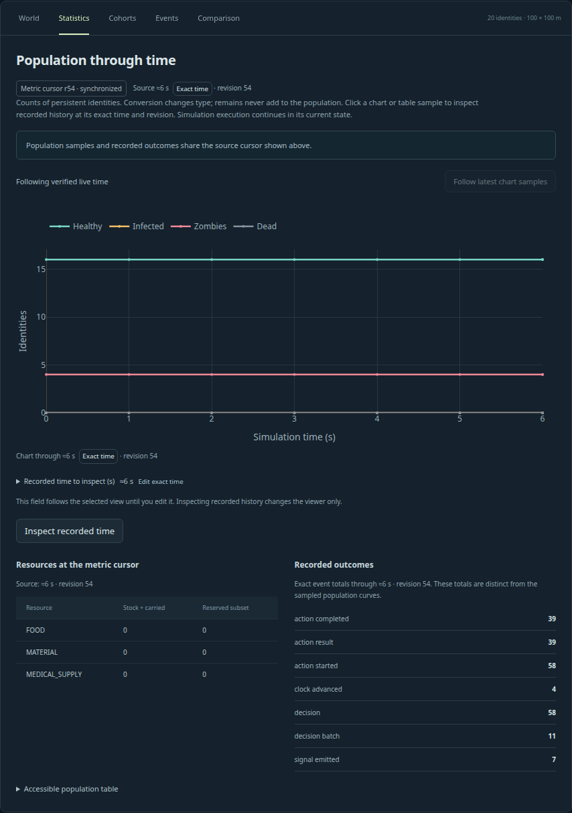
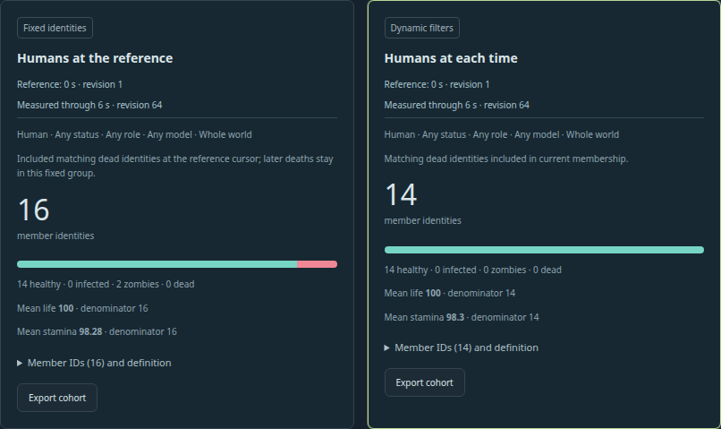
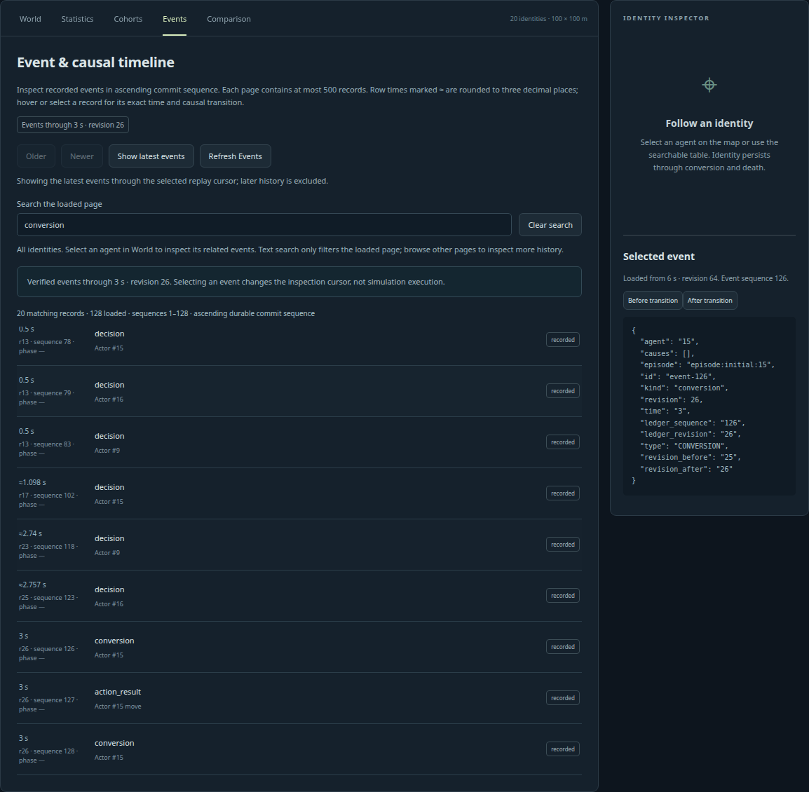
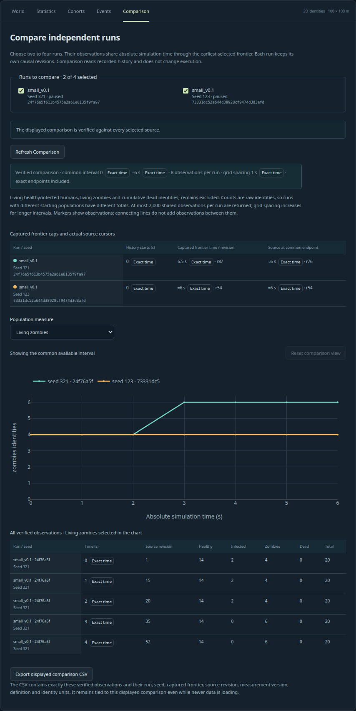
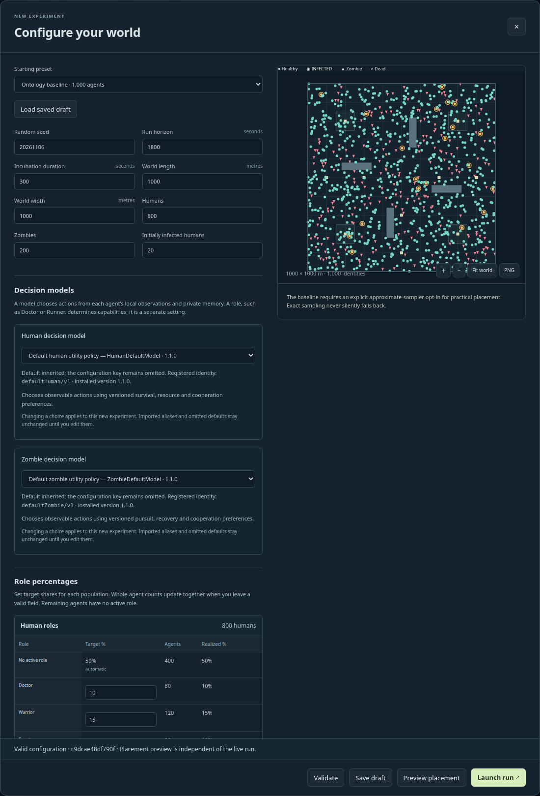

# Your first simulation, and what to do next

Start here for everyday use of the Zombie Game Simulation. This guide covers
the Linux checkout at `/home/fmeng/workspace/zombie_game_simulation` and its
bundled browser interface. You do not need to write code to run an experiment.

**The three things to remember:** a simulation does the work, the web service
hosts the controls, and the browser shows the results. Closing the browser or
the launcher menu leaves a running simulation running. **Stop & save** releases
its worker while keeping it resumable. Shutting down the web service is a
separate final step.

## Find the instructions you need

- [Run your first small experiment](#run-your-first-small-experiment)
- [Choose settings without surprises](#choose-settings-without-surprises)
- [Explore World, Statistics, Cohorts, Events and Comparison](#explore-your-results)
- [Pause, save, terminate or replay](#pause-save-terminate-or-replay)
- [Close everything and return later](#close-everything-and-return-later)
- [Use terminal commands](#use-terminal-commands)
- [Run the 1,000-agent baseline](#run-the-1000-agent-baseline)
- [Find files or solve a problem](#find-files-or-solve-a-problem)

The [GUI reference](GUI.md) explains every view in more detail. The
[startup/shutdown reference](START_STOP_GUIDE.md) includes installation, API
commands and recovery procedures. This guide describes current behavior,
including model selectors, configuration editing, survival measurements and
the service's shutdown progress and retry workflow.

## Run your first small experiment

### 1. Open the workspace

Open a terminal and run:

```bash
cd /home/fmeng/workspace/zombie_game_simulation
./simulate gui
```

The launcher selects the prepared Python environment, starts or reuses its
service, and opens your browser. If a browser does not open, use the printed
address: normally [http://127.0.0.1:8767](http://127.0.0.1:8767).
The launcher workspace is `runs/launcher`. This command opens the GUI without
creating a simulation.

You should see **Choose a run or create an experiment.** Existing records may
also appear in the sidebar; opening the workspace does not start them.



*A disposable, empty workspace. Your own workspace may already contain runs.*

If the environment is not prepared, follow [installation](START_STOP_GUIDE.md#install-on-a-fresh-checkout)
first. Python 3.12+ and the GUI extra are required. Node and pnpm are needed
only to rebuild the viewer; the repository includes a compiled viewer.
To keep the service visible in a terminal instead, use the
[foreground service option](#keep-the-web-service-in-a-terminal).

### 2. Configure a small world

1. Click **New experiment**. Wait for **Loading configuration** to finish.
2. Keep **Small · 20 agents** as the starting preset.
3. For this walkthrough, enter **Random seed: 123**, **Run horizon: 60**,
   **Worker selection: Manual worker limit**, and **Workers: 1**.
   Scroll down inside the form to reach worker settings below the role panels.
4. Leave the populations at **16 Humans**, **4 Zombies**, and **0 Initially
   infected humans**. Keep the other preset settings.
5. Keep **Default human utility policy** and **Default zombie utility policy**
   in the two decision-model selectors. Their identifiers and installed
   versions appear in the choices and the details below them.
6. Click **Validate** and read the result. Then click **Preview placement**.
   A map should replace the preview placeholder. This is a preview, not a
   running experiment.



*A validated 20-agent example. A different seed can change the arrangement.*

You can clear a numeric field completely before typing its replacement. If a
field has an error, correct it before continuing; the editor keeps your input.
Validation checks configuration rules. Preview additionally performs placement.
Neither starts a live run or consumes its decision randomness.

### 3. Launch, let it advance, and pause

Click **Launch run** once. The new run is selected and starts automatically.
Wait for initialization and the start acknowledgement. **Initializing the
world** means the engine is creating the world. **Loading recorded history**
means the viewer is reading a record. Neither message calls for another launch.

When the world appears, watch the simulation time and revision change. Leave
**Run pace** at **1×** for an easy first look. After a few simulated seconds,
click **Pause run** and wait for the acknowledgement. Time should then remain
stable. If the run has already reached its horizon, it is complete instead.



*The status and cursor identify the paused record being inspected. Your exact
pause time and revision depend on when you click.*

### 4. Inspect, then save your place

Click an agent on the map, or use **Find an agent** and select its ID in the
table. Read its type, role, life, inventory and model in the inspector.
Open **Statistics** to see population curves. At first, flat curves are normal:
agents can move and act without any population changing.

When finished, click **Stop & save**. Wait for the applied outcome and worker
cleanup. The run moves into **Saved / completed**. You can inspect its history
without restarting it, or use **Continue run** later if it has not completed.



*Saving stops the worker and retains the experiment. It does not remove its
record from the sidebar. This demonstration workspace also contains the second
example run introduced below; a first-time workspace will have just your one run.*

To finish the entire session, follow [Close everything](#close-everything-and-return-later).

## Choose settings without surprises

### What each setting changes

| Setting | What it means | A useful first choice |
| --- | --- | --- |
| Random seed | Controls the run's seeded randomness. Keep the same complete configuration, model version and seed for repeatable experiments. | `123` |
| Run horizon | Maximum elapsed **simulation seconds**, not a wall-clock timeout. | `60` |
| Humans / Zombies | Starting numbers of identities of each type. | `16` / `4` |
| Initially infected humans | A subset of Humans, not an extra population. It cannot exceed Humans. | `0` |
| Incubation duration | Simulation time from infection to conversion if cure or death does not intervene. | Keep the preset initially. |
| World length / width | Map dimensions in metres. Form edits resize the layout with the world; placement still enforces separation. | Keep the preset initially, or resize and preview. |
| Worker selection | Budget for policy workers. Automatic considers available resources; a manual limit makes the choice explicit. | One worker for this walkthrough. |
| Live storage | Memory live state or SQLite live state; **both** retain durable SQLite history. | Memory + durable SQLite history |
| Placement sampler | Exact joint rejection, or explicitly acknowledged conditional relocation. | Exact for Small; approved relocation for baseline. |

Worker count is not a speed guarantee. **Run pace** changes the execution's
wall-clock pacing, while zoom, layers, chart zoom and replay speed change viewing.
They do not change the scenario's durations or population. New scenario settings
apply to a new run; **Edit as new run** copies an existing run's frozen configuration.

### Resize the baseline world

1. Select **Ontology baseline · 1,000 agents**.
2. Enter `200` for **World length** and **World width**. The editor scales the
   obstacles, shelters, gates and stockpiles together and shows **Customized
   baseline**, with a summary of the adjustment.
3. Click **Validate**, then **Preview placement**. Review the new map before
   choosing **Launch run**.

The population remains 800 Humans and 200 Zombies. Resources, speeds, sensing
ranges and the 2 m / 15 m initial spacing requirements remain as set. A smaller
map changes density; it does not shrink every game parameter.

Custom layouts and ordinary explicit initial positions also resize with the
world. If explicit positions become too close or otherwise invalid, validation
identifies the conflict so you can correct the draft. Preview still checks whether
generated placement succeeds. Saved/exported drafts keep the adjusted layout;
loading them does not scale it a second time. Advanced JSON edits are used as
written. Historical/runtime state imports require deliberate handling instead
of automatic resizing; see [the detailed resizing guide](GUI.md#resize-a-world-and-its-layout).



The screenshot uses a short test horizon; keep the duration you want for your run.

### Set roles as percentages

In **Human roles** and **Zombie roles**, edit each role's target percentage.
**No active role** receives the remainder. Targets must each be between 0% and
100%, with their combined total no greater than 100% for that type.

The editor calculates integer counts when you change a population or target.
For seven Humans, a 10% Doctor target produces one Doctor: approximately 14.29%
realized. This rounding is expected. Read **Target**, **Realized**, and the counts
together. Initially infected Humans can have Human roles.

Imported counts remain intact until a related edit; exported configurations
retain the exact targets and rounding rule. Explicit per-agent configurations
and overriding `semantic` blocks have read-only population/role controls;
edit those records in Advanced JSON instead. See the [role reference](GUI.md#first-experiment).

### Choose a decision model

A model chooses actions using an agent's local observations and private memory.
A role such as Doctor or Runner determines available capabilities; it is a
different setting.

For ordinary use, keep **Default human utility policy** in **Human decision
model**, and **Default zombie utility policy** in **Zombie decision model**.
These request `HumanDefaultModel` and `ZombieDefaultModel`, currently version
**1.1.0**. Read the detail below each control for the registered identity and
whether its setting is inherited. Merely displaying an inherited default does
not add a new key or change the configuration's fingerprint.

Each list contains policies declaring support for that agent type. The
`randomLegal/v1` alternative chooses uniformly from locally observable
candidates; the engine still checks the resulting action. Imported aliases
remain intact until you deliberately change the selection.

Use **Advanced registered model or artifact** only when you have a registered
plugin ID or a trained `ppo:<artifact-directory>`. Its files, registration and
dependencies must exist where the service runs. Typing a name does not create
a model. Unknown or empty values remain visible with validation feedback.

For explicit individual agents, the controls show **Per-agent assignments ·
edit Advanced JSON**. Edit their `model_assignment` records there; their
parameters and requested versions are preserved. A value supplied by a
`semantic` block is also edited in that block. See the
[model reference](MODELS.md) for aliases and trained artifacts.

### Keep and reuse configurations

- **Save draft** keeps the current draft in this browser. It can retain
  unfinished Advanced JSON; saving is not proof of validation.
- **Load saved draft** replaces the current editor with that browser's saved draft.
- **Advanced configuration · JSON → Export draft** downloads JSON or TOML.
  **Import configuration** loads either format. Export is the portable option.
- **Replicate seeds** accepts up to eight comma-separated seeds, for example
  `123, 321`. Blank launches one run using the main Random seed field. Each
  replicate is a separate experiment that must eventually be stopped.

Ordinary fields and valid Advanced JSON share the current draft. You can switch
between them without losing custom settings. While JSON is unfinished or is not
an object, ordinary fields, presets and import/load replacements are disabled.
Correct the JSON, or choose **Discard unfinished JSON** to return to the last
valid draft. Partial objects such as `{}` use the server's resolved defaults,
including the seed. Explicit replicate seeds override that default.

The GUI **Small · 20 agents** preset differs from
[`configs/small.toml`](../configs/small.toml), which has **24 agents**, including
one infected Human, and a 120-second horizon. `./simulate start` uses that file.
Import that exact file when you want GUI and direct CLI runs to use the same scenario.

New runs record `role_assignment_order: canonical_v2`: equivalent role-count maps
produce the same seeded assignments regardless of JSON/TOML key order. Old frozen
configurations and checkpoints retain their legacy ordering behavior. Keep the
resolved configuration with your results when comparing runs across versions.

## Explore your results

### Read the time and source labels

**Time** is elapsed simulation seconds. **Revision** distinguishes committed
states, including multiple states at the same exact time. Values such as `1/3`
are exact rational seconds. A readable timestamp marked **≈** is rounded;
its exact value remains available in the record or detailed table.

The four population counts are Healthy humans, Infected humans, Living zombies,
and Dead identities. Together they equal the total identity count. Conversion
keeps an identity and moves it from infected Human to living Zombie. Remains
do not add another identity.

Each analysis panel labels the history it has actually read. A running world
may be ahead of those results. During refresh or failure, older verified data
keeps its original source label. **Loading**, **failed**, and **empty** are
different states; use the panel's Retry button for a failed request.

### World: follow one identity

Drag the map to pan, scroll or use **＋ / −** to zoom, and use **Fit world** to
reset. The lower-left is the origin and positive y points upward. Humans are
circles, infected Humans have rings, Zombies are triangles, and dead identities
are crosses. Marker size is a screen symbol, not a physical collision radius.

Use **Find an agent** to search an ID, type, role or status. The table displays
up to 100 matches, so narrow the search when needed. **Follow selected identity**
keeps the camera on that identity through movement, conversion and death.
**Layers** controls geometry, paths and other overlays.

To see what an agent actually knew, select it and switch **Perspective** to
**Recorded agent observation**. Global researcher views are cleared. The result
is a recorded decision input, not a view of everything in the world; a message
explains when no observation exists. Return to **Researcher · global state**
for the full workspace.

### Statistics: see what changed

Open **Statistics** after your run has advanced. Read its **Source** time and
revision, then the curves, event totals and resources. A **Statistics through …**
message identifies data that differs from the selected view. Time-zero results have
visible points; flat lines can be correct.



*The x-axis is simulation time. Curve colors and labels distinguish the four
population measures.*

Drag to zoom. Manual zoom stays in place while fresh data arrives. The chart's
**Follow latest chart samples** restores automatic chart following; in replay the equivalent
is **Reset chart view**. The main viewer's **Return to live** leaves recorded replay.
Open **Accessible population table** for exact observations. Selecting a sample
or using **Recorded time to inspect (s)** and **Inspect recorded time** opens
recorded history. The time field follows your selected view until you edit it,
then keeps your exact input while execution advances. Press Enter to inspect,
or **Use selected view time** to reset it. Switching runs also resets the field.
Type `0` deliberately to inspect the start; fractions such as `5/2` work too.
An empty or invalid value shows a helpful error without moving the viewer.
Curves are sampled observations, not a list of every event.

### Cohorts: follow a group

1. Pause a run and open **Cohorts**. **No cohorts have been created** is a
   successful empty result.
2. Click **Use All humans example**. It selects **Fixed identities**, Type
   **Human**, Any status, including already-dead identities.
3. Read **Reference for this submission**, then click **Create cohort** once.
4. Open **Member IDs … and definition**. Read both the selection reference and
   **Measured through …** cursor.



*The changing-population example below: both Human groups were created at
replay time zero. After conversion, the fixed group retains 16 identities while
the dynamic group contains 14. Creating a group does not change agent behavior.*

**Fixed identities** follows the same selected IDs even after conversion or
death. **Dynamic filters** asks who matches at the current measurement time.
For example, create a second Human group with Dynamic filters. A converted
identity remains in the fixed group but leaves the dynamic Human group.

To explore a changing population, create a separate Small experiment with
**Initially infected humans: 2**, **Incubation duration: 3**, seed `321`, and
horizon `60`. Inspect recorded times before and after changes in Events;
treatment or death can prevent a particular conversion. For a historical
cohort, seek to the desired reference before creating it. Creating a group
after conversion selects the identities matching at that later reference.

Zero members is valid. The untouched Small preset starts with no infected
Humans, so an initial INFECTED group is empty. Filters can overlap across
groups, so adding cohort sizes need not equal the population.

Human survival includes members who entered the source run as living Humans and
ends at conversion or death. Initially Zombie members are excluded from its
denominator. Identity survival includes both living entry types and ends at death.
Identities already dead at entry are excluded from both risk sets.
The cards show eligible members, events and right-censored survivors at the
displayed cursor. A dynamic cohort describes the members matching at that time;
it is not a fixed survival population. A child's entry is its branch boundary;
replaying the inherited prefix uses that historical source run's entry. The cards
and exports identify the entry source and cursor. JSON exports carry the exact
run, time and revision of the displayed
results, including when an older result remains visible during refresh or error.

### Events: explain a change

Open **Events** to see up to 500 latest records through its labeled source.
Rows run from earlier to later ledger sequence. Click a record for its details.
**Before recorded transition** and **After recorded transition** inspect the exact states around
its committed transaction; several records can share those boundaries.



*Use the exact record details when a displayed timestamp is rounded.*

Use **Older** and **Newer** to browse history. Paging pins the source so new
events cannot shift your pages. **Show latest events** returns to following
the selected live or replay view; it does not leave replay by itself.

Two filters are independent: selecting an agent filters its full identity
history before paging, while **Search the loaded page** searches only the
records already loaded. Clear the identity filter and text search separately
if expected records are missing. A new or early replay cursor may have no events.

### Comparison: put experiments side by side

For a seed-only comparison, create a second Small experiment with seed `321`,
keeping the same other settings as the first. If you already created the
changing-population example above, you can select it instead to explore the
controls without creating another run. The screenshots use that changing
population example above, with two initially infected Humans and shorter
incubation; this demonstrates the controls, not a comparison that isolates the
seed's effect. Let both advance and pause them for an easy first
comparison. Select one run, open **Comparison**, and check the second under
**Runs to compare**. You can select two to four runs.



*Scenario, seed and run ID identify each source; colors remain stable while
the selected runs update.*

Choose **Population measure**. If one run reaches 12 seconds and the other
8 seconds, the common interval ends at 8 seconds. Its start is the latest
available history start among the selected runs. Ordinary branches retain
parent history, so that start can precede their branch point. A single shared
time produces one point; disjoint histories show **no common interval**.

All selected runs use the same sample times, including exact interval endpoints,
with at most 2,000 observations per run. Counts are raw numbers, so consider
starting populations when comparing runs. Open **All verified observations**
for exact values or use **Export displayed comparison CSV** to keep that
complete verified dataset with its source labels and measurement definitions.

Running selections refresh automatically. Zoom stays in place until **Reset
comparison view**. Selection survives workspace-tab changes; switching the main
run resets the selection to that run. Main-viewer replay does not rewind the
comparison sources. See the [comparison reference](GUI.md#compare-independent-runs).

### Save a picture or dataset

For a quick picture use **PNG** on the world map or the chart's image control.
For a recorded-data job, open **Export**, select a format/time or interval,
then **Start export**. Wait for **COMPLETED**, then download both the artifact
and its provenance. Available formats include world PNG, population chart
PNG/SVG, population CSV/Parquet and portable HTML replay. Parquet and some
chart exports need the optional analysis dependencies.

Export jobs read recorded history independently of execution. Keep the
artifact's provenance to identify its captured source. Portable replay is a
sampled animation with at most 300 frames, not a video of every transition.
For exactly the displayed Comparison dataset, use that panel's own CSV button.

## Pause, save, terminate or replay

The two readouts above the tabs answer different questions:

- **Simulation** shows the latest confirmed execution status, time and revision.
- **Viewing live follow** or **Viewing recorded history** shows the state you
  are inspecting, with its own exact time and revision.

Clicking an early sample or event can make **Viewing recorded history** show
`0 s` while **Simulation — Running** continues advancing. The message beside
**Return to live** explains this. Click **Return to live** to catch up, or
**Pause run** if you want execution to pause while you inspect. Opening tabs and
expanding cohort details leave your viewing mode unchanged.

If a status request fails or is more than five seconds old, the GUI says
**Last confirmed**. Those values describe the last known execution state;
wait for status updates to recover before treating them as current.

| What you want | Use | What happens next |
| --- | --- | --- |
| Think while the world stays still | **Pause run** | Stops advancement at an acknowledged boundary; worker remains resident. |
| Continue a paused or saved run | **Continue run** | Resumes eligible execution; completed and managed-terminated runs cannot continue. |
| See one atomic change | **Step transition**, while paused | Processes the next engine transition. |
| See the next timestamp's ordered work | **Step timestamp**, while paused | Advances according to the engine's timestamp/phase rules. |
| Save continuation state without ending work | **Checkpoint** | Writes continuation state; it is not a stop command. |
| Finish now and return later | **Stop & save** | Saves, exits the worker, retains history and eligible continuation. |
| End this run without another checkpoint | **Terminate without a new checkpoint** | Permanently ends managed execution; retains already committed history and previous checkpoints. |
| Look at an earlier result | Viewer scrubber, exact time / **Inspect recorded time**, or **Replay** | Changes only the displayed history; execution can continue independently. |
| See the newest result again | Main **Return to live** | Returns the viewer to the latest committed state. |

Wait for an applied result, not just a submitted request. A checkpoint or other
atomic operation already underway can delay acknowledgement. Termination shows
**Termination requested**, then **Stopping / cleanup**, then **Worker cleanup
complete**. Existing history remains under **Terminated history**. There is no
delete-history operation in this workflow.

**Active** includes runs that still need attention, including paused workers.
**Saved / completed** contains stopped or completed records; completion at the
horizon or extinction means the original run cannot continue. **Terminated
history** remains inspectable without being resumable through the GUI/API.

A request timeout does not cancel a command. Use **Run commands → Retry original
command** to reconcile its retained reference. If another client has changed
the control generation, refresh controls before a new request. For independent
historical experiments, see [branching and interventions](GUI.md#execution-and-replay-controls).

## Close everything and return later

### If you used the launcher

1. Choose whether to save active runs or terminate them without another checkpoint.
2. Keep browser tabs open if you want to observe progress, or close them.
3. From the repository directory, run:

   ```bash
   ./simulate shutdown
   ```

   This requests saving any remaining active runs, then stopping the owned web
   service. `./simulate shutdown --terminate` instead requests ending active
   runs without another checkpoint. Menu **10** offers the same choices.

The launcher prints shutdown phases, elapsed time, outstanding work and per-run
request references. It closes viewers, cancels analysis/export work, reconciles
accepted commands, saves or terminates active runs, verifies worker cleanup and
then exits the service. The default **900-second budget covers the whole shutdown**.
An incomplete result preserves writer work and reports the current problem.
Retry the same shutdown mode, optionally with `./simulate --timeout 1800 shutdown`.
Use `--terminate` again when retrying that mode. Keep the workspace and consult
`runs/launcher/.launcher/service.log`; timeout is not completion.

On the next visit, run `./simulate gui` again. It reuses an available owned
service or starts one after exit. Select your saved run, then **Continue run**
if eligible. Leaving the menu with **0** or Ctrl+C only closes that menu.

### Keep the web service in a terminal

This alternative gives you a visible service log and a foreground Ctrl+C route.
Use a distinct workspace and port from the launcher:

```bash
cd /home/fmeng/workspace/zombie_game_simulation
source .runtimeenv/bin/activate
export PYTHONPATH="$PWD/src"
python -m zombie_sim.cli gui --experiments-dir runs/workspace --port 8765
```

Open [http://127.0.0.1:8765](http://127.0.0.1:8765). Keep that terminal open.
If you installed a fresh `.venv`, activate it instead of `.runtimeenv`.
There is no separate frontend server to start.

To finish, press **Ctrl+C once in this service terminal**. The service drains
viewers and analysis work, saves active runs and waits for worker cleanup before
exiting. To avoid a new checkpoint, terminate those runs before this step.
Wait for the service process to exit and the shell prompt to return. An incomplete
drain leaves status available at `/api/shutdown`; another Ctrl+C retries it.
Restart with the **same directory and port** to see the same records.

If a port is occupied, identify the service before acting. On Linux,
`ss -ltnp 'sport = :8765'` shows that port's listener. A closed port confirms
the endpoint is closed, not that every worker exited. Use the
[worker-cleanup check](START_STOP_GUIDE.md#check-managed-worker-cleanup) when needed.
Run one service per workspace. Rebuilding frontend files or reloading a browser
does not reload an already-running Python service after backend changes.

## Use terminal commands

### Friendly controls through the launcher

These commands operate on the launcher's workspace. Each `start` creates a run.
Use `list` to select a run; a full ID is safest if another client may change the list.

```bash
./simulate start --no-browser       # configs/small.toml: 24 agents
./simulate list
./simulate pause 1
./simulate resume 1
./simulate stop 1                   # Save and release worker
./simulate resume 1                 # Continue eligible saved run
./simulate terminate 1              # End it; retain existing history
```

Replace `1` with your intended list number or run ID. `terminate` leaves already
inactive records unchanged rather than restoring them just to change their status.
The commands require the launcher's service, which `start` or `gui` can create.
For another workspace, repeat its options **before** every action:

```bash
./simulate --workspace runs/my-study --port 8770 gui
./simulate --workspace runs/my-study --port 8770 list
```

For an uncertain request, `./simulate requests` shows stored request references;
`./simulate retry REFERENCE` retries the original payload. See the
[launcher reference](START_STOP_GUIDE.md#use-the-easy-launcher) for complete options.

### Direct CLI: no service or browser

Prepare the Python terminal as in the foreground-service example, then run:

```bash
python -m zombie_sim.cli validate configs/small.toml --preview
python -m zombie_sim.cli run configs/small.toml --workers 1 --until 30 --output runs/cli-example
python -m zombie_sim.cli inspect runs/cli-example
python -m zombie_sim.cli replay runs/cli-example --time 15 --output runs/cli-example/replay.json
python -m zombie_sim.cli resume runs/cli-example --until 120
```

Use a **fresh output directory** for `run`. It refuses to overwrite an existing
run ledger. `--until 30` means absolute simulation time 30 seconds. A later
`resume --until 120` advances toward absolute time 120, not 120 additional seconds.
The file's configured horizon remains 120 seconds. Successful exit saves a
checkpoint/manifest and releases resources; an early stop is `interrupted`
unless the run has already completed. Output is normally printed at the end.

For an unplanned stop during `run` or `resume`, press **Ctrl+C once** and wait.
The coordinator finishes initialization or the current atomic work, stops at a
committed boundary, writes its checkpoint and manifest, and closes workers.
Repeated Ctrl+C requests do not interrupt saving or cleanup. This can take time
for a large initialization or checkpoint; wait for the final output and shell
prompt. A storage error is reported rather than being presented as a successful
save. A planned `--until` boundary remains useful for reproducible experiments.

Direct CLI has no `pause`, `stop` or `terminate` subcommand. Use the launcher or
GUI/API for those managed controls. Ctrl+Z is shell suspension, not simulation
pause. To signal a direct run from another terminal, follow the
[verified-coordinator procedure](START_STOP_GUIDE.md#stop-a-headless-run-from-its-terminal).

Direct CLI resume checks durable termination records before restoring a run.
Terminated histories remain inspectable but cannot be resumed in place. Use
eligible stopped/interrupted histories after their worker has exited.

## Run the 1,000-agent baseline

First complete a Small run so you recognize normal loading, controls and cleanup.
Then choose **New experiment → Ontology baseline · 1,000 agents**.
The baseline has **800 Humans (including 20 infected)** and **200 Zombies**,
with a **1,800-second simulation horizon**.

1. Keep the baseline's **Conditional relocation (approximate)** sampler and its
   explicit acknowledgement. The user approved this placement approximation on
   2026-11-25. All spacing and geometry checks remain strict.
2. Choose **Automatic** workers or an explicit manual limit appropriate for your
   machine. More workers can add overhead; they do not remove serial work.
3. Validate, preview, and read any placement error. Do not reduce the population
   or relax constraints to make an error disappear.
4. Launch once and wait for initialization. When readable, inspect the world
   and then Statistics. For a short experiment, set a shorter horizon in a new
   configuration and record that it differs from the full baseline.
5. Allow time and disk space for history and checkpoints. Stop & save or
   terminate explicitly and wait for worker cleanup before stopping the service.



*This screenshot is a placement preview. It does not demonstrate completion of
the full baseline simulation.*

Conditional relocation is not claimed to sample the exact conditioned joint
distribution. Each run records its sampler, approval and placement statistics. Successful
initialization enforces the spacing and geometry checks. Exact joint rejection remains available; dense placement can
be very slow and never silently switches to relocation.

For a short headless check of the baseline configuration:

```bash
python -m zombie_sim.cli validate configs/baseline.toml
python -m zombie_sim.cli run configs/baseline.toml --workers 1 --until 0.5 --output runs/baseline-check
```

This stops at 0.5 simulated seconds while retaining the configured horizon.
Omit `--until 0.5` only when you intend the full run. Rendering benchmarks and
short baseline checks establish only their exercised workloads: they do not
promise real-time execution, all-core utilization, a bounded initialization
time, or completion of the full 1,800-second baseline. See
[parallel execution](PARALLEL.md) and [validation evidence](TESTING_REFINEMENT.md).

## Find files or solve a problem

### Where your work goes

Paths below are relative to the repository unless you supplied an absolute path.
Keep the whole workspace/run directory when backing up; a checkpoint alone is
not a substitute for all audit history and provenance.

| Item | Default location |
| --- | --- |
| Launcher workspace | `runs/launcher/` |
| Launcher service log and ownership metadata | `runs/launcher/.launcher/service.log` and `runs/launcher/.launcher/server.json` |
| Launcher command payloads | `runs/launcher/.launcher/requests/` |
| Foreground example workspace | `runs/workspace/`; service messages appear in its terminal |
| Managed run records | `<workspace>/runs/<run-id>/`; `<workspace>/manager.sqlite` indexes them |
| Managed history, continuation and failures | In that run directory: `run.sqlite`, `worker-checkpoint.json`, and `failure.log` if an engine failure was recorded |
| Direct CLI example | `runs/cli-example/`, including `run.sqlite`, `checkpoint.json` and `manifest.json` |
| Browser downloads | Your browser's configured download folder |
| Browser saved draft | Local browser storage; export JSON/TOML for a portable copy |

See [storage and recovery](STORAGE.md) before moving histories between machines
or recovering after an interruption. Do not delete retained SQLite sidecar files
while processes may still own them.

### A quick troubleshooting table

| What you see | What it usually means | What to do next |
| --- | --- | --- |
| Browser cannot connect | Service absent, wrong port, or startup pending | Check the printed URL and service log/terminal. Reuse the intended workspace. |
| Existing runs seem missing | Different workspace directory | Restart/open the intended absolute workspace; do not recreate runs as a substitute. |
| Loading configuration | Metadata request pending | Wait; use **Retry loading configuration** after a failure. |
| Empty/invalid numeric field | An unfinished edit | Type a valid replacement and validate; the previous value is not silently reused. |
| Unknown or empty advanced model ID | No available registered model or artifact was identified | Select a listed default/alternative, or correct the ID, artifact path and service dependencies; validate again. |
| Initializing the world | Actual engine initialization | Check placement settings/logs and wait; do not launch duplicates. |
| Loading recorded history | Viewer reading an existing record | Cancel loading or retry after failure; this does not stop execution. |
| Statistics looks flat | Counts may not have changed, or zoom is fixed | Check exact source/table; reset the chart view before assuming a defect. |
| Analysis is stale or failed | Independent panel request delayed/failed | Read its source label and use that panel's Retry button. |
| Cohort is empty | No agents match at its reference/measurement | Try **Use All humans example**, or inspect filters and cursor. |
| Events looks empty or stops following | Early cursor, filters, search or pinned page | Clear relevant filters; use **Show latest events** and main **Return to live** as appropriate. |
| Comparison has no common interval | Selected histories do not overlap | Read their history bounds and select overlapping histories. |
| Pause/stop/terminate remains pending | Current atomic work/checkpoint not finished | Preserve the command reference and inspect the log; retry the original request if uncertain. |
| Paused process still uses resources | Pause retains its worker | Stop & save or terminate when finished. |
| New fixes are not visible | Old Python service or old frontend assets | Stop runs, restart service, reload browser; rebuild source assets if needed. |
| Launcher reports incomplete shutdown | Its overall budget expired or cleanup failed | Read the phase/error and service log; retry the same shutdown mode. Writer work and history remain retained. |

When reporting a problem, retain the run ID, workspace, seed/configuration,
exact time and revision, visible error/request reference, and relevant service
log lines. Include whether the run was initializing, running, paused or stopped.
Avoid deleting or rewriting evidence while diagnosing it.

## What was verified for this guide

The walkthrough screenshots use disposable demonstration workspaces. GUI and
terminal checks exercise actual simulation workers and verify retained history
and cleanup. Their exact results and limits are recorded in the
[I10 verification record](ISSUE_REVIEW.md#i10-comprehensive-friendly-user-guide).
The model selectors, their actual assignments and the updated configuration
screenshots were additionally checked in Chromium and Firefox for
[I11](ISSUE_REVIEW.md#i11-make-the-decision-model-default-explicit).
The remaining-issues batch additionally verifies mixed configuration editing,
resolved launch seeds, cohort export/survival definitions, terminal resume guards
and committed-boundary interrupt saving. Exact evidence and shutdown validation
are in the [batch verification record](ISSUE_REVIEW.md#verification-of-the-approved-remaining-issues-batch).
These checks do not benchmark a full 1,800-second baseline.
