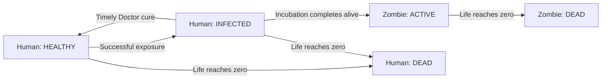

# Zombie Game Simulation Ontology

**Version:** 0.1 — review draft  
**Date:** 2026-11-06 (America/New_York)  
**Scope:** TASK 1 of `prompts/zombie_game_ontology.md`  
**Status:** Proposed ontology for human review; not an approved implementation specification.

## 1. Purpose, decisions, and reading guide

This ontology defines what exists in the Zombie Game, what its properties mean, how entities relate, which state changes are legal, and what actions mean. It gives future decision models and simulation engines a shared semantic contract. It does not implement the simulation, choose a storage backend, prescribe a parallel processing algorithm, or select a learning method. Those belong to TASK 2 after review.

The following decisions were confirmed by the project owner:

1. Living infected humans turn into zombies after incubation unless treatment prevents conversion.
2. Death is permanent. Dead humans and dead zombies never return to activity.
3. The initial world is a bounded plane with obstacles, shelters, medical supplies, and food.
4. The deliverable is a human-readable, editable Markdown document.

Everything else in this draft is a concrete proposal for review. Numerical values are game and experiment design parameters, not claims about human biology or epidemiology. The initial population, resource scarcity, and role balance will need empirical calibration during TASK 2.

### 1.1 Representation and standards

This is a **conceptual ontology expressed in controlled prose, typed property tables, relationship constraints, action contracts, and state-transition rules**. Markdown is its document format. No formal ontology standard such as OWL, RDF, or SHACL is used in this version, and this document does not claim conformance to them.

This choice keeps behavioral assumptions and time-dependent facts directly reviewable before committing to a formal encoding. In particular, an agent can be Human at one time and Zombie later; those labels must not accidentally become incompatible, permanent classifications of the same identity. A later formal ontology can represent time-indexed `AgentState` records and validate these constraints without changing their meaning. No particular formal standard is required for TASK 2 by this draft.

### 1.2 Normative language and notation

- **MUST / MUST NOT:** a consistency requirement of this draft.
- **MAY:** an allowed extension, only when explicitly enabled in the scenario.
- **Default / baseline:** a replaceable parameter value, recorded before a run begins.
- `Integer[a,b]`, `Real[a,b]`: inclusive bounded numbers; `Real>0` excludes zero. All real values MUST be finite.
- `Probability`: a real number in `[0,1]`. `Time`: elapsed simulation seconds, not wall-clock time.
- `?`: optional, with absence meaning “not applicable/not present,” never numeric zero.
- `1`, `0..1`, `0..*`, `1..*`: exactly one, optional one, any number, and at least one.
- Distances are meters (m), time is seconds (s), speeds are m/s. Life, stamina, hunger, and material quantities are abstract game units.
- `clip(v,a,b) = min(max(v,a),b)`. `round_int(v) = floor(v + 0.5)` for nonnegative values.

Unless expressly stated otherwise, an initial value is a scenario parameter, a current value belongs to a state at a particular time, and a derived value is calculated from other facts rather than independently assigned.

### 1.3 Navigation

1. [Purpose and notation](#1-purpose-decisions-and-reading-guide)
2. [Concepts and relationships](#2-concepts-and-relationships)
3. [Space and environment](#3-space-and-environment)
4. [Common agent attributes](#4-common-agent-attributes)
5. [Human and zombie attributes](#5-human-and-zombie-attributes)
6. [Life, infection, and conversion](#6-life-infection-and-conversion)
7. [Roles and extension rules](#7-roles-and-extension-rules)
8. [Perception and decision models](#8-perception-and-decision-models)
9. [Action semantics](#9-action-semantics)
10. [Common actions](#10-common-actions)
11. [Human actions](#11-human-actions)
12. [Zombie actions](#12-zombie-actions)
13. [Role actions](#13-role-actions)
14. [Time, interaction conflicts, and consistency](#14-time-interaction-conflicts-and-consistency)
15. [Baseline scenario](#15-baseline-scenario)
16. [Run history and research concepts](#16-run-history-and-research-concepts)
17. [Validation and worked cases](#17-validation-and-worked-cases)
18. [Requirements coverage and review](#18-requirements-coverage-and-review)

## 2. Concepts and relationships

### 2.1 Principal concepts

| Concept | Meaning and identity |
|---|---|
| `OntologyVersion` | The immutable vocabulary and semantic rules used by a scenario and run. |
| `ScenarioDefinition` | A versioned specification of geometry, populations, parameter values, allowed roles/actions, observation rules, and stopping conditions. It describes possible runs rather than one realized history. |
| `SimulationRun` | One realization of exactly one scenario version with a run ID, random seed, model assignments, initial state, and subsequent history. |
| `World` | The run's single bounded physical environment. |
| `SpatialEntity` | Something with a point, line, or area geometry: an agent, obstacle, gate, shelter region, stockpile, or remains. |
| `Agent` | A persistent individual identified by `(run_id, ID)`. Identity survives changes of type, role, health, and position. |
| `AgentState` | The values describing an agent at an effective time and causal revision. Current Human and Zombie are mutually exclusive state classifications. |
| `HumanState` / `ZombieState` | The applicable type-specific portion of a living or dead agent state. An agent has exactly one of these in each state. |
| `RoleDefinition` | A reusable, versioned specialization with a compatible type, properties, capabilities, and conversion/retirement rules. |
| `RoleAssignment` | The assignment of a role to an agent over a time interval. Historic assignments remain available after removal. |
| `Capability` | Permission to attempt an action, distinct from whether the action is currently feasible. |
| `DecisionModel` | A versioned source of action choices. It may be rule-based, learned, or externally controlled. |
| `ModelAssignment` | A time-bounded link from an agent to a decision model and its parameters. |
| `Observation` | What an agent can know at a stated time under the scenario's observation contract. |
| `ActionDefinition` | A named contract describing parameters, eligibility, duration, costs, preconditions, and effects. |
| `ActionIntent` | A proposed action from a model; it is not proof that the action occurred. |
| `ActionOccurrence` | An admitted attempt with start/resolution times and a success, miss, failure, or cancellation outcome. |
| `Event` | An identified occurrence that changes state or records a meaningful outcome, with time and causal predecessors. |
| `Effect` | A specific state change caused by an event, or a bounded temporary modifier such as a dash. |
| `InfectionEpisode` | One successful infection of a human, with source, onset, conversion deadline, and eventual outcome. Reinfection after cure starts a new episode. |
| `ResourceStock` | A count of items of a single resource type held by a stockpile or inventory. |
| `Inventory` | Resources held by a living human; after death or conversion these resources become a ground stockpile. |
| `Remains` | The physical feeding resource created by a death. It is not an agent capable of action. |
| `Signal` | A finite-lived communication emitted by an agent, with payload, source position, and reception radius. |
| `Intervention` | An explicitly authorized external change, distinguished from an agent action and recorded in history. |
| `Snapshot` | A complete semantic state of a run at a time and revision, including pending occurrences and biological deadlines. |
| `Measurement` | A derived research quantity with a definition, observation interval, and source run. |

### 2.2 Relationship constraints

| Relationship | Cardinality and meaning |
|---|---|
| Run `instantiates` ScenarioDefinition | Exactly 1 scenario version per run; a scenario can have many runs. |
| Run `usesOntology` OntologyVersion | Exactly 1 version per run; semantic changes create a new scenario/run lineage. |
| Run `hasWorld` World | Exactly 1; all coordinates are interpreted in this world. |
| Run `containsAgent` Agent | `0..*`; each agent belongs to exactly 1 run. |
| Agent `hasState` AgentState | `1..*` historical states; exactly 1 current state at a specified causal revision. |
| Agent `hasRoleAssignment` RoleAssignment | `0..*` historical assignments; at most 1 active role. No role is represented by absence, not a fictitious `NONE` role. |
| Agent `hasModelAssignment` ModelAssignment | Exactly 1 active assignment while alive; a model may serve many agents with separate per-agent memory. |
| RoleDefinition `grants` Capability | `1..*`; type-level capabilities exist even without a role. |
| Observation `isFor` Agent | Exactly 1 observer, with exactly 1 observation time and world revision. |
| ActionIntent `isProposedBy` Agent | Exactly 1 actor; `0..*` typed targets depending on the action. |
| ActionOccurrence `realizes` ActionIntent | Exactly 1 intent; a rejected intent has no admitted occurrence. An intent cannot be executed twice. |
| Event `hasEffect` Effect | `0..*`; even a miss or rejection can be recorded without a world-state effect. |
| InfectionEpisode `infects` Agent | Exactly 1 agent; at most 1 active episode per human. Source is 0..1 agent, plus a mandatory source category such as bite, spit, or initial condition. |
| Shelter `hasGate` Gate | Exactly 1 in the baseline; extensions can allow more. |
| Shelter `hasWall` Obstacle | `1..*`; the protected region is enclosed except for its gates. |
| ResourceStock `isHeldBy` Inventory or Stockpile | Exactly 1 current holder. Transfers preserve resource identity by type and quantity. |
| Remains `comesFrom` Agent | Exactly 1 dead agent, and at most 1 remains entity is created per death. |
| Event `causedBy` Event/ActionOccurrence/Intervention | `0..*` predecessors, forming an acyclic causal relation; initial conditions have no earlier in-run cause. |

All entity references MUST identify an entity in the same run unless they explicitly describe scenario inheritance or a counterfactual parent run. Entity identifiers, action identifiers, and event identifiers are distinct namespaces. Human-readable names are labels, not identifiers.

## 3. Space and environment

### 3.1 World and geometry

| Property | Type / units | Meaning and baseline |
|---|---|---|
| `length` | `Real>0`, m | Extent along x; **1,000 m**. |
| `width` | `Real>0`, m | Extent along y; **1,000 m**. |
| `boundary_policy` | Enum | `CLOSED` in v0.1: no exit and no wraparound. |
| `coordinate_system` | Fixed label | Cartesian, origin at the lower-left corner, positive x rightward and positive y upward. |
| `distance` | Derived, m | Euclidean distance: `sqrt((x2-x1)^2 + (y2-y1)^2)`. |
| `traversable_region` | Derived region | World rectangle minus impassable obstacle and closed-gate footprints. |

The world is the closed rectangle `[0,length] × [0,width]`. Positions on its outer boundary are legal. Obstacle footprints include their boundaries and are forbidden to living agents. A path must remain entirely in traversable space; legal endpoints alone do not make a path legal. A dead agent's frozen historical position is not an occupancy constraint on a later gate operation; its remains are a separate spatial entity.

Agents are points in v0.1. They cannot pass through walls, but they do not physically collide with one another. Several agents can share a coordinate. This is a deliberate abstraction, so doorway crowding and body packing are not supported claims of this version. Shelters have no hard occupancy capacity. Body radii, congestion, and multi-floor space require a future ontology extension.

An action's interaction distance is measured to a target point for agents, stockpiles, and remains, and to the nearest point of the target footprint for gates and barricades. Unless an action says otherwise, it also requires an unobstructed interaction segment. For an attack on a gate/barricade, the segment may end on the target surface but may not cross a different obstacle first.

### 3.2 Environmental entities

| Entity | Required properties | Semantics |
|---|---|---|
| `Obstacle` | `entity_id`, closed rectangular `footprint`, `blocks_movement=true`, `blocks_vision=true`, `destructible=false` | Permanent obstacle, including shelter walls. |
| `Gate` | `entity_id`, `shelter_id`, rectangular `footprint`, `mode`, integer `integrity`, `max_integrity` | Modes: `OPEN`, `CLOSED`, `BREACHED`. A closed gate blocks movement and vision; the others do not. Baseline maximum integrity 200. |
| `Shelter` | `entity_id`, rectangular `interior`, wall IDs, gate IDs | A region protected by physical barriers. Shelter membership is spatial, not ownership, immunity, or automatic exclusion of zombies. |
| `Barricade` | `entity_id`, rectangular `footprint`, integer `integrity`, `max_integrity`, `creator_id` | Destructible obstacle created by an Engineer. Baseline maximum integrity 100. At zero integrity it ceases to block and becomes a recorded destroyed entity. |
| `Stockpile` | `entity_id`, point `position`, zero or more ResourceStocks | Ground resources accessible within pickup distance. Zero stock is allowed. Resources cannot be accessed through a wall. |
| `Remains` | `entity_id`, `source_agent_id`, point `position`, integer `biomass`, `created_at` | Initially 4 biomass units for either dead type. Remains block neither movement nor sight. Zero biomass means exhausted. |
| `Signal` | `entity_id`, `sender_id`, `sender_type_at_emission`, `position_at_emission`, `kind`, bounded `payload`, `radius`, `emitted_at`, `expires_at` | Information only; it cannot command another agent's model. |

`integrity` MUST be in `[0,max_integrity]`. `BREACHED` means gate integrity is zero. An open or closed gate has positive integrity. Repairing a breached gate yields an `OPEN` gate with positive integrity; closing is a separate action. A gate cannot close, or be repaired from breached, while a living agent occupies its footprint. Rebuilding a destroyed barricade requires a new build action and a new identity.

In v0.1 a barricade may fill a shelter's gate footprint only while that gate is `OPEN` or `BREACHED`. It becomes an independent barrier. The gate cannot close or be repaired from breached while an intact barricade overlaps its footprint. Barricade interiors cannot overlap other intact barrier interiors; sharing an edge is allowed. Their closed footprints cannot contain a nonempty stockpile or nonexhausted remains point. Existing living humans or zombies are never trapped inside newly created geometry.

### 3.3 Resource types and conservation

| Resource type | Unit mass | Permitted use |
|---|---:|---|
| `FOOD` | 1 | A human consumes 1 item to reduce hunger by 40. |
| `MEDICAL_SUPPLY` | 1 | First aid, Doctor treatment, or Doctor antidote prophylaxis. One item has one use. |
| `MATERIAL` | 1 | Engineer construction or repair. |
| `BIOMASS` | Not portable | Feeding resource attached to remains, usable only by zombies. It is not an inventory item. |

Portable stocks use nonnegative integer quantities. Inventories have integer unit-mass capacity. A transfer is atomic: the same items leave one holder and enter another. Consumption and construction remove the specified quantity; no resource appears except in an initial condition, death-generated biomass, or a recorded intervention. There is no natural restocking, farming, resource decay, or stockpile movement in v0.1.

Dropped inventories become a stockpile at the drop point, retaining quantities exactly. Empty stockpiles and exhausted remains may remain addressable for history even if a later implementation omits them from active spatial search.

### 3.4 Movement, visibility, and signals

Visual detection requires both distance within the observer's effective sensing radius and clear line of sight. Closed gates, walls, obstacles, and intact barricades occlude vision. Agent bodies, stockpiles, and remains do not. Sensing is omnidirectional; heading is therefore not a necessary v0.1 attribute.

Signals propagate within their stated Euclidean radius through barriers. This is an explicit sound-like abstraction, not a sound physics model. A receiver must be alive and within radius at emission. The signal is delivered once; entering the radius later does not deliver it. The payload remains available as a dated observation until expiry and may subsequently survive only in the model's own memory.

The emitter's type and position at emission are observable to receivers. Semantic payload is understood only by agents whose current type matches the emitter's type at emission. Opponents receive a generic noise cue with source position and time. Neither form updates a sender's later location automatically.

## 4. Common agent attributes

The following table specifies each agent's core dictionary. `Fixed` means fixed for that individual within a run; `State` changes through defined events; `Derived` is determined by other current facts. Profile values can change at conversion or by a versioned intervention, never silently.

| Attribute | Type / cardinality | Kind | Meaning / default |
|---|---|---|---|
| `ID` | Integer >= 1 / 1 | Fixed | Unique within its run; never recycled, including after death. |
| `run_id` | Identifier / 1 | Fixed | Scope of identity and history. |
| `created_at` | Time >= 0 / 1 | Fixed | 0 for baseline agents; later creation is outside v0.1 except explicit interventions. |
| `type` | `Human` or `Zombie` / 1 | State | Current biological type. Death retains the type held immediately before death. |
| `role` | Role identifier / 0..1 | State | Current active specialization; absent when role-free or dead. Historical roles are retained separately. |
| `status` | `HEALTHY`, `INFECTED`, `ACTIVE`, `DEAD` / 1 | Derived | Human with positive life: HEALTHY or INFECTED; Zombie with positive life: ACTIVE; any zero-life agent: DEAD. |
| `life` | Integer[0,100] / 1 | State | Current life; baseline 100. Zero triggers permanent death in the same state transition. |
| `max_life` | Integer = 100 / 1 | Profile | The universal life cap in this version, including Tyrants. |
| `x`, `y` | Real, m / 1 each | State | Current point position within the world; while alive it must be outside impassable geometry. Death freezes the last living location. |
| `base_speed` | Real>0, m/s / 1 | Profile | Human 2.0; Zombie 1.6 before role overrides. |
| `speed` | Real >= 0, m/s / 1 | Derived | Maximum current movement speed, after role/effect modifiers; 0 when dead. This is a speed limit, not actual velocity. |
| `base_sense_r` | Real >= 0, m / 1 | Profile | Human 40; Zombie 35 before role overrides. |
| `sense_r` | Real >= 0, m / 1 | Derived | Current effective visual sensing radius; 0 when dead. |
| `stamina` | Real[0,100] / 1 | State | Action/movement energy; baseline 100. At zero an agent remains alive and may rest or wait. |
| `max_stamina` | Real = 100 / 1 | Profile | Energy cap. |
| `movement_cost` | Real >= 0, stamina/m / 1 | Profile | Human 0.10; Zombie 0.08. Applies to actual distance traveled, including dash. |
| `rest_rate` | Real >= 0, stamina/s / 1 | Profile | Human 4; Zombie 3; applies only during rest. |
| `base_damage_resistance` | Real[0,0.8] / 1 | Profile | Fraction of physical damage prevented before temporary effects; default 0, with role overrides. |
| `damage_resistance` | Real[0,0.8] / 1 | Derived | Effective physical resistance after guard, if active. Does not reduce starvation or infection probability. |
| `action_state` | `IDLE`, `BUSY`, `DEAD` / 1 | Derived | Whether an agent has an admitted unresolved action, or is dead. |
| `active_action_id` | Occurrence ID / 0..1 | State | At most one active action; absent for idle or dead agents. |
| `cooldown_until` | Map of action ID to Time / 1 | State | Earliest legal next admission of each cooldown-bearing action. Missing entries mean no remaining cooldown. |
| `effects` | Set of typed timed Effects / 1 | State | Each has source, start, exclusive end, and explicitly defined parameters. No unspecified effects are legal. |
| `model_assignment` | Assignment reference / 0..1 | State | Required when alive. Conversion installs the scenario's default Zombie model assignment. Ends on death. |
| `last_state_event_id` | Event ID / 1 | State | Provenance of the current revision; initial state has an initialization event. |
| `death_at`, `death_cause` | Time, cause / 0..1 each | State | Both present iff dead. Cause identifies damage/starvation/intervention and its causal event. |

### 4.1 Derived values and effects

An effective numeric property is evaluated in this order: type profile, single role override, then its explicitly allowed temporary modifier. There is no unrestricted stacking. Unknown modifier types are invalid.

- `speed = role_or_type_base_speed × dash_multiplier` while an authorized dash is in progress; otherwise the multiplier is 1. Dead agents have speed 0.
- `sense_r = max(role_or_type_base_sense_r, active_recon_radius)` for Scouts; otherwise it equals the role/type value. Dead agents have sense_r 0.
- `damage_resistance = max(base_damage_resistance, active_guard_resistance)` while guard applies; otherwise it equals base_damage_resistance.
- `infection_resistance_effective = max(human.infection_resistance, active_prophylaxis_resistance)`.
- `rallied` modifies the zombie attack hit probability as defined in Section 12. It does not compel an action or change damage.
- Effects use `[start_at,end_at)` intervals. At `end_at` they no longer apply. Reapplication of the same effect kind and strength refreshes its end to the later end. Different strengths retain separate timed records, and only the strongest currently active value applies; numeric magnitudes do not add.

Effect applicability follows its recipient: guard requires a living Warrior, recon a living Scout, dash a living Runner, prophylaxis a living Human, and rallied a living Zombie. A recipient's incompatible role/type change ends the effect. An emitter's later death or role change does not undo an already applied effect on another eligible recipient; it lasts until expiry or the recipient's own invalidation. All effects end on the recipient's death.

Human hunger, infected status, and life loss do not silently change speed, sensing, accuracy, or stamina recovery. Any such future coupling must be an explicit extension. Ordinary movement, attacks, and rest remain available at positive life, subject to their stated conditions.

## 5. Human and zombie attributes

### 5.1 Human attributes

These apply exactly while `type=Human`. A dead human retains its terminal human values, except that infection references and biological timers are cleared and the inventory is emptied by the death transition. Hunger timers below are required only for living humans. Historical values remain available if the agent converts.

| Attribute | Type / units | Meaning / baseline |
|---|---|---|
| `human.hunger` | Real[0,100] | 0 means satiated, 100 means starving. Initially 20. |
| `human.hunger_rate` | Real >= 0, units/s | 0.05 while alive, including during actions and rest. Hunger is capped at 100. |
| `human.starvation_started_at` | Time? | Start of the current uninterrupted interval at hunger 100; absent below 100. |
| `human.next_starvation_damage_at` | Time? | First damage at starvation start + 10 s, then every 10 s while hunger remains 100. Each occurrence removes 1 life. |
| `human.combat_skill` | Probability | Human melee hit proficiency; default 0.35. This is an attribute, not the backend decision model's intelligence. |
| `human.melee_damage` | Integer >= 0 | Raw damage of ordinary human melee; default 16. |
| `human.medical_skill` | Probability | First-aid proficiency; default 0.20. Doctors override it. |
| `human.infection_resistance` | Probability | Fractional resistance to an infectious exposure; default 0.20. It does not cure an existing episode. |
| `human.infection_resistance_effective` | Derived Probability | Maximum of natural resistance and an active prophylaxis resistance; used for a new exposure only. |
| `human.infection_episode_id` | Identifier? | Exactly one active episode iff status is INFECTED. |
| `human.infection_progress` | Derived Real[0,1] | 0 when no active episode; otherwise elapsed episode time / incubation duration, clipped to [0,1]. Conversion occurs at 1 if alive. |
| `human.inventory` | Inventory / 1 | Food, medical supplies, and materials; absent stocks mean quantity 0. |
| `human.carry_capacity` | Integer >= 0 | Default 10 unit-mass items; Engineer override 16. Reservations still count toward carried mass. |

“Has medical skill” and “has fighting skill” are represented by proficiency values and action capabilities, rather than separate booleans that could contradict them. All humans can attempt ordinary combat and first aid. Only the Doctor role grants cure/prophylaxis capabilities. An infected human retains human capabilities until conversion or death.

### 5.2 Zombie attributes

These apply exactly while `type=Zombie`.

| Attribute | Type / units | Meaning / baseline |
|---|---|---|
| `zombie.attack_skill` | Probability | Zombie attack proficiency; default 0.40. |
| `zombie.virulence` | Probability | Infectious potency used in bite exposure probability; default 0.45. |
| `zombie.claw_damage` | Integer >= 0 | Raw physical damage of a successful claw; default 14. |
| `zombie.bite_damage` | Integer >= 0 | Raw physical damage of a successful bite; default 6. |
| `zombie.feed_healing` | Integer >= 0, life/biomass | Life recovered per biomass consumed; default 8. |
| `zombie.feed_energy` | Real >= 0, stamina/biomass | Stamina recovered per biomass consumed; default 12. |

Zombies are active organisms for game purposes, not dead agents. They cannot be reinfected, consume food or medicine, use human inventories, or receive human first aid. Feeding is a recovery opportunity; there is no zombie starvation, passive decay, or automatic regeneration in v0.1. Zombie cooperation is available through signals, Tyrant rally, and Screamer calls. Predation and competition over remains can emerge from model choices.

## 6. Life, infection, and conversion

### 6.1 Valid type/status combinations

| Type | Status | Required facts |
|---|---|---|
| Human | HEALTHY | life > 0 and no active infection episode. “Healthy” means uninfected, not necessarily uninjured or well fed. |
| Human | INFECTED | life > 0 and exactly one active infection episode. |
| Zombie | ACTIVE | life > 0 and no active human infection episode. |
| Human or Zombie | DEAD | life = 0, no active role/model/action/effect/episode. Type records the last living type. |

Other combinations are invalid. Incapacitation, injury, fatigue, hunger, prophylaxis, and being inside a shelter are not additional mutually exclusive statuses; they are represented by attributes, effects, or spatial relationships. `LIVE` is a derived predicate `life > 0`, not a competing status value.

The two DEAD nodes preserve type at death. Neither has an outgoing transition.

### 6.2 Infection episode

Every episode records `episode_id`, `agent_id`, `source_kind`, optional `source_agent_id`, `source_event_id`, `onset_at`, `incubation_duration`, `conversion_due_at`, optional `ended_at`, and `outcome` (`ONGOING`, `CURED`, `CONVERTED`, `HOST_DIED`).

The baseline incubation duration is **300 s**, with `conversion_due_at = onset_at + incubation_duration`. Progress is `(current_time - onset_at) / incubation_duration`, clipped to `[0,1]`. It is a summary of that clock, not a separate mutable infection quantity.

After a successful infectious hit on a living HEALTHY human, draw one Bernoulli outcome with probability `clip(exposure_potency × (1 - infection_resistance_effective), 0, 1)`. A successful draw creates a new episode. A failed draw creates no episode. Subsequent exposures during an ongoing episode cause their normal physical damage but do not restart, accelerate, postpone, or duplicate the episode.

Transmission occurs only through the defined zombie bite and Spitter spit actions. Infected humans are not contagious. There is no environmental, airborne, foodborne, or corpse transmission. A cure restores HEALTHY status and gives no lasting immunity; prophylaxis is a separate temporary effect. This keeps infection sources interpretable in experiments.

### 6.3 Permitted lifecycle transitions

| From | Trigger | To | Mandatory effects |
|---|---|---|---|
| Human / HEALTHY | Successful infectious exposure | Human / INFECTED | Create episode and deadline; life changes only through the accompanying damage. |
| Human / INFECTED | Completed Doctor treatment before deadline | Human / HEALTHY | Close episode as CURED and cancel its conversion deadline; retain current life, hunger, inventory, and role. |
| Human / INFECTED | Incubation deadline reached alive | Zombie / ACTIVE | Apply conversion transition below. |
| Any living state | Life reaches 0 | Same type / DEAD | Apply death transition below. |
| Any DEAD state | Any ordinary action, treatment, deadline, or feeding | No transition | Dead agents cannot act, be healed, convert, or revive. |

### 6.4 Conversion is one atomic transition

1. Preserve `ID`, `run_id`, creation time, location, and history.
2. Close the infection episode as CONVERTED. Record the previous human state and causal infection episode.
3. Cancel the current action, release any item reservation, end human role/model assignments, and remove human temporary effects and cooldowns.
4. Drop the complete human inventory at the conversion location into a stockpile.
5. Change type to Zombie and status to ACTIVE. Preserve **current life and stamina**; conversion never heals or kills the agent by itself.
6. Apply the default Zombie profile, with no role, and assign the scenario's default Zombie decision model with fresh model-private memory. Historical human memory is not automatically transferred.
7. End human hunger/starvation schedules. Human-only attributes cease to be current applicable attributes. The new zombie is eligible for its next decision after conversion.

There is no reverse conversion in v0.1. New zombies do not automatically become Tyrants, Runners, Spitters, or Screamers. Role assignment after initialization requires an explicitly enabled intervention; it is not an unrecorded adaptation.

### 6.5 Death is one atomic, terminal transition

Set life to 0 and status/action_state to DEAD; record death time/cause; cancel ongoing actions; release reservations; terminate role and model assignments, timed effects, and biological deadlines. Close an ongoing infection episode as HOST_DIED. Freeze the final location and type. Drop a human's inventory as a stockpile and create one remains entity with 4 biomass.

Physical damage and death are resolved before any infection draw from that same hit. Therefore, a lethal bite cannot produce an infected living human or a later zombie. Dead agents are retained in identity/history; feeding consumes their remains, never their recorded identity or life.

Mitigated physical damage is `max(0, round_int(raw_damage × (1 - damage_resistance)))`. Actual damage is `min(current_life, mitigated_damage)`, and life after damage is `current_life - actual_damage`. Raw, mitigated, and actual damage are distinguishable in history. Healing uses `min(100, life + heal_amount)` and is only legal for a living eligible target. Starvation damage bypasses physical damage resistance.

## 7. Roles and extension rules

### 7.1 Role composition

An agent has one type and zero or one active role. Type capabilities are inherited; role capabilities are additions. A role-free human is a fully functional human, and a role-free zombie is a fully functional zombie. Capability acquisition never selects an action on the model's behalf.

A `RoleDefinition` MUST declare its unique `role_id`, version, label, compatible type, property dictionary with units/ranges/defaults, any type-profile overrides, granted actions, and assignment/retirement rules. Unknown properties, conflicting overrides, and actions without contracts are invalid. The complete role registry used by a run is frozen as part of its scenario version.

Roles are assigned at initialization in v0.1. Changing them later requires a recorded intervention with the new definition and its applicability checks. A role change cancels any active role-only action and ends its role-only effects; already spent stamina stays spent. Stamina and life are never replenished merely by changing roles. Removal of a capacity-increasing role drops any excess portable items to a stockpile, with the dropped quantities explicitly recorded. Conversion and death follow Section 6.

Future multi-role support requires an explicit revision defining override composition, action collisions, and eligibility. It is not implicitly permitted by this ontology.

### 7.2 Human roles

All role properties below are profile values unless explicitly marked as current state. Unlisted properties retain their type defaults.

| Role | Profile overrides | Role-specific properties | Granted actions and purpose |
|---|---|---|---|
| `DOCTOR` | `human.medical_skill=0.90` | `treatment_duration=4 s`, `treatment_cost=1 MEDICAL_SUPPLY`, `prophylaxis_resistance=0.80`, `prophylaxis_duration=120 s` | `treat_infection`, `prophylaxis`; cure infection and temporarily protect allies. Ordinary first aid also benefits from the higher skill. |
| `WARRIOR` | `human.combat_skill=0.85`, `human.melee_damage=22`, `base_damage_resistance=0.20` | `strike_damage=34`, `guard_resistance=0.60`, `guard_duration=4 s` | `power_strike`, `guard`; protect others through positioning and combat, without imposing a fixed defensive policy. |
| `SCOUT` | `base_speed=2.6 m/s`, `base_sense_r=55 m` | `recon_radius=85 m`, `recon_duration=12 s`, `mark_radius=90 m` | `recon`, `mark_target`; discover threats and share dated observations. |
| `ENGINEER` | `human.carry_capacity=16` | `build_integrity=100`, `build_material_cost=2`, `repair_amount=60`, `repair_material_cost=1` | `build_barricade`, `repair_barrier`; alter access routes and maintain defenses. |

Doctor treatment is a cure rather than a probabilistic medical outcome in this baseline. First aid heals injury but never cures infection. Guard is an effect: physical damage uses `max(base_damage_resistance, guard_resistance)` while it applies. Guard does not reduce infection chance, stop a hit, or obstruct movement.

### 7.3 Zombie roles

| Role | Profile overrides | Role-specific properties | Granted actions and purpose |
|---|---|---|---|
| `TYRANT` | `base_speed=1.3 m/s`, `base_damage_resistance=0.30`, `zombie.claw_damage=24`, `zombie.attack_skill=0.65` | `rally_radius=30 m`, `rally_duration=10 s`, `rally_hit_bonus=0.10`, `demolish_damage=60` | `rally`, `demolish`; support nearby zombies and break defenses. Life remains capped at 100. |
| `RUNNER` | `base_speed=3.2 m/s`, `zombie.claw_damage=10` | `dash_multiplier=1.5`, `dash_duration=1 s` | `dash`; briefly move at a maximum of 4.8 m/s. The speed increase does not include an automatic attack. |
| `SPITTER` | `base_speed=1.4 m/s` | `spit_range=12 m`, `spit_damage=4`, `spit_potency=0.30`, `max_spit_charges=3`, `recharge_interval=30 s`; current `spit_charges: Integer[0,max_spit_charges]`, `next_charge_at: Time?` | `spit`; trade limited ranged exposure opportunities against recovery time. |
| `SCREAMER` | `base_sense_r=50 m`, `zombie.claw_damage=10` | `call_radius=120 m`, `call_ttl=12 s` | `scream`; send a long-range hunt/location cue to zombies, also revealing noise to humans. |

Spitters start with 3 charges. Spending the first charge from a full reservoir schedules the next charge at resolution time + 30 s. At that deadline, a living Spitter gains one charge; if still below capacity, the next deadline is 30 s later, otherwise it is absent. Further expenditure does not postpone an already scheduled recharge. A missed spit spends a charge; a target-invalid attempt does not. Death or role removal terminates recharge.

Role attribute domains are explicit: ranges/radii are finite nonnegative reals in meters; durations, TTLs, and recharge intervals are finite positive reals in seconds; raw damage and repair/healing amounts are nonnegative integers; build integrity is a positive integer; item costs and maximum charges are positive integers; guard resistance is in [0,0.8]; prophylaxis resistance, spit potency, and rally hit bonus are in [0,1]; dash multiplier is a finite real >= 1. Common-property overrides retain their original domains. Spitter current charges range from 0 to its scenario's declared maximum; its next-charge time is present iff it is a living Spitter with an incomplete reservoir. All role properties are observed under the same rules as other current local game attributes. Only charge expenditure/recharge changes Spitter charge state during ordinary play.

### 7.4 Extension contract

Adding a role requires a versioned definition and complete action contracts; it MUST NOT reinterpret existing property meanings. A new role must preserve identity uniqueness, valid type/status combinations, permanent death, world bounds, inventory conservation, and nonnegative bounded resources.

For each added action, declare: actor eligibility, typed parameters/targets, observation requirements, distance and line-of-sight conditions, duration, stamina and item costs, cooldown, start and completion conditions, deterministic effects, stochastic outcomes if any, interaction conflicts, and outcome visibility. For each new attribute, declare type, unit, domain, initial value, applicability, mutability, visibility, and the events that change it. A parameter value change within an existing domain creates a new scenario version; a new meaning or lifecycle creates a new ontology version.

## 8. Perception and decision models

### 8.1 Observation contract

Each living agent's decision input has the following semantic parts:

| Part | Available information |
|---|---|
| `self_state` | Its complete applicable current game state, inventory, active effects, cooldowns, infection clock if any, and action capabilities. |
| `local_agents` | Living agents within `sense_r` and line of sight. For each: ID, current type/role/status, life, position, speed limit, sensing radius, stamina, current action label, applicable human/zombie/role game attributes, inventory totals, effects, and cooldowns. Active infection progress/deadline are included. |
| `local_environment` | Visible portions of barrier geometry; visible stockpile/remains positions and exact available quantities; gate state/integrity and barricade integrity when their visible surface is in range. Shelter designation is available when its interior or boundary is visible. |
| `received_signals` | Dated messages and noise cues received under Section 3.4. Reports are attributed statements, not independently verified current world facts. |
| `time_and_bounds` | Current simulation time, world length/width, ontology/scenario version, and the agent's own decision/action history. |
| `observable_action_feasibility` | Eligibility and constraints ascertainable from this observation, including self resources and cooldowns. It is not a query about unseen world state. |

This is an intentionally information-rich **full local state** baseline: infection and inventory are not hidden from an observer who directly sees the agent. A later partial-observation scenario may hide named fields only if its observation policy explicitly says so and is recorded for comparison. Other models' private memory, hidden world state, future random draws, and future events are never in an ordinary observation.

An observation is a dated snapshot, not a live reference. A model may remember past observations and learn from history, but remembered positions and reports may become stale. Conversion initializes fresh zombie model memory as specified earlier. The entire map is not automatically known: bounds are known, geometry is discovered locally, and remembered geometry may be used for planning.

Direct attacks and interactions require a currently perceived target at admission, except self-targets and role broadcasts. Received messages alone do not grant direct targeting of an otherwise unseen agent. At resolution, distance, visibility where required, and eligibility are checked again. A failed interaction outside current perception reports only that it failed, not the target's hidden new location or status.

### 8.2 Decision-model semantics

A model assignment records `model_id`, `model_version`, agent applicability, `observation_contract_version`, `action_vocabulary_version`, and a reference to model parameters. Per-agent memory is separate from shared model parameters. Learned models may share weights across agents without sharing private observations or memory.

The model chooses an action and its parameters from available capabilities. It may choose movement direction, target, timing, cooperation, avoidance, competition, or waiting. The world validates intent and applies the action contract; the model cannot directly write life, position, resources, infection, or another agent's action.

The baseline maximum idle decision interval is 1 s: an idle living agent gets a decision opportunity no later than 1 s after becoming idle. The simulator's method of providing that opportunity is deferred to TASK 2. Actions have positive duration. A missing, malformed, or repeatedly rejected choice results in a recorded 1 s `wait`, preventing zero-time decision loops. This is a semantic liveness rule, not a policy prescribing normal behavior.

Rewards, objectives, training algorithms, policy networks, model-serving interfaces, and optimization schedules are outside TASK 1. A `RewardDefinition` may later attach a versioned mathematical objective to an experiment without changing what its actions mean. No universal reward is assumed for humans or zombies.

## 9. Action semantics

### 9.1 Shared action record

Every intent identifies actor, action definition/version, proposed start time, parameters, typed targets, and the observation on which it was based. Every admitted occurrence additionally records its actual start, planned end, resolution time, resource reservations, result, and caused event IDs.

Results are `SUCCEEDED`, `MISSED` (a valid attack with a failed hit draw), `FAILED_PRECONDITION` at resolution, `CANCELLED_BY_DEATH`, `CANCELLED_BY_CONVERSION`, `CANCELLED_BY_CONFLICT`, or `CANCELLED_BY_INTERVENTION`. A movement interrupted by newly blocking geometry is `PARTIAL_BLOCKED` and records its actual traveled path. Rejections at admission have a separate `REJECTED` intent outcome and reason. An invalid target and a stochastic miss are different outcomes.

An unresolved occurrence is `IN_PROGRESS`, has no final result or resolution time, and retains its reservations. Ending a run at a time horizon does not invent completion of such actions; the final snapshot retains them as pending.

### 9.2 Universal conditions and costs

1. The actor MUST be alive, eligible, idle, and off cooldown at admission. One actor may have at most one active action; receiving passive effects or damage does not use its action slot.
2. Required targets MUST exist, be eligible and observable as required, and satisfy range/geometry conditions. Nonmovement interactions require legal range at both admission and resolution. Unless specified otherwise, the actor stays at its starting position during the action.
3. The actor MUST have the stated stamina and unreserved items. Flat stamina costs are paid at admission and are not refunded for a miss or cancellation. Items are reserved at admission but consumed/transferred only on successful resolution; failures release reservations.
4. Movement consumes stamina continuously by actual traveled distance. The actor must have enough stamina for its entire planned path at admission; a dash additionally pays its flat stamina cost first. Interruption spends only stamina for distance already traveled, plus any paid flat cost.
5. On resolution, current target eligibility, range, line of sight, and resource/geometry conditions MUST still hold. A miss spends the attempt's stamina and any explicitly stated charge. A target-invalid attempt produces no damage, healing, infection, or item consumption.
6. A listed cooldown begins at resolution, including a miss, resolution failure, or conflict cancellation. Admission rejection starts no cooldown. Death/conversion retires the old action/cooldown state as specified in Section 6.
7. At positive life, incoming nonlethal damage does not interrupt an action unless its contract or the reciprocal-conflict rule says so. There is no general stun effect.
8. Stock changes, healing, damage, exposure, and role effects are committed atomically for one resolved action. No success may partially transfer items or apply only half its specified paired effects.
9. Item quantities requested in a pickup, drop, or transfer are positive integers of one portable resource type. Exact requested quantities are required; no silent partial fill is permitted.
10. Base interaction reach is 1.5 m for agent contact and resource use. Barrier work uses 2 m to the barrier surface. All ranges are inclusive. Distances/units are the same for every role.

Items reserved for an action still exist in their holder. Other actions see the holder's total and available quantities separately. On death or conversion, release reservations before dropping the inventory so an item is never dropped twice or lost in a pending action.

Actions do not impose a behavior policy. For example, capability to bite does not mean a zombie always bites, and a Doctor need not heal the nearest human.

## 10. Common actions

All living humans and zombies have these capabilities, regardless of role. The parameter ranges below are the baseline action vocabulary.

| Action | Parameters and duration | Cost / cooldown | Preconditions and effects |
|---|---|---|---|
| `move` | Planned continuous path beginning at current position; duration `dt` in [0.25,5] s | Actual path length × movement_cost; no cooldown | Path remains traversable, and speed at every point is <= current `speed`. A zero-length path is legal but `wait` is the clearer choice. Follow the path without teleportation. |
| `wait` | Duration in [0.25,5] s | 0; none | Stay at the current position. Hunger, infection, recharge, and incoming effects continue. Waiting does not recover stamina. |
| `rest` | Duration in [1,5] s | 0; none | Stay in place; regain stamina at `rest_rate` per second up to 100 throughout the interval. No automatic life healing. Biological clocks continue. |
| `signal` | Kind `WARNING`, `REQUEST_HELP`, `RESOURCE_REPORT`, or `DIRECTION`; payload consisting of an optional known entity ID, known/observed coordinate, and optional resource type/quantity; duration 0.5 s | 1 stamina; 2 s cooldown | At completion emit a signal at the actor's then-current location, radius 40 m, TTL 8 s. Payload must refer to information present in the actor's observation or memory, with its original observation time attached. No effect forces recipients to follow it. |

During movement, `path_length <= integral(speed(t), dt)` is necessary, and the instantaneous speed limit must also hold. The outer world boundary never reflects or wraps an agent automatically. An initially illegal path is rejected. A path made illegal by a later barrier change stops at its last legal location before contact and records `PARTIAL_BLOCKED`; this rule also applies to dash. Collision feedback concerns the encountered local obstacle, not arbitrary unseen map queries.

For an interrupted path, the stop point is 0.01 m of remaining path length before the first forbidden contact, or the current location if contact is less than 0.01 m away. This makes “before contact” well-defined for closed barrier footprints. No barrier may be created or closed on an occupied point.

## 11. Human actions

Unless stated otherwise, these actions apply to every living human, including INFECTED humans. Ordinary human actions cannot heal or transfer portable resources to zombies.

| Action | Target / parameters | Duration | Stamina / cooldown | Resolution contract |
|---|---|---:|---|---|
| `melee` | Living opponent within 1.5 m | 1 s | 6 / 1 s | Draw hit probability `clip(0.50 + 0.45 × combat_skill,0,1)`. On hit, apply `human.melee_damage` through physical damage resistance. |
| `pickup` | Visible stockpile within 1.5 m; resource type and quantity | 1 s | 1 / none | Reserve requested stock at admission. Succeed only if it remains reserved and the actor has capacity for the entire quantity. Move it to inventory. |
| `drop` | Resource type and quantity from own inventory | 0.5 s | 0 / none | Place the quantity in a stockpile at the actor's position. |
| `transfer` | Other living human within 1.5 m; type and quantity | 1 s | 1 / none | Move the reserved items into the recipient's inventory if its free capacity is sufficient. Receiving portable items is passive and does not force consumption or action. |
| `eat` | Self; 1 FOOD | 2 s | 0 / none | Requires hunger > 0; consume the item and reduce hunger by 40, floor 0. If hunger falls below 100, clear starvation timers. |
| `first_aid` | Self or living human within 1.5 m with life < 100; 1 MEDICAL_SUPPLY | 3 s | 4 / 2 s | Restore `10 + round_int(20 × actor.medical_skill)` life, capped at 100. No effect on infection or hunger. |
| `open_gate` | CLOSED gate within 2 m | 1 s | 1 / none | Set mode OPEN, retain integrity. No automatic closing. An intact overlapping barricade still blocks passage. |
| `close_gate` | OPEN gate within 2 m | 1 s | 1 / none | Set mode CLOSED only if its footprint has no living agent and no intact overlapping barricade. Retain integrity. Cannot close a BREACHED gate. |

Default opponents are living agents of the other type. Scenario parameter `allow_intraspecies_combat=false` prevents deliberate Human–Human and Zombie–Zombie direct attacks. Setting it to true permits attacks on other living agents of the same type, never self. Cooperation and resource competition among the same type do not depend on this switch. Infected humans are still humans for eligibility.

Opening/closing a gate is a capability of humans, with no implicit shelter ownership or permissions. Zombies can move through open/breached gates but cannot operate them. A zombie inside a shelter remains dangerous; shelter location is not a damage or infection immunity effect.

## 12. Zombie actions

The base zombie hit probability for claw, bite, and spit is `clip(0.60 + 0.30 × zombie.attack_skill + active_rally_bonus,0,0.95)`. The rally bonus is 0 unless the specified Tyrant effect is active. Barrier attacks are deterministic and do not use this hit draw.

| Action | Target / parameters | Duration | Stamina / cooldown | Resolution contract |
|---|---|---:|---|---|
| `claw` | Living opponent within 1.5 m | 1 s | 6 / 1 s | Draw a hit. On hit, apply `zombie.claw_damage` through target physical resistance. Claw does not transmit infection. |
| `bite` | Living opponent within 1.5 m | 1.5 s | 10 / 2 s | Draw a hit. On hit, apply `zombie.bite_damage`; if the target survives and is HEALTHY Human, attempt infection with exposure potency `zombie.virulence`. A same-type target, when allowed, receives damage but cannot be infected. |
| `feed` | Remains within 1.5 m, biomass >= 1 | 3 s | 0 / 1 s | Reserve and consume exactly 1 biomass. Restore `feed_healing` life and `feed_energy` stamina, each capped at its maximum. Requires life < 100 or stamina < 100 at admission and resolution. Feeding never affects the dead source agent. |
| `smash` | CLOSED gate or intact barricade within 2 m | 2 s | 10 / 1 s | Deal 20 integrity damage. At gate integrity 0, set BREACHED; at barricade integrity 0, remove its blocking effect. Permanent obstacles/walls are ineligible. |

Attack hit and infection are distinct random outcomes, recorded separately. For example, a baseline zombie bite against an unprotected baseline human has conditional infection probability `0.45 × (1 - 0.20) = 0.36` after a hit that leaves the human alive. There is no infection attempt after a miss or lethal damage.

## 13. Role actions

Shared cost, observation, range, and resolution rules in Section 9 apply to every role action. All numeric values below are the baseline; role properties govern values explicitly named in their dictionaries.

### 13.1 Doctor

| Action | Contract |
|---|---|
| `treat_infection` | Target self or INFECTED living human within 1.5 m. Duration `treatment_duration` (4 s); 6 stamina; reserve/consume `treatment_cost` (1 medical supply); cooldown 2 s. Completion must be strictly before the target's conversion deadline. Close the active episode as CURED and set HEALTHY. Do not change life, hunger, stamina, or role. If the target converts, dies, or is cured first, release the item and fail/cancel as applicable. |
| `prophylaxis` | Target self or HEALTHY living human within 1.5 m. Duration 4 s; 6 stamina; 1 medical supply; cooldown 2 s. Apply effective resistance at least `prophylaxis_resistance` (0.80) for `prophylaxis_duration` (120 s). Does not cure existing infection. Reapplication refreshes duration under the nonstacking rule. |

### 13.2 Warrior

| Action | Contract |
|---|---|
| `power_strike` | Living opponent within 1.5 m. Duration 1.5 s; 15 stamina; cooldown 6 s. Human melee hit formula; raw damage `strike_damage` (34). Apply ordinary physical resistance and death rules. |
| `guard` | Self. Duration 1 s; 8 stamina; cooldown 8 s. At completion apply physical resistance at least `guard_resistance` (0.60) for `guard_duration` (4 s). The Warrior can act again while this effect persists. Does not shield a different agent, prevent infection, or make a physical obstacle. |

### 13.3 Scout

| Action | Contract |
|---|---|
| `recon` | Self. Duration 2 s; 6 stamina; cooldown 20 s. On completion raise sensing radius to at least `recon_radius` (85 m) for `recon_duration` (12 s). Line of sight still applies. The effect changes subsequent observations, not past ones. |
| `mark_target` | A directly visible living agent. Duration 0.5 s; 1 stamina; cooldown 3 s. At completion, the target must still be visible. Emit a radius `mark_radius` (90 m), TTL 10 s signal containing target ID, type, position, and observation time. Allied receivers get a report; opponents get a noise cue. A mark does not track the target after emission or grant direct attack eligibility. |

### 13.4 Engineer

| Action | Contract |
|---|---|
| `build_barricade` | Specify center, orientation parallel to x or y, and length in [2,8] m; thickness is 1 m. Duration 8 s; 12 stamina; `build_material_cost` (2 materials); cooldown 2 s. Center must be within 2 m of the actor and the entire footprint visible and inside the world. At admission and completion its interior must not overlap any intact barrier other than an OPEN/BREACHED gate; shared edges with walls are allowed. Its closed footprint must contain no living agent, nonempty stockpile point, or nonexhausted remains point. Create a new barricade with integrity/max_integrity `build_integrity` (100). Footprints crossing a gate must satisfy Section 3.2. |
| `repair_barrier` | Damaged gate or intact damaged barricade within 2 m. Duration 5 s; 8 stamina; `repair_material_cost` (1 material); cooldown 1 s. Restore `repair_amount` (60) integrity up to its maximum. A breached gate becomes OPEN. Gate restoration must satisfy occupancy/barricade checks. A destroyed barricade cannot be repaired. Permanent walls cannot be repaired or strengthened. |

### 13.5 Tyrant

| Action | Contract |
|---|---|
| `rally` | Broadcast from self. Duration 2 s; 15 stamina; cooldown 20 s. At completion, all other living zombies within `rally_radius` (30 m), including across barriers, gain `rally_hit_bonus` (0.10) for `rally_duration` (10 s). It is a signal-like effect; recipients choose their own actions. The Tyrant receives no hidden recipient identities in its result. A simultaneous radius-30, TTL-10 noise/signal cue follows Section 3.4. |
| `demolish` | CLOSED gate or intact barricade within 2 m. Duration 3 s; 18 stamina; cooldown 6 s. Deal `demolish_damage` (60) integrity damage; apply the same breach/destruction rules as smash. |

### 13.6 Runner

| Action | Contract |
|---|---|
| `dash` | A planned continuous path. Duration exactly `dash_duration` (1 s); flat 12 stamina plus distance × movement_cost; cooldown 8 s. During this action, speed limit is base speed × `dash_multiplier` (4.8 m/s at baseline). All movement boundary/obstacle rules apply. The multiplier ends with the action. No extra attack or damage occurs at its destination. |

### 13.7 Spitter

| Action | Contract |
|---|---|
| `spit` | Living opponent directly visible within `spit_range` (12 m). Duration 1 s; 8 stamina; reserve 1 spit charge; cooldown 8 s. At a valid resolution, spend the charge and draw the zombie hit probability. On hit, deal `spit_damage` (4) physical damage; if the target remains a HEALTHY Human, attempt infection with potency `spit_potency` (0.30). Misses also spend the charge. Target-invalid attempts release it. Recharge follows Section 7.3. No persistent puddle or separate projectile entity is created. |

### 13.8 Screamer

| Action | Contract |
|---|---|
| `scream` | Optional known target/location from observation or memory, with its observation time; otherwise the actor's own location. Duration 2 s; 15 stamina; cooldown 30 s. Emit a `HUNT_CUE` signal with `call_radius` (120 m) and `call_ttl` (12 s). Zombies receive the dated payload; humans receive the source noise cue. No forced movement, global target reveal, automatic damage, or attack bonus occurs. |

### 13.9 Complete capability sets

- Every living agent: `move`, `wait`, `rest`, `signal`.
- Every living human additionally: `melee`, `pickup`, `drop`, `transfer`, `eat`, `first_aid`, `open_gate`, `close_gate`.
- Every living zombie additionally: `claw`, `bite`, `feed`, `smash`.
- A role grants exactly the actions listed for it in Sections 13.1–13.8, in addition to its type capabilities.
- Dead agents have no capabilities. A capability never overrides a precondition, cooldown, resource limit, or permanent death.

## 14. Time, interaction conflicts, and consistency

### 14.1 Time model and continuously changing state

Semantic time is nonnegative real elapsed time. Actions have intervals; their movement/rest effects can evolve during an interval, while attack, item use, construction, and communication effects occur at completion. Hunger grows continuously while a human is alive; incubation progresses with elapsed time. Their values are defined at any requested time, not just when the agent is selected to act.

The choice between a synchronous engine, asynchronous events, or another processing strategy remains in TASK 2. Whatever is chosen must preserve these meanings and document any numerical approximation. Merely omitting an idle agent from a computation must not pause its infection or hunger clock. A storage or processing representation is not part of the ontology.

When multiple changes share exactly the same semantic time, the baseline precedence is:

1. Advance continuous trajectories, hunger, and rest to that time; expire effects whose end equals that time.
2. Resolve due starvation damage and Spitter recharges. Any resulting zero life produces immediate death.
3. Resolve due conversions for remaining living infected humans.
4. Resolve scheduled, authorized interventions, subject to invariants and the already applied lifecycle transitions.
5. Resolve completing actions with conflict rules and immediate death after each damaging action; then offer eligible new action admissions.

An equal-time ordering within a step must be recorded. Equivalent unconflicted events may have an arbitrary ordering because their effects commute. Conflicting equal-time actions or reservations are resolved by a seeded, symmetric arbitration rule, so lower agent IDs do not receive a permanent priority advantage. This is a requirement on outcomes; the algorithm that realizes it belongs to TASK 2.

These rules deliberately mean that treatment completing exactly at conversion time is too late, and food completing exactly at a lethal starvation tick is too late. Actions must complete earlier to prevent those transitions. Positive action durations prevent repeated zero-time reactions at a deadline.

### 14.2 Reciprocal attacks

The requirement file explicitly excludes both sides' near-simultaneous opposing attack events taking effect. For this draft, “near-simultaneous” means **reciprocal direct attack occurrences whose active intervals overlap**: A attacks B while B is already attacking A, or vice versa. Touching endpoints without an overlapping positive-duration interval are sequential, not reciprocal conflicts.

The first attack to reach a valid resolution wins the encounter; if both validly resolve at the same time, use the symmetric arbitration rule. Exactly one winning attempt may draw a hit and apply effects. The opposing overlapping attack is cancelled, even if the winning attempt misses or its damage is nonlethal. Its already spent stamina is not refunded. If a participant dies or converts, that lifecycle cancellation reason takes precedence over conflict cancellation.

A target-invalid attempt does not win an encounter or cancel the opposite attempt. After the conflict, surviving agents may make fresh decisions once idle and off cooldown. Therefore, repeated sequential damage and death are possible, but stale reciprocal attacks cannot both take effect. This proposed definition is intentionally precise and is highlighted for review because it rewards faster attack resolution.

### 14.3 Other conflicts

- Two actors cannot reserve the same single item or biomass unit. Existing reservations take precedence; simultaneous claims are arbitrated before admission. Losers are rejected without paying stamina.
- Multiple transfers into one inventory cannot exceed its capacity. Recipient capacity is rechecked at each completion; a later transfer may fail and release its source reservation.
- Several attackers may attack one target. Non-reciprocal attacks are resolved in a consistent order with current-state checks. Attacks after the target's death fail; no target loses life below zero.
- Two heals, cures, or repairs recheck the target at completion. A cure completed after another cure fails without consuming its reserved item; no second episode is invented.
- Opposed gate operations and overlapping construction must produce a single valid sequence. A newly occupied gate cannot close; overlapping barricades cannot both be constructed.
- Shared model parameters do not authorize shared private observation state. Shared compute does not authorize effects from a cancelled actor.

Actions whose effects concern disjoint state may be processed concurrently if the resulting history is equivalent to a valid semantic order. TASK 2 will decide parallel execution and conflict-detection algorithms. The ontology requires consistent outcomes and causal records, not a particular locking, scheduling, partitioning, or database design.

## 15. Baseline scenario

This profile supplies a concrete starting point for implementation and review. It is not a completed simulation, a tuned benchmark, or a claim of statistical significance.

### 15.1 Run parameters

| Parameter | Baseline value / interpretation |
|---|---|
| Scenario label | `baseline_v0.1` |
| World | 1,000 m × 1,000 m; area 1 km²; closed boundary. |
| Initial population | **1,000 agents: 800 humans and 200 zombies.** |
| Initial human statuses | 780 HEALTHY, 20 INFECTED. All 20 episodes start at t=0 and are due at t=300 s. Choose their identities without role preference. |
| Initial zombie status | 200 ACTIVE. No DEAD agents initially. |
| Life / stamina | 100 / 100 for every initial agent. |
| Human hunger | 20 for every initial human; growth 0.05/s. |
| Human movement / sensing | 2.0 m/s / 40 m before role overrides. |
| Zombie movement / sensing | 1.6 m/s / 35 m before role overrides. |
| Incubation | 300 s for initial and subsequently acquired episodes. |
| Decision opportunity | Maximum idle interval 1 s; action durations as defined above. |
| Combat | `allow_intraspecies_combat=false`. |
| Initial action/effect state | IDLE, no active effects, no reservations, no remaining cooldowns; Spitters have 3 charges. |
| Duration | Stop at 1,800 s, or earlier if no living agents remain. A type's extinction is recorded but does not itself stop the baseline run. |
| Seed | 20261106 for the first demonstrative run. Replicated studies use distinct recorded seeds. |
| Initial model assignments | Every Human references `HumanDefaultModel`; every Zombie references `ZombieDefaultModel`. These are semantic placeholders for the default models to be defined and implemented in TASK 2, not existing software. |
| Conversion model/role | `ZombieDefaultModel`, fresh model memory, no active role. |
| External interventions | None in the baseline. Counterfactual runs declare theirs explicitly. |

The 1 km² world permits separated local encounters and travel between resource clusters. At density 1,000 agents/km², a 40 m sensing circle has approximately `999 × pi × 40² / 1,000,000 ≈ 5.0` other agents under an idealized unobstructed uniform placement away from boundaries. Actual neighborhoods differ because of walls, initial spacing, and motion. A baseline human takes 500 s to cross the world's length at full speed without stops, so a 1,800 s run permits several travel/interaction episodes. These are scale checks, not evidence that the outcomes are already scientifically meaningful.

### 15.2 Role counts

| Human role | Count | Zombie role | Count |
|---|---:|---|---:|
| No role | 400 | No role | 120 |
| DOCTOR | 80 | TYRANT | 20 |
| WARRIOR | 120 | RUNNER | 30 |
| SCOUT | 80 | SPITTER | 20 |
| ENGINEER | 120 | SCREAMER | 10 |
| **Total** | **800** | **Total** | **200** |

Each Doctor begins with 1 medical supply, each Engineer with 1 material, and every other portable inventory quantity is initially zero. This yields 80 carried medical supplies and 120 carried materials. Role assignment is independent of infection selection and position, subject to these exact counts. No role is assigned on the basis of agent ID order.

### 15.3 Shelters and permanent obstacles

Four shelters have southwest envelope origins `(150,150)`, `(750,150)`, `(150,750)`, and `(750,750)`. For an origin `(u,v)`, the shelter occupies a 100 m × 100 m envelope. Translate the following local rectangular geometry by `(u,v)`:

| Part | Local x interval | Local y interval | Initial state |
|---|---|---|---|
| Interior | (2,98) | (2,98) | Traversable; boundaries are wall/gate interfaces. |
| North wall | [0,100] | [98,100] | Permanent obstacle. |
| West wall | [0,2] | [2,98] | Permanent obstacle. |
| East wall | [98,100] | [2,98] | Permanent obstacle. |
| South-west wall | [0,47] | [0,2] | Permanent obstacle. |
| South-east wall | [53,100] | [0,2] | Permanent obstacle. |
| South gate | [47,53] | [0,2] | CLOSED, integrity 200/200. |
| Interior stockpile | Point x=50 | Point y=50 | 60 food, 20 medical supplies, 40 materials. |

Shared barrier edges are permitted; their interiors do not overlap. When the gate is open, the passage's interior is traversable except where wall boundaries remain. There are no other gaps in a shelter's perimeter.

Four additional permanent rectangular obstacles create occlusion and route choices:

| Obstacle | x interval | y interval |
|---|---|---|
| O1 | [420,460] | [180,340] |
| O2 | [540,580] | [660,820] |
| O3 | [180,340] | [540,580] |
| O4 | [660,820] | [420,460] |

### 15.4 Exterior stockpiles and totals

Six exterior stockpiles are at `(100,500)`, `(300,500)`, `(500,100)`, `(500,300)`, `(700,500)`, and `(900,500)`. Each contains 60 food, 20 medical supplies, and 20 materials.

| Location category | Food | Medical supplies | Materials |
|---|---:|---:|---:|
| Four shelter stockpiles | 240 | 80 | 160 |
| Six exterior stockpiles | 360 | 120 | 120 |
| Initial carried inventories | 0 | 80 | 120 |
| **Initial total** | **600** | **280** | **400** |

There are no initial remains, barricades, signals, or hidden resource sources. With no eating, a human starting at hunger 20 reaches hunger 100 after 1,600 s, and first loses life to starvation at 1,610 s. Food is therefore a late-horizon pressure in this starting profile; it does not immediately dominate infection and combat. The 600 food items provide fewer than one meal per initial human, motivating competition if enough humans survive. Earlier resource pressure is a declared parameter change for later experiments.

### 15.5 Placement constraints

Initial positions are sampled over traversable space with at least 2 m separation between every pair and at least 15 m between any Human–Zombie pair. Zombies are excluded from shelter interiors initially; humans may start inside or outside. Positions are otherwise uniform conditional on these constraints. Walls, gates, permanent obstacles, and stockpile/remains points must be geometrically valid before population placement. Agents may be near stockpiles; stockpiles themselves are not barriers.

The initial world MUST allow exterior access to each shelter doorway and to every exterior stockpile. Opening a shelter's gate must make its interior stockpile reachable. This is an initial connectivity requirement, not a promise that later barricades cannot block access. If a requested density or geometry makes placement infeasible, scenario initialization fails with a clear reason rather than silently reducing the population or violating distances.

### 15.6 Parameter variation without changing meaning

Experiments may vary world dimensions, geometry, population counts, type/role proportions, infection prevalence, positive incubation duration, resource quantities, profile values within their declared domains, observation policy, model assignments, and run horizon. Every changed value must be saved in the scenario/run record. Geometry and counts must be revalidated rather than assumed to scale automatically.

Within v0.1, an agent always has exactly one current type, at most one role, permanent death, and the defined lifecycle. Reanimation, multiple simultaneous roles, births during ordinary play, vehicles, weapons/ammunition, ranged human combat, dynamic weather, airborne infection, uncertain medical diagnosis, and multi-floor worlds require explicit extensions. They are not unfinished parts of this starting ontology.

## 16. Run history and research concepts

### 16.1 What “full evolution” means

A run's semantic record MUST be sufficient to reconstruct every modeled state at a requested time/revision and explain why it changed. A sequence of coarse snapshots alone cannot establish this when multiple actions occur between them.

The required information is:

- Scenario and ontology versions, complete parameters, initial state, geometry, role/action registries, model assignments, seed, and run start/stop conditions.
- All decision opportunities, model choices, admitted/rejected intents, action starts, reservations, outcomes, cancellations, and resulting effects with actor/target identities and causal links.
- Biological events, life changes, infection sources/episodes/outcomes, role/model changes, resource transfers/consumption, deaths, remains consumption, barrier changes, signals, and interventions.
- Actual movement paths and their time parameterization; rest intervals, hunger rates, and all change points needed to reconstruct continuously varying values. A finite compact representation is acceptable if it preserves these semantics.
- All random outcomes and the event that used each outcome. Recording a seed alone is insufficient when model behavior or processing can be nondeterministic.
- Each decision's observation, or sufficient historical state plus the exact observation contract and time/revision to reconstruct it. Model-private memory needed for a counterfactual restart must be available at that restart point, or the restart must be explicitly limited to state replay.
- Final state and termination reason, including pending actions, reservations, cooldowns, recharge times, infection deadlines, active effects, and starvation timers.

This specifies information content, not physical storage. TASK 2 will select snapshot intervals, event representation, indexing, compression, live-state storage, and parallel access. Retaining a seed, version label, or model identifier without the referenced definition/parameters does not by itself make a study reproducible.

### 16.2 Research measurements

| Measurement | Definition |
|---|---|
| Healthy / infected / zombie populations | Counts of living Human/HEALTHY, Human/INFECTED, and Zombie/ACTIVE at time t. |
| Dead population | Cumulative dead identities, optionally grouped by type at death and cause. Do not count remains as additional agents. |
| Incidence | Number of new infection episodes over an interval; initial episodes are reported separately. Reinfections after cure count as new episodes. |
| Conversion and cure totals | Episode outcomes CONVERTED and CURED; conversion is not a death. |
| Attack outcomes | Attempts, admissions, hits, misses, conflict cancellations, and actual damage, distinguished by action/type/role. |
| Human survival time | From run entry to death or conversion; still-human survivors at run end are right-censored. This differs from time until the persistent identity dies. |
| Identity survival time | From run entry until permanent death; conversion does not end the interval. Survivors are right-censored. |
| Resource utilization | Initial/additional stock, consumed quantities, ground stock, carried stock, and reservations by type. Reservations are subsets, not an extra stock. |
| Shelter occupancy | Number of living agents spatially inside each shelter, by type/status; closed-gate status alone does not imply safety. |
| Cooperation | Operational measures such as successful transfers, treatment of others, shared signals received, and maintained barricades; a signal alone is not proof of behavioral cooperation. |
| Group emergence | Time series of connected components in a declared proximity graph. Baseline analysis uses living same-type agents within 20 m with line of sight; a persistent group is a component tracked under an explicitly stated matching rule for at least 30 s. This is an analysis concept, not a predefined command hierarchy. |
| Information and behavior | Action distributions, observation-to-action delays, responses following signals, and role/model-specific behavior under a declared analysis protocol. Causation requires an experimental design, not just correlation. |

For a baseline run with no population-creation intervention:

`healthy_humans(t) + infected_humans(t) + active_zombies(t) + dead_agents(t) = 1000`.

### 16.3 Counterfactuals and interventions

A counterfactual run records its parent run, branch time and causal revision, starting snapshot, retained history, model-state availability, changed parameters/interventions, and random-outcome alignment policy. It is a separate run, not an overwrite of the parent. The same integer agent ID may appear in both runs, but its full identity includes its run ID; cross-run correspondence is explicit.

An intervention declares time, authorized source, affected entities, intended changes, and before/after state. Examples include adding a resource stock, changing a model assignment, or replacing a compatible role. Interventions cannot silently resurrect dead agents, change an identity, or violate resource/domain constraints. Creation of an additional agent, when explicitly enabled for a counterfactual, uses a new ID and records the added population; the baseline conservation equation then includes such additions. New mechanics require an ontology extension, not merely an intervention label.

## 17. Validation and worked cases

### 17.1 Semantic validation checklist

The future implementation must enforce these conditions. This draft has been checked for structural coverage and internal consistency; no executable simulator or runtime conformance tests are supplied in TASK 1.

Document checks confirmed 18 working navigation links, consistent column counts across 32 tables, 29 distinct action contracts, role totals of 800 humans and 200 zombies, and resource totals of 600 food / 280 medical supplies / 400 materials. Rectangular geometry checks confirmed that barriers have no interior overlaps, all ten stockpiles are outside barrier footprints, the four closed shelters form separate interior regions, and opening all gates connects those interiors to the exterior. These checks validate the proposed specification and layout, not gameplay balance or statistical power.

| ID | Constraint |
|---|---|
| V01 | IDs are unique within their run and are never reused. Every reference resolves in its declared scope. |
| V02 | length and width are positive finite reals; all positions respect bounds, and living positions/path segments respect current barriers. |
| V03 | Each agent has exactly one type, a valid matching status, and life in [0,100]. |
| V04 | life = 0 iff status is DEAD. Death is terminal; a dead identity never acts, heals, converts, or revives. |
| V05 | A living infected human has exactly one active infection episode; all other current states have none. |
| V06 | Episode deadline equals onset plus positive incubation duration. Cure, conversion, and host death close an episode exactly once. |
| V07 | Conversion preserves identity, position, current life/stamina, and history; human inventory/role/effects do not silently disappear or persist as zombie capabilities. |
| V08 | At most one compatible active role and one active model assignment exist per living agent. Dead agents have neither. |
| V09 | Every action is granted by the actor's type/role and conforms to its full contract. |
| V10 | An agent has at most one active action. Actions have positive durations; cooldowns and reservations are respected. |
| V11 | Stamina and hunger stay in [0,100]. Regeneration, consumption, and starvation follow their clocks without negative quantities. |
| V12 | Inventory mass never exceeds capacity. Transfer and pickup conserve items; only recorded consumption/intervention changes totals. |
| V13 | Reserved quantities are subsets of existing stock/charges. A reservation cannot be spent twice, dropped twice, or remain after its action ends. |
| V14 | Movement respects the current speed at every point and never teleports through barriers. |
| V15 | Local observations use sensing, occlusion, timestamps, and the declared field-visibility policy. Private state is not leaked by feasibility checks. |
| V16 | Every stochastic outcome has a valid probability, identified source event, and recorded realized outcome. |
| V17 | Physical damage is integer and bounded by remaining life; starvation bypasses armor; healing cannot revive. |
| V18 | Lethal damage resolves death before any same-hit infection draw. Re-exposure never duplicates an ongoing episode. |
| V19 | Reciprocal overlapping attack attempts admit at most one valid winning attempt; cancelled attempts have no target effects. |
| V20 | Gate modes agree with integrity. Construction/closure never creates impassable geometry on a living agent. |
| V21 | Every death creates at most one remains entity; consumed biomass never returns; remains are not living agents. |
| V22 | Continuous evolution, biological deadlines, effect expiration, and equal-time precedence are independent of an agent's selection frequency. |
| V23 | The initial role/status counts, resource totals, placement distances, geometry, and connectivity satisfy the scenario. |
| V24 | Causal history is acyclic and preserves every required state change, including interrupted and failed actions. |
| V25 | Derived values agree with their source facts; no independent writable duplicate can contradict type, status, speed, progress, or inventory totals. |

### 17.2 Worked cases

**Case A — successful transmission without death.** A baseline zombie successfully bites an unprotected HEALTHY human at t=40. The human has life 80 and resistance to physical damage 0. Life becomes 74. Conditional infection probability is 0.36; suppose the recorded draw succeeds. The same human ID now has status INFECTED, onset 40, and deadline 340. Another bite at t=70 may damage the human but does not reset that deadline.

**Case B — cure and reinfection.** A Doctor starts treatment of that human at t=330 with one available medical supply. It completes at t=334, within range, while the human is alive and infected. The supply is consumed, the episode ends CURED, status becomes HEALTHY, and life remains 74 if no other event changed it. The former t=340 deadline has no effect. A new later successful exposure creates a different episode and deadline.

**Case C — treatment loses to the deadline.** Treatment instead starts at t=336 and would complete at t=340. Conversion at t=340 takes precedence. The human becomes a role-free Zombie with the same ID, current life/stamina, and position. Its inventory drops once. The Doctor's attempt fails on the now-ineligible target and releases its reserved medical item; its paid stamina is not refunded. The new zombie receives no cure from that attempt.

**Case D — lethal bite never creates a zombie.** An unarmored human has life 5. A successful baseline bite deals 6, clamped to the remaining life, and death occurs immediately. No infection draw is made. The Human/DEAD identity and its remains persist; neither can convert or be healed.

**Case E — reciprocal attacks cannot both kill.** An unarmored human with life 10 and a baseline zombie with life 10 begin opposing one-second melee/claw attacks at the same time. Arbitration chooses the human attempt. If it hits, 16 raw damage kills the zombie; the zombie's attack has no effects. If the human misses, the zombie's opposing attempt is still cancelled by the reciprocal-conflict rule, and neither loses life in this encounter. Subsequent fresh attacks are possible.

**Case F — scarce item reservation.** Two humans simultaneously try to pick up the only medical supply in a stockpile. One claim is admitted and reserves the item; the other is rejected. If the admitted actor converts before completion, the reservation is released and the item stays in the stockpile. It was never part of that actor's inventory and is not dropped with its carried items.

**Case G — legal endpoints do not authorize wall crossing.** An agent plans a short straight path from one side of a closed gate to the other. Both endpoints are traversable, but the segment crosses the gate footprint. The move is rejected. Opening or breaching the gate, or choosing a route through an existing opening, can make a new path legal.

**Case H — shelter does not imply safety.** A human opens a shelter gate and a zombie moves into its interior. Closing the gate later blocks the doorway but does not remove the zombie or protect its human neighbors. Ordinary sensing, combat, and infection apply inside.

**Case I — cure of infection differs from healing injury.** First aid on an infected human increases life but leaves the same episode/deadline. Doctor treatment ends the episode but leaves life unchanged. Both actions can be useful, and neither can be used after death.

**Case J — starvation is event-time behavior.** An uneating baseline human reaches hunger 100 at t=1600. First damage is at t=1610, then every 10 s. Eating completed at t=1609 lowers hunger to 60 and cancels the pending starvation schedule. Eating at t=1610 happens after that instant's starvation tick if the human survives it. Rest does not pause the hunger clock.

**Case K — recorded population accounting.** Suppose a run begins with 780 healthy humans, 20 infected humans, and 200 zombies. Five infected humans convert and three other humans die, with no other changes. It then has 777 healthy humans, 15 infected humans, 205 living zombies, and 3 dead identities: 1,000 total. The three remains are resources and are not counted as agents.

## 18. Requirements coverage and review

### 18.1 TASK 1 traceability

| Requirement in the source file | Where it is addressed |
|---|---|
| Bounded Euclidean playground and meaningful length/width | Sections 3 and 15: 1,000 × 1,000 m, geometry, units, constraints, population-scale rationale. |
| Identify and rigorously define necessary agent attributes | Sections 4–6: identity, type, role, status, life, position, speed, sensing, energy, histories, and valid transitions. |
| Creative type-specific human/zombie attributes | Section 5: proficiency, hunger, resistance, infection episodes/inventory; virulence, attack properties, and feeding efficiencies. |
| Mandatory movement constrained by speed and playground | Sections 3, 9, and 10: continuous legal paths, speed bounds, barriers, costs, and interruption. |
| Additional actions and agent/environment interactions | Sections 10–13: combat, treatment, feeding, resource use/transfer, communication, gates, and construction/repair. |
| Extensible role system | Section 7: role definitions, composition, applicability, lifecycle, and extension requirements. |
| Initial roles with role-specific attributes and actions | Sections 7 and 13: four human and four zombie roles with complete contracts. |
| Model-driven decisions using local environment and neighbors | Section 8: observations, local-state access, model assignments, action intents, memory, and authority boundary. |
| Human–human and zombie–zombie interactions | Sections 10–13: transfer, healing, information sharing, rally, competition, and optional same-type combat. |
| Human-readable ontology and standards explanation | This Markdown document; Sections 1.1 and 1.2 explain its representation and absence of a formal ontology-standard dependency. |
| Review before implementation | Section 1: review-draft status; no TASK 2 implementation is included. |

The overview's efficiency, recorded evolution, experimentation, and consistency concerns are represented semantically in Sections 14 and 16. Concrete algorithms, runtime architecture, learning/training guides, storage solutions, instance directories, and parallel scheduling remain TASK 2 deliverables.

### 18.2 Suggested review order

1. **Lifecycle:** infection sources, guaranteed Doctor cure, 300 s incubation, conversion preserving life/stamina, and permanent death (Section 6).
2. **Interaction fairness:** overlapping reciprocal attacks produce one winning attempt, including when it misses; exact deadline precedence (Section 14).
3. **Perception:** exact local neighbor state is visible, including infection; signals carry dated reports; no automatic global map (Section 8).
4. **Roles and balance:** one role at a time, eight proposed roles, no roles inherited on conversion, and their costs/abilities (Sections 7 and 13).
5. **Scenario scale:** 1 km², 1,000 agents, 30-minute horizon, physical shelters, resource totals, and late hunger pressure (Section 15).

These are proposed design choices for the owner's review, not unresolved gaps hidden in the ontology. Any requested change should update the related property definitions, action contracts, lifecycle rules, examples, and baseline together. Implementation begins only after the owner gives a subsequent instruction to proceed.
