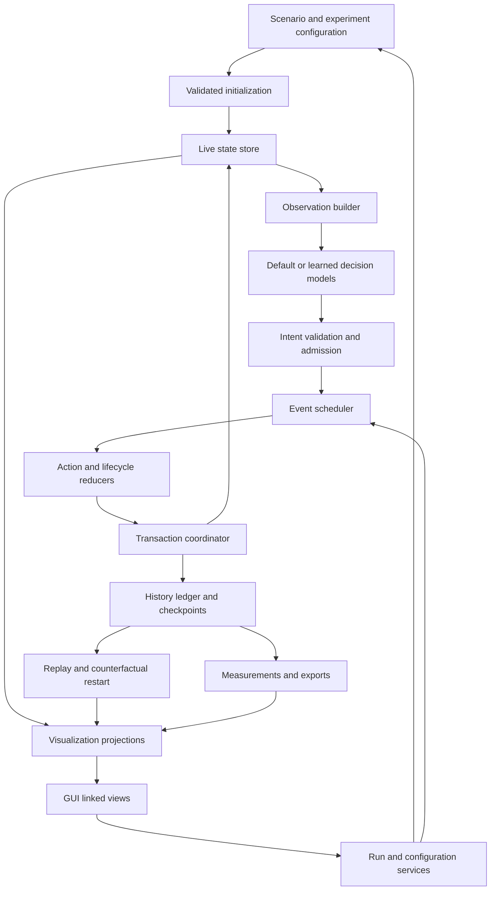

# TASK 2 Simulation Framework Implementation Plan

**Stage:** 1 — draft for review  
**Revision:** 0.2, November 24, 2026, America/New_York  
**Implementation status:** Not started. Stage 2 begins after your review and instruction to proceed.

The proposed framework runs the ontology's world through asynchronous events, lets interchangeable models choose agents' actions, and records enough information to replay and restart an experiment. It includes all 29 actions, eight roles, both memory and database live-state stores, consistent parallel event processing, a working reinforcement-learning example, and a graphical workspace for configuration, run control, live visualization, and replay.

The central design choice is to separate **what an action means** from **why an agent chooses it**. The simulation enforces the ontology. Default policies, learned policies, and external controllers all submit intents through the same interface.

For this revision, start with decision D9 and [Section 13](#13-visualization-and-gui), which cover the newly added Visualization & GUI requirement. The remaining sections specify the implementation contracts and delivery milestones. The companion [action and validation matrix](task_2_action_and_validation_matrix.md) covers every action, all 25 ontology invariants, and GUI acceptance cases G01–G16. The design choices remain open for review.

- [Decisions for review](#1-decisions-for-review)
- [Ontology integration](#2-ontology-integration)
- [Architecture and interfaces](#3-architecture-and-interfaces)
- [Time and event execution](#4-time-and-event-execution)
- [Parallel processing](#5-parallel-processing)
- [Space and initialization](#6-space-and-initialization)
- [Actions and lifecycle](#7-actions-and-lifecycle)
- [Default agent intelligence](#8-default-agent-intelligence)
- [Model extensions and training](#9-model-extensions-and-training)
- [Live state and recorded evolution](#10-live-state-and-recorded-evolution)
- [Configuration and experiment management](#11-configuration-and-experiment-management)
- [Research outputs](#12-research-outputs)
- [Visualization and GUI](#13-visualization-and-gui)
- [Verification and performance](#14-verification-and-performance)
- [Delivery milestones](#15-delivery-milestones)
- [Review record](#16-review-record)

## 1 Decisions for review

All entries are proposals, not accepted decisions. D5 needs particular attention because the ontology does not specify a practical sampling algorithm.

| ID | Proposed decision | Consequence and alternative |
|---|---|---|
| D1 | Python 3.12 simulation package and command-line interface, with NumPy for bulk state operations; expose shared application services to the GUI in D9. | Fits the existing Python ontology tooling and learning ecosystem. Headless and graphical use share the same engine and validation. Keep a native-kernel extension boundary. |
| D2 | Asynchronous discrete-event execution with analytically evaluated continuous motion, hunger, and rest. | Preserves unequal action durations and exact deadline precedence without a global gameplay tick. A fixed-step approximation is not part of the first implementation. |
| D3 | A serial reference scheduler plus parallel execution of independent event groups, parallel policy inference, and parallel independent runs. | One coordinator owns committed state. Conflicting events remain ordered; worker completion speed never decides who wins. |
| D4 | In-memory default live store, functional SQLite live store, and an append-only SQLite history ledger with checkpoints and Parquet exports. | Delivers two real storage backends without requiring a database server. PostgreSQL and distributed storage remain future adapters. |
| D5 | Practical placement using uniform-coordinate proposals and constrained relocation sampling, explicitly reported as an approximation to the joint conditional uniform distribution. | All geometry and separation constraints remain strict. Exact joint rejection sampling is available for small reference cases. Accepting this approximation for the 1,000-agent baseline requires an explicit review decision; it must not silently become an ontology guarantee. |
| D6 | Full semantic history by default; checkpoints every 30 simulated seconds or 50,000 committed transactions, whichever comes first. | Checkpoints accelerate recovery; events and continuous segments preserve changes between them. Intervals are configurable execution settings. |
| D7 | Deliver local-state utility policies, a Gymnasium controlled-agent adapter, a PettingZoo AEC adapter, and an executable PPO training/evaluation example. | Training begins with small scenarios and fixed opponents. Large training campaigns and a claim that learned policies outperform defaults are separate experimental work. |
| D8 | Preserve the ontology's game rules and original validation evidence; refresh stale plan-provenance metadata in a documented maintenance change during Stage 2. | The current plan hash differs from the formal package's pinned plan hash. Revalidating and recording the new reference must be explicit. |
| D9 | Deliver a local browser GUI using React/TypeScript, a Python FastAPI service, a Canvas 2D world renderer, and Plotly statistics charts. | Provides linked agent/statistics/cohort/timeline views and validated configuration/run controls in the first release. Bundle browser assets for local use; native desktop packaging can be a later adapter. |

The first release is a research framework with both GUI and CLI workflows, live visualization, replay, plots, and inspection exports. The GUI is a required TASK 2 deliverable. Distributed speculative simulation and large-scale hyperparameter optimization remain outside this release.

## 2 Ontology integration

### 2.1 Source authority

The semantic baseline is [zombie_game_ontology_v0.1.md](../ontology/zombie_game_ontology_v0.1.md), especially Sections 3–16 and invariants V01–V25. The formal package adds machine-readable vocabulary, constraints, and examples:

| Source | Use in implementation |
|---|---|
| [Current TASK 2 requirements](zombie_game_plans.md) | Scope: logic, intelligence, live storage, history, evolution, parallelism, instance management, and Visualization & GUI. |
| [ontology.ttl](../ontology/formal_v0.1/ontology.ttl) and [ontology.owl](../ontology/formal_v0.1/ontology.owl) | Entity/state distinctions, relationships, classification, capabilities, and export identifiers. The OWL file is the equivalent combined core/catalog serialization. |
| [catalog.ttl](../ontology/formal_v0.1/catalog.ttl) | Registry of 29 actions, eight roles, capabilities, baseline action parameters, and role overrides. |
| [shapes.ttl](../ontology/formal_v0.1/shapes.ttl) | SHACL constraints and diagnostics for exported snapshots and action/lifecycle traces. |
| [baseline.ttl](../ontology/formal_v0.1/baseline.ttl) and [baseline-summary.json](../ontology/formal_v0.1/baseline-summary.json) | Initial geometry, population allocations, resources, and baseline parameters. RDF is the authoritative machine-readable source. |
| [COVERAGE.md](../ontology/formal_v0.1/COVERAGE.md) and [coverage.json](../ontology/formal_v0.1/coverage.json) | Traceability and behavioral gaps that runtime tests must cover. |
| [Examples](../ontology/formal_v0.1/examples.json), fixture graphs, boundary checks, and build/validation scripts | Conformance cases, export conventions, and reproducible validation workflow. |
| [README](../ontology/formal_v0.1/README.md), [manifest](../ontology/formal_v0.1/manifest.json), toolchain, checksums, and [validation report](../ontology/formal_v0.1/VALIDATION_REPORT.md) | Provenance, representation decisions, and the limits of existing validation evidence. |

The formal coverage register contains 402 source units, 25 invariants, 29 partially formalized actions, and 70 SPARQL constraints. Runtime correctness cannot be inferred from the recorded 62/62 formal-package checks. For example, complete trajectories, perception privacy, fair arbitration, inventory drops, and restartable model memory still need implementation and tests.

The Stage 1 inspection confirmed graph equivalence between the Turtle core/catalog union and RDF/XML. It also confirmed that the Markdown ontology still matches its pinned digest. This was a read-only inspection, not a fresh execution of the full formal validator.

**Provenance issue:** the manifest pins the source plan to `57e073fe0f18c831dc9a2dd3a69dc3c5702f12e61b72908baf83b443257e7adf`; the current plan, including Visualization & GUI, has SHA-256 `fd744c3bd9fa6d57c1b14e0934eae3ee5fe9dff9d9592503218d8ada696472ac` as inspected on November 24, 2026. The validator checks this hash, so its old overall PASS is not a claim about the current inputs. D8 proposes preserving the old evidence, reviewing this reference change, refreshing provenance through the package workflow, and issuing a new report.

### 2.2 Executable mapping

Create a versioned mapping from every field, action, and invariant to its source section, runtime validator/reducer, and test cases. Import structured role/action parameters from the RDF catalog; supply missing type defaults from an explicit, reviewed mapping to the Markdown tables. Assert registry equality with the manifest to prevent forgotten or invented actions.

Keep OWL reasoning and SHACL outside the event-processing hot path. Runtime types and transaction validators enforce rules during execution. Export selected traces for independent formal checks. Historical state records are immutable; exporting a changed episode must retain its onset/end revisions so an old infected state remains valid.

The exporter explicitly maps runtime names to the existing vocabulary, including `type → biologicalType`, `role → activeRole/roleDefinition`, `run_id → inRun`, `last_state_event_id → lastEvent`, and action-state `DEAD → ACTION_DEAD`. Emit applicable fields and omit absent ones. Give inventory/stock observations their own state identities so a historical holder or quantity is not overwritten by a later snapshot.

Existing fixtures are focused conformance examples, not complete simulation histories. For example, their hunger values need not represent all continuous evolution between their selected states. Preserve their original validation purpose and add separate end-to-end simulator fixtures.

For scenario overrides, create a resolved per-run catalog. Several supplied checks, including treatment resource consumption, assume baseline numbers. A nonbaseline run therefore needs an explicitly versioned parameterized validation profile. Do not validate an override against incompatible baseline constants or suppress its failures. Any actual disagreement between prose and formal constraints becomes a documented issue before implementing the affected rule.

## 3 Architecture and interfaces

### 3.1 Component boundaries



GUI commands enter validated application services; visualization consumes committed state/history. The GUI has no direct state-store write path and cannot alter agent observations through its researcher view.

Proposed source layout:

```text
src/zombie_sim/
  domain/         # typed entities, state variants, identifiers, units, registries
  config/         # TOML loading, resolution, validation, scenario fingerprints
  ontology/       # import mapping, RDF exports, conformance profiles
  geometry/       # rectangle predicates, visibility, trajectories, spatial index
  engine/         # clock, queue, arbitration, transactions, parallel workers
  actions/        # shared action lifecycle and all 29 action handlers
  policies/       # observations, model protocol, memory, default utility models
  storage/        # live-store protocol, memory store, SQLite store, history
  experiments/    # instances, replications, interventions, branches, provenance
  learning/       # encoders, adapters, rewards, rollout collection, PPO example
  analysis/       # measurements, survival accounting, groups, plots, exports
  visualization/  # committed scene projections, cohorts, timeline, view exports
  application/    # run manager, shared GUI/CLI commands, configuration services
  server/         # HTTP API, WebSocket subscriptions, bundled GUI assets
  cli.py
gui/              # React/TypeScript views, canvas renderer, controls, browser tests
configs/          # exact baseline, small examples, experiments, training recipes
tests/            # contract, lifecycle, geometry, storage, replay, parallel, RL, GUI API
docs/             # user guide, extension guide, algorithms, training and GUI guides
```

### 3.2 Domain representation

Use a persistent `AgentIdentity(run_id, agent_id)` and separate current state. The type-specific state is a Human/Zombie tagged variant; conversion replaces that variant without replacing identity. Roles and models are references to versioned definitions, with separate assignment histories. Absence is explicit; a role-free agent does not get a fictitious role.

Use integers for life, counts, integrity, charges, and revisions. Store canonical source facts and calculate status, effective speed/sensing/resistance, infection progress, and inventory totals through one derived-state implementation. Cached derived values carry a source revision and cannot be written independently.

The default store uses indexed NumPy columns for frequently accessed numeric fields and tables for variable-length inventories, assignments, effects, paths, episodes, and model memory. Immutable read views prevent a policy or worker from mutating shared state. Stable ID-to-row maps survive deaths and conversions.

### 3.3 Public contracts

These signatures describe the intended API; they are not implementation added during Stage 1.

| Interface | Required operations and guarantees |
|---|---|
| `Simulation` | `initialize`, `advance_until`, `next_decision_batch`, `submit_intents`, `checkpoint`, `close`; expose committed revisions only. |
| `StateStore` | `read_view(time, revision)`, `read_many(keys)`, `commit(expected_versions, delta, events)`, `export_snapshot`; atomic multi-entity changes and identical semantics across backends. |
| `ActionHandler` | `validate_admission`, `declare_access`, `admit`, `resolve`, `cancel`; return typed deltas, reservations, scheduled events, and visible outcomes. Handlers do not directly mutate stores. |
| `DecisionModel` | `initialize_memory`, `decide_batch(observations, memories, rng_handles)`, `encode_memory`, `decode_memory`; return intents and new per-agent memory. A scalar adapter supports `decide`. |
| `ObservationBuilder` | Build immutable observations and observable feasibility from an exact time/revision; separate policy-visible results from privileged audit data. |
| `HistoryStore` | Append committed event batches, write/verify checkpoints, retrieve indexed history, reconstruct state, and validate completeness. |
| `RewardDefinition` | Versioned reward terms over event/interval records, with declared information access and terminal/truncation rules. |
| `Measurement` | Versioned definition, sampling protocol, source run/revisions, output schema, and parameter metadata. |
| `RunControlService` | Create/start, pause/continue, step, stop-and-save, checkpoint, resume, and branch through coordinator boundaries; idempotent command IDs and explicit acknowledgements. |
| `VisualizationService` | Snapshot/subscribe/seek, query agents/events/cohorts/metrics, and export views from committed revisions; bounded presentation buffers and resynchronization. |
| `ConfigurationService` | Describe schema, validate/resolve drafts, preview initialization, compare configurations, and save instances; use the same rules and fingerprints as CLI operations. |

New action/role plugins must declare complete contracts, read/write dependencies, cancellation behavior, visibility, serialization, and conformance tests. Models may change strategy freely within the frozen vocabulary. New mechanics require a new ontology/scenario lineage.

## 4 Time and event execution

### 4.1 Asynchronous semantics

An action occupies an interval; the scheduler jumps to the next event time. No one-second world tick is imposed. The one-second rule applies only to the maximum delay before an idle agent receives a decision opportunity.

Use a `SimTime` value represented as an exact rational number derived from finite decimal inputs. Timers such as `onset + incubation`, action durations, cooldowns, and the default hunger threshold then compare exactly. Serialize times as numerator/denominator pairs with a readable seconds field. Never merge close timestamps using an epsilon.

Positions and path lengths use float64. Time parameters calculated from geometric intersections are converted once to the canonical time representation, recorded, and reused on replay. Document their floating-point error separately from exact biological/action timers. Use robust boundary predicates, including higher-precision fallback near a boundary; tolerances must not make a wall traversable. The ontology's 0.01 m movement stop offset remains exact in meaning and is not replaced with a numerical epsilon.

The supplied RDF format uses finite decimals. Representable times export directly; a nonterminating rational time requires a separately versioned validation profile retaining exact numerator/denominator facts and declaring the decimal projection precision. Do not pass rounded values off as satisfying exact baseline timing equations. Include this representation boundary in the numeric and ontology-export tests.

Hunger, rest, and movement use anchored segments. For example, hunger is `min(100, h0 + rate × (t − t0))` until a change point. Schedule the hunger-100 crossing and subsequent 10-second damage deadlines explicitly. Queries materialize state at the requested time even if that agent has had no decisions. Movement records piecewise-linear waypoints and segment times; each segment must satisfy the instantaneous speed limit.

This approach trades rational-clock overhead for clear ordering. Benchmark it before introducing another representation; any faster numeric mode must document approximation and pass boundary tests.

### 4.2 Event phases

Queue entries contain exact time, phase, stable logical event identity, dependency tokens, and a cancellation generation. At each earliest time:

1. Evaluate continuous segments at that time and expire effects with an equal end time. Process movement stop points and continuous threshold bookkeeping consistently in this phase.
2. Apply starvation damage and Spitter recharges; perform immediate death cleanup when life reaches zero.
3. Convert remaining living humans whose active infection deadline is due.
4. Apply scheduled authorized interventions.
5. Resolve completing actions in the conflict order, with immediate lifecycle consequences after each action.
6. Give due idle agents observations, collect decisions, and arbitrate new admissions. Take requested checkpoints and measurements at documented boundaries.

Phases 5 and 6 are the completion/admission portions of ontology Section 14.1's fifth step. An action newly admitted at time `t` cannot retroactively conflict with an attack ending at `t`.

Initially idle agents receive an opportunity at time zero. Completion or conversion normally permits a same-time decision after all completions; deferred opportunities must be no later than one simulated second. A missing, malformed, or rejected choice is recorded and replaced with a one-second wait. Initially use one proposal attempt per opportunity, preventing rejection loops. Busy agents keep their current action; nonlethal damage does not silently interrupt them.

At the horizon, finish all events due at that time, record their order, and stop before offering new admissions. Actions ending later remain pending in the final snapshot. Do not stop merely because one biological type becomes extinct.

GUI pause, stepping, and pacing are scheduler controls described in Section 13.3. Pausing stops advancement at a committed boundary and preserves the scheduler phase/cursor; it does not create a game action, consume stamina, or advance biological clocks in wall-clock time.

### 4.3 Randomness and equal-time arbitration

Give initialization, policy choices, combat hits, exposure draws, and arbitration separate deterministic random domains. Key a draw by the master seed, domain, stable occurrence/decision identity, and draw index. Do not use worker IDs, database row allocation order, or completion time as entropy.

For equal-time conflicts, assign independent pseudorandom priorities to all contenders using their stable intent/event identities and the contest time. Sort by priority; resolve a priority collision with an additional keyed draw. This is symmetric across agent labels over seeds and avoids permanent low-ID priority. Record contenders, ordering, algorithm version, probability, raw draw, and outcome. A replay consumes recorded results rather than re-running randomness.

### 4.4 Reciprocal attacks

Maintain an index of active directed attack occurrences. On admission, link an occurrence to any opposite directed attack whose active interval overlaps with positive duration. The first occurrence reaching a **valid** resolution wins; an invalid target does not establish a winner. Equal-time valid contenders use the seeded priority order.

The winner alone draws a hit. Its reciprocal opponent is cancelled even if the winner misses or deals nonlethal damage. Paid stamina stays spent, released reservations return to their holders, and conflict cooldown starts at cancellation time. If the winning attack kills the other actor, use death cancellation; conversion cancellation likewise takes precedence when applicable.

Example: human melee and zombie bite both start at `t=10`. A valid melee resolves at `t=11` and cancels the bite planned for `t=11.5`, even on a miss. If melee is invalid at `t=11`, it does not cancel the bite. A fresh attack starting exactly when a previous one ends is sequential.

## 5 Parallel processing

### 5.1 Algorithm and consistency argument

First implement the serial scheduler as the reference. The parallel scheduler uses the same event priorities and phase boundaries. It does not advance one part of the world past a time at which another part may affect it.

For the current time and phase:

1. Compute a conservative read set `R(e)` and write set `W(e)` for each event. Include possible consequences: target death, inventory drops, reservations in other holders, cancelled reciprocal actions, model assignments, queue changes, signal receivers, and trajectory changes.
2. Add an undirected dependency edge when `W(a)` intersects `R(b) ∪ W(b)`, or `W(b)` intersects `R(a) ∪ W(a)`. Read/read sharing alone creates no edge.
3. Include spatial predicate tokens, not just returned entity IDs. A query for an empty doorway or no stockpile inside a footprint must conflict with a write that changes that answer. Use cell-membership/geometry versions and conservative swept trajectory envelopes. Begin with a global geometry token for barrier changes where finer dependencies are uncertain.
4. Partition the graph into connected components. Process components concurrently against immutable views; within each component, resolve events serially in the canonical seeded order and recheck preconditions after every delta.
5. Workers return deltas, event records, discovered dependencies, and version checks. They cannot publish changes or write the database.
6. The coordinator verifies the declared dependencies and read versions, then commits results in canonical order. An expanded dependency or stale read invalidates the affected result: rebuild the component or rerun it serially using the same random keys. Never keep partial effects from a discarded result.

Independent components commute because neither writes data or query predicates read or written by the other. Serial execution inside each component respects the reference order. Combining those facts yields a valid serial history. This argument depends on complete dependency declarations; differential tests and runtime access tracking check that assumption.

Simultaneous resource reservations use the same algorithm during admission. Existing reservations win over new claims. A losing claim is rejected before paying stamina. Receiving inventory capacity is rechecked at completion, so two transfers cannot overfill it.

Barrier operations and broadcasts may create large components. That reduces speedup but preserves semantics. Unknown plugin dependencies fall back to a global conflict token until a narrower declaration is validated.

### 5.2 Execution strategy

Use a persistent process pool for CPU-bound Python work and batch small components to amortize communication. Python's process executor uses separate processes and requires serializable inputs/results; choose the spawn context explicitly for portability. [Python executor documentation](https://docs.python.org/3.12/library/concurrent.futures.html).

Parallel policy calls receive observations from the same frozen decision boundary. Their intents enter a common admission batch; whichever model returns first gets no priority. Shared model weights do not share per-agent memory. Batch neural inference by model/version while retaining independent memory and random handles.

Run independent seeds in separate processes with separate instance directories and databases. This provides useful parallelism even when a single crowded world has little independent event work. Cap total workers across run-level and within-run pools to avoid multiplying CPU/memory demand.

Record component sizes, serialization cost, conflict/retry rates, inference time, and commit time. Select serial execution below a measured workload threshold. Do not promise a speedup for tightly coupled scenes.

## 6 Space and initialization

### 6.1 Geometry and movement

Implement rectangle/segment intersection, point-to-footprint distance, world bounds, line of sight, footprint overlap, and visibility clipping. Treat barrier footprints as closed; touching a wall is forbidden for living agents. Outer world boundaries are legal. Agent bodies do not collide and shelters have no capacity limit.

Use a uniform spatial grid for broad-phase queries and exact predicates for final acceptance. Index moving agents conservatively by swept path envelopes, then evaluate their positions at query time. Updating only their last committed coordinates would miss moving targets and is unacceptable. Geometry changes invalidate affected visibility/path caches.

A new gate closure or barricade first checks occupancy at its event time. If legal, inspect remaining paths intersecting the new barrier and schedule stops 0.01 m of path length before first contact, or immediately if less than 0.01 m remains. Spend energy only for distance actually traveled and record `PARTIAL_BLOCKED`. No teleportation, agent-body collision, automatic reflection, or wraparound is introduced.

Policy routing operates only on discovered geometry. Use A* over a visibility graph of remembered barrier segments/corners with a small planning clearance, then validate every emitted movement segment through the engine. The clearance is a planning preference, not an agent body radius. Unknown space may require exploration and replanning. Engine rejection/result messages must not disclose hidden obstacle locations beyond allowed local collision evidence.

Visible environment observations expose visible portions of geometry, not an entire hidden rectangle because one face was seen. Signals use emission-time recipient positions, traverse barriers, deliver once, and expire. Store delivery records so a later entrant never receives an old broadcast. Payload understanding follows the receiver's current type and the emitter's type at emission.

### 6.2 Baseline construction

Import the four shelters, 28 initial barriers including gates, ten stockpiles, and exact role allocations. Instantiate 800 humans and 200 zombies, independently randomize roles within each type, and choose 20 infected humans without role or position preference. All initial episodes end incubation at 300 s; the initial seed is 20261106. Initial portable totals are 600 food, 280 medical supplies, and 400 materials, including carried items.

Validate initial connectivity, not just absence of overlaps: exterior stockpiles and doorways must be reachable, and opening each gate must connect its stockpile to the exterior. Zombies cannot start inside shelters. Every pair must be separated by at least 2 m and every Human–Zombie pair by at least 15 m.

### 6.3 Placement decision D5

Uniform independent sampling followed by rejection of the **whole configuration** gives the literal joint conditional distribution, but acceptance can become impractical with 1,000 constrained agents. Sequential placement alone generally does not have that joint distribution.

Proposed practical initializer: obtain a legal configuration with randomized placement order and bounded restarts, then perform random-order single-agent relocation sweeps. Each proposal is uniform over that type's legal static region and is accepted only when all pairwise constraints hold. The target joint uniform distribution is stationary for these moves, but a finite run is an approximation and mixing is not guaranteed. Record sampler version, seed, proposal counts, burn-in, acceptance rates, and spatial diagnostics; compare several starts and small cases against whole-configuration rejection sampling. Choose burn-in from these checks rather than silently asserting exact uniformity.

If D5 is declined, keep the exact sampler with an explicit attempt budget and revisit baseline initialization before claiming a practical 1,000-agent run. Exceeding a sampling budget is reported as failure to find a placement, not proof that the geometry is mathematically infeasible. Never lower counts or separation distances to make a run start.

## 7 Actions and lifecycle

Implement every action in the [companion matrix](task_2_action_and_validation_matrix.md#1-action-implementation-matrix). Each handler has admission validation, resource/charge reservation, continuous behavior if any, completion revalidation, effects, cancellation, cooldown, and policy-visible result handling.

Share reusable reducers for damage, healing, resource movement, exposure, effect application, and geometry mutation. The important orderings are explicit:

- Physical damage uses `floor(raw × (1 − resistance) + 0.5)`, clamped to remaining life. Immediate death precedes any same-hit infection draw.
- Human melee/power strike use `clip(0.50 + 0.45 × combat_skill, 0, 1)`. Zombie claw/bite/spit use `clip(0.60 + 0.30 × attack_skill + rally_bonus, 0, 0.95)`.
- Only a surviving healthy human receives a bite/spit exposure draw: `clip(potency × (1 − effective_resistance), 0, 1)`. Re-exposure during an episode never resets its deadline.
- Flat stamina is paid once at admission. Items stay in their holder while reserved and are consumed/transferred only on success. Spit is the explicit exception where a valid miss consumes a charge.
- Nonmovement actors remain in place; target eligibility, inclusive range, visibility, capacity, and geometry are rechecked at completion. Target-invalid results do not reveal a hidden target's new state.
- Effects use half-open intervals and the strongest applicable value. A recipient's death or incompatible role/type change ends its effects; an emitter's death does not revoke effects already applied to other recipients.

Death and conversion are atomic compound transitions. Both cancel the actor's action, release all its reservations before inventory handling, retire assignments as specified, and cancel obsolete timers. Death freezes type/location, closes an episode as `HOST_DIED`, and creates exactly one remains entity. Conversion preserves current life, stamina, identity, and location; drops the inventory once; installs a role-free zombie profile and fresh default zombie memory; and ends human clocks. Neither transition can leave an item reserved in another holder.

Interventions enter the scheduler's intervention phase and use the same validation/transaction pipeline. Support resource additions, compatible role changes, and model replacement first. Role changes preserve life/stamina, retire incompatible actions/effects, and explicitly drop excess inventory when capacity decreases. A documented deterministic drop order is part of the intervention configuration. No intervention may revive a dead identity.

## 8 Default agent intelligence

Default behavior must exercise the framework meaningfully while remaining replaceable. Implement `HumanDefaultModel` and `ZombieDefaultModel` as utility policies with per-agent memory, candidate generation, short path planning, and seeded tie-breaking.

Memory records discovered geometry/resources, dated sightings and signals, current objective, recent failed attempts, and planned routes. A policy first derives observable candidates, then scores them using normalized survival urgency, infection urgency, expected damage/recovery, resource value, ally benefit, exposure risk, travel time, and stamina cost. Weights, thresholds, memory expiry, and exploration preferences belong to versioned model parameters rather than engine rules. Log the chosen score and reason for inspection.

| Policy | Nontrivial default behavior |
|---|---|
| Human base | Explore for resources and shelters; eat before prolonged starvation; treat injuries; reserve medicine for higher-value uses; flee or fight based on visible threats, escape routes, health, and stamina; open/close gates according to observed passage needs and danger; transfer/drop items when useful. |
| Doctor | Prioritize curable infections using travel plus treatment time and deadline slack; request medicine/help; distinguish healing from cure; use prophylaxis for uninfected agents facing exposure. |
| Warrior | Compare ordinary melee and power strike by predicted resolution, hit/damage, stamina, and cooldown; guard before likely contact; position near vulnerable visible allies without inventing a shield mechanic. |
| Scout | Explore frontiers, use recon near uncertain threats, mark visible targets, and relay dated findings without omniscient tracking. |
| Engineer | Acquire sufficient materials, repair useful damaged barriers, and propose legal defensive footprints while avoiding known routes it intends to keep usable. |
| Zombie base | Pursue visible or remembered humans; compare claw and bite by attack timing, damage, and infection value; investigate noise; feed when recovery is valuable; rest and attack blocking gates/barricades when appropriate. |
| Tyrant | Rally when observable allies can benefit; choose demolish versus smash based on integrity, time, energy, and cooldown. |
| Runner | Use legal dash paths to close distance or reposition while retaining enough energy for follow-up actions. |
| Spitter | Manage charges and recharge; prefer ranged opportunities when useful; fall back to movement, claw, bite, or recovery. |
| Screamer | Broadcast useful sightings at a controlled cadence; avoid repeatedly reporting unchanged stale information; retain ordinary zombie actions. |

Every action gets a focused scenario in which the default policy selects it for a documented reason. There is no requirement to force every action into every baseline run. Tests check strategic choices under controlled inputs and legal behavior, not a single supposedly optimal global trajectory.

## 9 Model extensions and training

### 9.1 Model contract and information boundaries

A model artifact declares its ID/version, applicable types/roles, observation version, action vocabulary, encoder version, parameter checksum, dependencies, and deterministic/restart capabilities. Shared immutable weights and per-agent memory are separate objects. Conversion allocates fresh zombie memory; death retires memory from active use while preserving history.

Models see self state, full visible local agent state, clipped local geometry/resources, dated signals, time/bounds, their history, and observation-derived feasibility. They never receive a `StateStore`, hidden targets, future events/draws, or another model's memory. Feasibility masks derive only from that observation; the engine may still reject an apparently feasible action after a competing reservation or other state change.

Default deterministic execution waits for a decision batch in wall-clock time without advancing simulation time. A configurable wall-clock inference timeout may produce a recorded fallback wait, but such runs must declare timing-dependent decisions; they cannot promise identical reruns from a seed alone. Process isolation and adapter error handling prevent a policy exception from corrupting state.

Communication parameters reference dated knowledge records from observations, received reports, or the actor's retained memory. Validate those references when admitting a signal or scream; a model cannot manufacture an unseen entity and label it a known target. Full audit reasons remain available to researchers while ordinary results obey the observation contract.

Plugins can submit the full typed action vocabulary, including paths, resource quantities, and construction footprints. The learning example uses a versioned candidate encoder: each candidate contains a legal-looking action template and typed parameters constructed only from observation and memory. A network scores the variable-length candidate set. The encoder must cover all 29 action types when applicable; any pruning and movement discretization are declared policy restrictions, not simulator limitations.

Encode bounded self attributes with declared normalization, type/role/action categories, relative visible-agent and resource features, dated signal features, and remembered-map features. Use masks and a permutation-invariant neighborhood encoder so nearby-agent list ordering does not change the meaning. Candidate features include action kind, parameters, referenced target features, duration/cost estimates, and observable feasibility. Keep a reversible candidate-index-to-intent mapping in every rollout record; padding must never become an executable action.

### 9.2 Environment adapters

Provide a controlled-agent Gymnasium adapter in which all other agents use assigned policies. `step` submits the selected agent's intent and advances to its next decision opportunity or terminal condition; return elapsed simulated time and accumulated interval rewards. This is a semi-Markov transition because elapsed time varies.

Provide a PettingZoo AEC adapter for multiple learning agents. At a shared decision time, freeze all observations and collect the entire batch of intents before admitting any of them. API iteration order must not leak earlier submissions into later observations. PettingZoo supports AEC environments and imposes restrictions on automatic conversion to its Parallel API; the asynchronous engine will not claim that conversion without testing the required semantics. [PettingZoo AEC documentation](https://pettingzoo.farama.org/api/aec/).

Persistent simulation identity survives conversion. A human-policy learning episode terminates at conversion and a new zombie controller episode can begin under that identity, using distinct controller-episode IDs and reset memory. Death terminates a controller episode. Distinguish an externally imposed rollout cutoff from a task-defined finite horizon; only the former is truncation. Include remaining task time when a reward task defines a finite horizon, and bootstrap correctly. [Gymnasium time-limit guidance](https://gymnasium.farama.org/tutorials/gymnasium_basics/handling_time_limits/).

### 9.3 Concrete training recipe

Deliver a PyTorch PPO example over candidate scores, with shared weights by policy family and per-agent recurrent state. Suggested initial settings are two 128-unit encoding layers, a 128-unit recurrent state, learning rate `3e-4`, PPO clip `0.2`, four update epochs, gradient norm limit `0.5`, and minibatches of 256 decisions using sequence-aware batching. These are configurable starting values, not tuned results.

Use time-aware discounting `gamma(dt) = 0.99^(dt / 1 second)` and similarly time-scaled advantage decay. Store the actual interval duration, reward timing, masks, chosen candidate parameters, old log probability, value estimate, terminal/truncation flags, and recurrent-state boundaries. Aggregate rewards within each interval with their event times so changing action duration does not silently change the objective.

Supply two explicitly experimental reward definitions:

- `human_survival_v1`: +0.01 per simulated second alive as human; −10 on human death or conversion; +2 per successful cure of another human; +0.01 per actual life point restored to another human. Report every term separately to expose reward exploitation.
- `zombie_pressure_v1`: +1 for a newly caused infection episode; +0.02 per actual damage point inflicted on a human; −5 on own death. No reward for a miss, invalid target, or duplicate exposure to an existing episode.

These objectives do not alter action effects or establish universal human/zombie goals. Privileged training reward data, if used, stays outside actor observations; checkpoint selection also uses independent survival/infection metrics rather than reward alone.

Training workflow:

1. Verify adapters, masks, lifecycle transitions, reward accounting, and checkpoint reloads on tiny deterministic worlds.
2. Collect default-policy trajectories and produce an imitation baseline to verify the observation/action pipeline.
3. Train a small controlled scenario against frozen default opponents. Begin with CPU execution and a 4,096-decision smoke budget; supply a 200,000-decision starter recipe with configurable environment workers and optional GPU inference. Use 1,024-decision rollout batches initially, retaining recurrent sequence boundaries. These budgets verify operation and provide a starting experiment, not a convergence guarantee.
4. Expand through survival/navigation, combat/infection, resource cooperation, and mixed-role curricula. Each curriculum scenario has its own fingerprint.
5. Use separate recorded training, validation, and held-out test seed sets. Select checkpoints on validation; evaluate the selected checkpoint once on the held-out set.
6. Compare random legal, default utility, imitation, and PPO policies on the same test scenarios/seeds. Start with 30 paired evaluation seeds, report interval estimates and raw runs, and expand replication based on variance rather than claiming that 30 is universally sufficient.

Deliver runnable training/evaluation commands, reward and encoder documentation, a reloadable smoke-trained checkpoint, and a report of actual metrics. Full-population convergence or policy superiority is not an acceptance condition for the framework.

## 10 Live state and recorded evolution

### 10.1 Two concrete live stores

`MemoryStateStore` is the performance default. It supports immutable revision views, batched reads, per-entity/predicate versions, and atomic delta publication. `SQLiteStateStore` persists the same current semantic tables and provides bulk reads into equivalent immutable views. It is a real alternative backend, not just a snapshot exporter. A common contract suite must run against both.

SQLite tables cover identities/current states, environment entities, inventories/stocks, reservations, episodes, assignments, effects, active occurrences, pending events, and model memory. Use one writer per run and WAL mode on local storage. SQLite WAL permits concurrent readers with a writer but only one writer at a time; it is not a multi-host network-filesystem design. [SQLite WAL documentation](https://sqlite.org/wal.html).

Use indexes on holder/resource, actor/action, episode deadline, entity/revision, and event sequence. Cache/read in batches; do not issue one SQL query per nearby agent. Spatial indexes are derived accelerators that can be rebuilt from a checkpoint.

### 10.2 History schema

The authoritative run ledger includes:

| Record | Required contents |
|---|---|
| Run manifest | Full resolved configuration, ontology/action/role definitions, source and dependency fingerprints, model artifacts, seeds, numeric conventions, hardware/runtime, and stop reason. |
| Decision | Opportunity identity, observer, exact time/revision, observation or reconstructable reference plus hash, selected intent, memory update, and model diagnostics. |
| Event | Event ID, commit sequence, exact time, phase/order, type, actor/targets, causal predecessors, transaction ID, outcome, deltas, and random records. |
| Occurrence and reservation | Intent linkage, start/planned/resolved times, quantity/holder/charge identity, reservation lifecycle, costs, cooldown, cancellation/failure reasons. |
| Continuous segment | Time-parameterized path and actual travel, hunger/rest anchors and rates, interruption/change points. |
| Lifecycle and environment | Infection episodes, cures/conversions/deaths, inventory drops, remains, consumption/transfers, assignments, barriers, signals/deliveries, interventions. |
| Checkpoint | Complete semantic state, pending events/actions/reservations, timers, effects, cooldowns, memory, ID/decision counters, RNG metadata, and durable ledger position. |
| Control audit | GUI/CLI command ID, run/control generation, requested operation, acknowledgement, effective time/revision, and outcome; scheduling/intervention changes additionally have semantic events. |

Store searchable metadata in SQLite and versioned compressed structured payloads for larger records. Index participant/event associations separately for per-agent histories. Exact rational time is authoritative; a float seconds index may only narrow searches before an exact comparison. Export analytical event/state/measurement tables to partitioned Parquet. Exports are reproducible derivatives, not another authoritative state store.

### 10.3 Commit and recovery

For the SQLite live backend, update live tables, append history, and advance the durable watermark in the same database transaction. For the memory backend, compute a staged batch, durably append its full event/delta/memory records, and only then publish the committed view. If the process fails after logging but before memory publication, recover by applying that committed batch once. Stable transaction IDs make retries idempotent.

Batch durability work at bounded commit boundaries while preserving per-event ordering inside each batch. Apply backpressure when logging cannot keep up; do not discard events to maintain speed. A storage failure stops the run as failed with its last durable revision, rather than reporting a complete history.

Write checkpoints to temporary files with a manifest, typed arrays, structured records, model-memory blobs, scheduler phase/cursor and any remaining ordered work at the current time, and checksums; flush and atomically rename before registering them in the ledger. Unregistered partial files are ignored. Verify source/model checksums on restart. Avoid executable object serialization for ordinary state records.

Replay starts at the nearest earlier checkpoint, applies committed deltas in recorded order, then evaluates continuous segments at the requested time. It must not call policies or redraw stochastic outcomes. Provide both the state after all events at time `t` and the state at a specified causal revision.

Restart additionally restores pending events, assignments, per-agent memory, and decision/random counters. Memory changes are recorded per decision, allowing restart at a committed decision boundary between checkpoints. A model unable to serialize its private state is explicitly limited to state replay or a declared reset intervention; exact continuation cannot be claimed.

### 10.4 Storage scale

At an illustrative average of one decision per agent per second, the baseline could produce about 1.8 million decisions, plus actions and other events. Shorter actions can produce more. Full observation copies can dominate storage, so default history uses reconstructable observations with versioned contracts and hashes; offer explicit observation capture for debugging and training exports.

Measure bytes per decision/event, checkpoint size, reconstruction latency, and peak memory using pilot runs. Report estimated full-run storage before a large batch. Checkpoint cadence, compression, and export partition sizes may change without changing game semantics; dropping required history may not.

## 11 Configuration and experiment management

### 11.1 Configuration model

Use TOML files with strict typed validation and finite numeric checks. Parse floating-point parameters as decimal values before canonicalization. Reject unknown fields, incompatible roles/actions, invalid domains, inconsistent totals, impossible geometry, unsupported observation versions, and unresolved model artifacts.

Separate semantic settings (world, agents, profiles, policies, horizon, observation contract, interventions) from execution settings (worker counts, storage backend, checkpoint cadence, profiling). Resolve defaults into canonical JSON and hash the complete semantic configuration plus referenced definitions/artifacts. Changing worker count must not silently create a different game scenario.

The GUI edits these same typed configurations through schema-driven forms, with units, ranges, presets, and a resolved-configuration preview. Store display layout, camera position, visible layers, and playback speed separately as viewer preferences. Editing a frozen run's semantic parameters follows the new-run/branch/intervention rules in Section 13.4.

An experiment groups a declared parameter grid or sampled parameter set and a fixed seed list. An instance is one resolved scenario/model/parameter combination. Each run is one seed/replicate realization, with a unique run ID. Resumption retains that ID; a counterfactual branch receives a new one.

```text
experiments/<experiment_id>/
  experiment.toml
  instances/<instance_id>/
    resolved_config.json
    runs/<run_id>/
      manifest.json
      run.sqlite
      checkpoints/
      artifacts/          # referenced model/config/ontology objects by digest
      exports/
      measurements/
      diagnostics/
      views/              # saved view/cohort definitions and export provenance
  training/<training_run_id>/
  analysis/<analysis_id>/
```

Analysis manifests name the exact source runs and measurement definitions. Training manifests record data split, encoder/reward versions, hyperparameters, optimizer state, checkpoints, and evaluation results. Artifacts must resolve from the experiment archive, not depend on mutable files outside it.

### 11.2 Planned CLI

The following commands are proposed deliverables and do not exist yet:

```text
zombie-sim validate configs/baseline.toml
zombie-sim run configs/baseline.toml --seed 20261106 --workers 4
zombie-sim inspect <run_id>
zombie-sim replay <run_id> --time 300 --revision <revision>
zombie-sim resume <run_id>
zombie-sim branch <run_id> --revision <revision> --interventions <file>
zombie-sim experiment <experiment.toml>
zombie-sim export <run_id> --format parquet
zombie-sim analyze <experiment_id>
zombie-sim train <training.toml>
zombie-sim evaluate <model_artifact> --experiment <evaluation.toml>
zombie-sim gui --experiments-dir experiments --port 8765
```

Report progress using simulated time, living populations, committed events, disk usage, and phase timings. Final status distinguishes horizon completion, no living agents, user interruption, and failure. An interrupted run gets a durable restart point; it is not mislabeled completed.

### 11.3 Counterfactual branches

Branch at an explicit committed time/revision, creating a new run with parent digest, branch revision, identity correspondence, inherited checkpoint/history references, changed configuration/interventions, and model-state availability. Retain pending actions and reservations unless an intervention explicitly cancels them. Remap internal references to the child run while preserving explicit links to parent provenance.

Offer independent randomness and aligned random domains. Alignment uses stable lineage/decision identities rather than global event sequence, so inserting one event does not shift every subsequent draw. Once branches diverge, describe exactly which draw keys still correspond; do not claim perfect counterfactual coupling for unrelated events. Preserve the parent unchanged.

## 12 Research outputs

Implement the ontology's measurements as reproducible readers of history, with default one-second observation samples and exact event counts. Include healthy/infected/zombie/dead counts, infection incidence excluding initial episodes, cures/conversions, attack admissions/hits/misses/cancellations, actual damage, resources and reservations, shelter occupancy, and cooperation events.

Provide human survival time ending at death or conversion, and persistent-identity survival time ending only at death, both with right censoring. Check population conservation separately from remains counts.

For group analysis, sample a same-type proximity graph using the ontology's 20 m distance and line-of-sight rule. Propose one-second sampling and maximum-overlap component matching with a declared Jaccard threshold of 0.5, recording splits/merges and a 30 s persistence threshold. These sampling/matching choices are analysis parameters; label persistence as observed at that sampling resolution.

Deliver population/resource plots, spatial snapshots or replay animations, policy action distributions, paired experiment comparisons, and machine-readable tables. The GUI in Section 13 presents these measurements alongside the world and event timeline using shared run/time/revision selections. A researcher view may show privileged world state; it cannot feed information back into agent policies.

## 13 Visualization and GUI

### 13.1 User workflow and implementation boundary

The GUI supports a complete workflow: choose a baseline or saved instance, edit and validate parameters, preview the initial world, launch a run, inspect its evolution, pause/step it, compare cohorts, replay saved history, and export results. Users can operate this workflow without editing configuration files or entering CLI commands.

Implement `visualization/` as a reusable projection/query module with no browser dependency. It reads committed state, history, observations, and measurement definitions. Implement `gui/` as the interactive workspace and `server/` as its transport adapter. CLI, GUI, and headless experiments use the same application services. Simulation workers run separately from the web service so a blocked browser request or chart cannot stall the coordinator.

The proposed stack is FastAPI for typed HTTP requests and WebSocket subscriptions, React/TypeScript for panels/forms, Canvas 2D for the world, and Plotly for interactive statistical charts. FastAPI supports WebSocket endpoints, and Plotly provides a React integration. Pin compatible versions and lock frontend/backend dependencies during M0. [FastAPI WebSockets](https://fastapi.tiangolo.com/advanced/websockets/), [Plotly React integration](https://plotly.com/javascript/react/).

Package the compiled frontend with the GUI installation extra so ordinary users need only the Python launcher and a browser; Node tooling is needed for frontend development/builds. Serve assets locally without CDN dependencies. Default to a loopback listener with session/origin checks; hosted multi-user deployment is a later packaging concern. Keep headless operation available without GUI dependencies.

### 13.2 Linked views

Use an instance/run sidebar, top run controls, a central world/statistics workspace, a selectable inspector, and a shared timeline. Panels may be resized or collapsed; each view identifies its run, display time, revision, and live/replay mode. Selecting a chart time, agent, or event updates linked panels through a single view context rather than issuing unrelated queries with different cursors.

| View | Required content and interaction |
|---|---|
| World and agent activity | Pan, zoom, fit world, select/search/follow an agent; distinguish human/zombie/status/role with both color and symbols; render shelters, gate modes/integrity, barricades, resources, remains, movement trails, and action indicators. Optional layers show sensing, visibility, signals, infection deadlines, and groups. Agent marker sizes are screen symbols, not physical body radii. |
| Agent inspector | Current or historical applicable attributes, role/model assignments, life/stamina/hunger, inventory total/available/reserved quantities, effects, cooldowns, infection episode, active action, and event/decision history. Follow the same identity through conversion and death; dead identities remain inspectable. |
| Population and resource statistics | Healthy/infected/zombie/dead population curves; incidence, cures, conversions, survival, resource accounting, shelter occupancy, and action outcomes. Show units, sample interval, definition, and counts/denominators; separate exact event totals from sampled continuous summaries. |
| Cohort comparison | Save fixed membership at a chosen revision, such as initially infected humans, or a dynamic predicate, such as currently infected humans. Filter by type, role, model, infection, or region; compare counts, survival, distributions, and resource/action measures. Show how membership changes and distinguish human-survival from identity-survival censoring. |
| Event and causal timeline | Filter by actor/target/action/outcome; inspect starts, reservations, misses, conflicts, cures/conversions/deaths, barriers, and interventions. Show equal-time phase/order and follow causal predecessors or jump to the event's before/after revision. |
| Instances and experiments | Browse configurations, seed/replicate status, parent/branch lineage, model artifacts, and outputs; duplicate configurations, launch/monitor bounded batches, and compare selected runs using declared time alignment. Display separate cursors for runs rather than pretending their revision numbers match. |
| Configuration and control panel | Common/advanced parameter forms, validation and geometry preview, configuration differences, start/pause/continue/step/stop controls, pacing, checkpoints, resume, and branch/intervention workflows. Show pending commands and actual acknowledged results. |

A fixed cohort retains its member identities after type/role changes; a dynamic cohort recomputes membership at each sampled revision. Save the membership rule, reference revision, handling of dead members, denominator, and measurement version with every cohort/export. Overlapping cohorts must not be presented as a partition whose counts necessarily sum to the population.

Offer a clearly labelled **researcher view** and a **recorded agent observation view**. The latter displays the actual observation supplied at a selected decision, including dated reports, with hidden geometry/agents and model-private state omitted according to the observation contract. It must not substitute current global state for historical knowledge. Switching to it clears global overlays, tooltips, and side-panel caches that would reveal hidden information.

### 13.3 Live controls and replay controls

Live control and replay playback are separate modes with distinct labels. Browsing an earlier time never rewinds the running simulation. Leaving live follow, pausing playback, seeking, and changing replay speed affect only the viewer; an explicit run-pause command is required to pause execution. A Return to live control restores the latest consistent view.

| Control | Exact behavior |
|---|---|
| Validate and start | Resolve the draft through shared validators; display errors at fields and in a summary; start a new run only after valid initialization. Show initialization progress and any placement failure without silently changing parameters. |
| Pause and continue | Stop after an atomic committed transition/batch, acknowledge the effective time/revision, and preserve pending work. Continue from that scheduler cursor. Never insert a `wait` action or let wall-clock pause advance hunger/infection. |
| Step transition | While paused, resolve the next ordered atomic semantic transaction, including all immediate death/conversion/cancellation consequences, then pause. It may contain several event records. Respect earlier phases and inspect each resulting revision. |
| Step timestamp or advance to time | Complete the next semantic timestamp, including the defined admission phase, or advance to a requested future time. Preserve horizon rules and pending later actions. Rendered frames do not define the step size. |
| Run pacing | Target 0.25×, 1×, 4× simulated-seconds-per-wall-second or fastest execution by changing wall-clock scheduling. Do not change action durations, event priority, random draws, or policy timeouts; show achieved speed when the target cannot be met. |
| Stop and save, checkpoint, resume | Stop gracefully at a durable boundary, preserving pending actions and the restart cursor; report an interrupted status. Checkpoint explicitly or resume a compatible interrupted run. Completed runs remain immutable; a fresh experiment uses a new run/branch. |
| Replay and seek | Read recorded history without invoking policies or new random draws; play/pause, change speed, scrub, jump to events, or enter exact time/revision. Show loading/cancel/error states for expensive reconstruction. |
| Branch and intervene | Select an explicit committed revision; preview the change and lineage; create a child run or schedule an enabled intervention through the existing invariant checks. Record its actual effective time/revision. |

Commands carry a unique command ID, run ID, expected control/configuration generation, and an exact expected revision when an operation depends on a fixed state. Lifecycle commands such as pausing a progressing run use the control generation rather than an always-changing revision. Acknowledgements distinguish accepted/pending/applied/rejected and include the effective boundary. Persist command outcomes so reconnect/retry cannot start a duplicate run or apply an intervention twice. Serialize conflicting commands from tabs and CLI clients; reject stale operations with a refreshable explanation.

Commit a command's semantic effect and completion record in the same durable transaction. For operations spanning run creation, files, and process launch, first reserve the resulting run/branch ID in a durable command journal, then reconcile staged work after a crash using that identity and an exclusive run-worker lease. A crash after creating the child or applying an intervention but before sending an acknowledgement must not create another child or repeat the effect on retry.

Persist scheduler phase/cursor and outstanding ordered work for pauses inside a timestamp. Step mode temporarily uses serial commit boundaries without changing the canonical event order. Keep control-audit records separate from semantic world changes so graphical/headless comparisons ignore harmless differences in pause/pacing history.

Closing a browser tab or losing a viewer connection does not stop a managed run. On reconnect, query its actual status and resynchronize. Stop/cancel remain explicit commands; server/worker failure is reported separately from a viewer disconnect.

### 13.4 Hyperparameter tuning and configuration ownership

Generate forms from the backend schema for world geometry, populations/role counts, infection/resources, profiles/action parameters, observation settings, model assignments/weights, seeds, horizon, execution options, and experiment/training parameters. Provide plain-language descriptions, units/ranges, conditional fields, baseline presets, import/export, and a diff against the source preset. Advanced settings remain accessible without allowing unknown fields or bypassing validation.

Preview geometry and candidate initialization using the chosen seed in an isolated preview job. Reuse an accepted preview artifact only when its resolved configuration fingerprint and seed match the launched run; otherwise regenerate it. Previewing must not consume the live run's random stream. Retain exact counts and placement diagnostics.

| Setting class | GUI edit behavior |
|---|---|
| Draft semantic parameters | Editable; validate and save a new resolved instance/scenario version before launch. Show changes and derived totals. |
| Parameters of an existing run | Read-only as historical provenance. An Edit as new run action copies them into a draft. A supported branch/intervention may change specified behavior explicitly; arbitrary direct state edits are unavailable. |
| Enabled interventions | Use typed forms for supported resource additions, compatible role changes, and model replacement. Validate targets, time, and invariants; changes due at one time enter the ontology's intervention phase. Reject elapsed deadlines or stale fixed-state requests. |
| Presentation and pacing | Camera, layers, selected cohorts, chart display, replay speed, and run pacing can change without altering the semantic configuration. Pause execution before changing execution settings that require rebuilding workers/stores; unsupported changes require restart with a documented configuration. |

Statistics, cohort filters, and GUI selections do not change an agent's policy or private memory. A model assignment change is a recorded intervention, not a side effect of selecting a model in an inspector. Persist saved view/cohort definitions and their provenance under the instance/run; unsaved panel layout may remain a local viewer preference.

### 13.5 Visualization data and transport

Use HTTP for configuration, commands, indexed history queries, exports, and initial snapshots; use WebSocket subscriptions for live scene/measurement/status updates. Both live and replay projections use the same schemas and measurement definitions. Backend queries operate on bounded immutable views or history read transactions, never hold a simulation write lock while drawing or serving the browser.

Each view bundle includes schema version, run ID, subscription/query generation, monotonically increasing sequence, exact display time/revision, committed frontier, and measurement watermark. Deltas name their base sequence/revision and contain creations, updates, removals, and geometry changes. Encode exact times and potentially large identifiers/revisions as canonical strings so browser numbers cannot round their identity. Cache keys include run, revision, perspective, and filter/cohort definition.

Apply a bundle atomically across linked panels. If statistics lag the scene, hold a common cursor for comparison or explicitly label the older watermark; never label mixed revisions as synchronized. On a missing/out-of-order delta, request a fresh snapshot. A replay seek increments a query generation so a late response for an old seek cannot overwrite the newly selected time.

Propose at most 10 live scene publications per wall-clock second and 30 display frames per second, with chart refresh up to twice per wall-clock second. These are presentation budgets, not simulation ticks or measurement-sampling intervals. Animate only recorded continuous path segments within the committed interval, respecting discontinuities and barrier-change points; without that evidence, show sampled positions. Never extrapolate an agent through an uncommitted conversion, death, or barrier change.

Use bounded subscription buffers and acknowledgements; coalesce superseded scene frames into a self-contained latest snapshot or a valid delta from the last acknowledged base. Throttle or disconnect/resync a slow subscriber instead of letting its queue grow indefinitely. Browser WebSocket itself provides no automatic backpressure, so the application must implement this flow control. Semantic events, command outcomes, and required history are never dropped. [MDN WebSocket documentation](https://developer.mozilla.org/en-US/docs/Web/API/WebSocket).

### 13.6 Usability, exports, and performance

Keep status, legends, units, live/replay mode, selected time, and view lag visible. Provide keyboard-operable controls, labelled fields, focus states, color-independent status symbols, reduced-motion mode, and accessible tables alongside canvas/charts. Explain invalid values and failed commands with actionable messages; disable inapplicable controls rather than silently ignoring them. Browser tests cover the supported desktop Chromium and Firefox versions recorded at release, including narrow-window layout and keyboard-only workflows.

Cache static geometry in a separate canvas layer, cull outside the viewport, and limit labels/trails when zoomed out. At large populations, offer explicitly labelled spatial aggregation while preserving exact selected-agent inspection and chart counts. Layered canvases allow relatively static geometry to avoid unnecessary redraws. [MDN canvas optimization](https://developer.mozilla.org/en-US/docs/Web/API/Canvas_API/Tutorial/Optimizing_canvas).

Proposed acceptance budgets on the recorded development machine: at least 30 frames/s for the 1,000-agent baseline in the standard world view; local selection/pan response within 100 ms at the 95th percentile; command receipt acknowledgement within 250 ms on local transport, with a separate pending state until the next safe engine boundary. Profile a 10,000-agent scene with aggregation and bounded buffers; report its measured frame rate, data rate, lag, and memory. Treat these as test targets, not measured results, and address misses or explicitly revise them during review.

Export world frames as PNG, charts as PNG/SVG, underlying tables as CSV/Parquet, and a selected replay interval as a portable animation artifact. Export jobs use history and run outside the event-processing path; they report progress and can be cancelled. Save source run, exact time/revision or interval, cohort/filter definition, units, sampling/aggregation settings, and visualization version with each export.

Add a complete GUI walkthrough and example saved workspace. The user should be able to launch the baseline, inspect an infected human and its eventual outcome, compare fixed and dynamic cohorts, pause/step across a deadline, replay the result, change parameters in a new instance, and export a comparison entirely through the GUI.

## 14 Verification and performance

### 14.1 Correctness gates

| Area | Required evidence |
|---|---|
| Ontology integration | Registry/domain checks, reviewed provenance, original formal fixtures with new validation report, and simulator-produced RDF traces. |
| All actions | Admission, success, failure/cancellation, reservation, cooldown, visibility, and boundary cases in the companion matrix. |
| Lifecycle and deadlines | Worked cases A–K; same-time cure/conversion and food/starvation; lethal exposure; reinfection; Spitter recharge; effect expiry. |
| Geometry | Endpoints across walls, tangencies, closed boundaries, moving occupancy, dynamic barriers, partial visibility, and exact resource reach. |
| State invariants | Property-based generated action/intervention sequences checking V01–V25, resource accounting, and valid references after every commit. |
| Parallelism | Canonical serial/parallel event and state equality across 1, 2, and 4 workers, shuffled task completion, scarce-resource contention, and dependency under-declaration recovery. |
| Storage | Same results on both live backends; fault injection before/after log commit and checkpoint rename; idempotent recovery; no half-transfers. |
| Replay and restart | Random time/revision state reconstruction; uninterrupted versus checkpoint-resumed equality including model memory and future decisions. |
| Information access | Indistinguishable hidden worlds yield equal observations/masks; memory isolation; no hidden recipient identities from rally; no stale-message direct targeting. |
| Learning | Adapter API checks, batch decision fairness, variable elapsed times, reward sums, lifecycle resets, termination/truncation, and checkpoint evaluation. |
| Visualization and GUI | G01–G16 in the companion matrix: linked-view correctness, cohort semantics, GUI/CLI parity, exact control boundaries, reconnect/resync, replay separation, configuration round trips, exports, accessibility, and observer isolation. |

Fairness checks examine symmetric contest outcomes across seeds and agent relabelings. Probability checks use deterministic boundary cases plus seeded sample tests with declared statistical tolerances. Do not make a fragile exact 50/50 frequency assertion.

Deterministic equality applies to built-in policies and supported deterministic model/runtime settings on the pinned platform. Record GPU/library nondeterminism where applicable; recorded-outcome replay remains available even when recomputing a model is not bit-identical.

### 14.2 Performance evaluation

Benchmark 100, 1,000, and 10,000 agents, with both dispersed and deliberately crowded interaction scenes. Scale geometry/resources explicitly for larger scenarios and report realized density; do not call a scaled scenario the unchanged baseline. Include many simultaneous reservations, broad broadcasts, and moving-agent gate closures.

Measure simulated seconds per wall second, committed events/second, decision latency, peak resident memory, history bytes, checkpoint duration, replay latency, and speedup versus the serial scheduler. Record hardware, worker settings, scenario fingerprint, and seed. The target is a full 1,000-agent/1,800-second baseline with complete history on the development machine; wall-time and memory budgets will be set from the first measured serial pilot rather than guessed now.

Expected algorithmic costs are heap queue operations of `O(log E)`, spatial queries proportional to visited cells/candidates, and conflict grouping proportional to indexed key memberships plus actual conflicts. Dense conflicts can still approach quadratic work. Optimize measured bottlenecks while retaining the serial oracle. A large speedup is not required on a scene whose events all conflict.

Repeat representative runs with the GUI disconnected, live follow enabled, and an intentionally slow subscriber. Verify identical semantic history/final state under deterministic policies while measuring renderer/query overhead, transport bandwidth, bounded-buffer behavior, plot/query latency, and the Section 13.6 interaction budgets. Include replay seeking, cohort changes, and exports while a run continues. Rendering performance is separate from simulation throughput.

## 15 Delivery milestones

Stage 2 follows these milestones after approval. Each produces reviewable code, runnable examples, and its relevant checks; later milestones remain part of TASK 2 rather than optional follow-up work.

| Milestone | Implementation and deliverables | Exit criterion |
|---|---|---|
| M0 Specification and package foundation | Resolve D1–D9; preserve/reconcile provenance; Python/frontend packaging and dependency locks; source mapping; scenario schemas; registry importer; GUI view/control schemas and layout wireframes; contributor/user entry documentation. | Sources and baseline parameters are traceable; formal provenance is accurately reported; configuration validates or gives actionable errors; GUI workflow and shared contracts are reviewable. |
| M1 Domain and serial execution | Domain/state stores' contract, initial memory backend, geometry, time/queue, seeded RNG/arbitration, lifecycle, move/wait/rest, basic observations, and history records from the start. | Small hand-worked worlds obey exact deadlines, movement, death/conversion, one-action-at-a-time, and replayable event ordering. |
| M2 Complete action system | All remaining actions and roles, reservations, effects, signals, dynamic geometry, reciprocal attacks, and complete observation contracts. | All 29 contracts have executable coverage; ontology worked cases and invariant checks pass. |
| M3 Policies and baseline run | Default utility policies, local map memory/routing, reviewed placement sampler, exact baseline import, CLI run/inspect, basic measurements, initial read-only world/agent/statistics views. | All default actions are demonstrated in focused scenarios; the full baseline completes with valid counts/resources and recorded termination; initial views match committed state. |
| M4 Storage and experiment lifecycle | SQLite live backend, durable ledger, complete checkpoints, recovery, replay/resume/branch, experiments, Parquet exports, and analysis artifacts. | Backend equivalence, recovery fault tests, and restart comparisons pass; a counterfactual branch leaves its parent intact. |
| M5 Parallel execution | Dependency tracking/grouping, worker pool, batched inference, independent-run pool, telemetry, and algorithm documentation. | Serial/parallel equivalence and contention suites pass; measured benchmarks explain speedups and overhead. |
| M6 Learning extensions | Model plugin example, encoders, Gymnasium/AEC adapters, reward definitions, imitation/PPO training, evaluation scripts, checkpoint artifact, training/testing guide. | A user can train, reload, evaluate, and assign a policy without changing engine code; smoke training and adapter tests pass. |
| M7 Visualization and GUI completion | Full linked views, cohort/timeline/replay, configuration/control panels, instance/experiment workflows, schema validation, streaming/resync, exports, accessibility, packaged launcher, and GUI guide. | G01–G16 pass; the complete Section 13.6 walkthrough works without CLI commands; GUI/CLI and graphical/headless semantic results agree; interaction budgets are measured. |
| M8 Release validation | Full source-to-test matrix, complete baseline artifacts, GUI demonstration and exports, performance/storage/rendering report, installation/reproduction guide, and documented limitations. | All TASK 2 requirements below are demonstrated using saved commands, configurations, GUI workflows, and results. |

Dependency order is M0 → M1 → M2 → M3, with M4 building on the history/store foundations in M1; M5 requires stable transactions/replay, and M6 requires stable observations/actions. GUI foundation and read-only views begin in M0/M3; M7 integrates M4 replay/instances, M5 run control, and M6 model/training configuration. M8 validates the complete system. No calendar estimate is asserted before implementation and profiling establish the work rate.

### 15.1 TASK 2 acceptance mapping

| TASK 2 requirement | Concrete completion evidence |
|---|---|
| Ontology-faithful simulation logic | All actions/roles, V01–V25 tests, worked cases, baseline world, and formal trace exports. |
| Nontrivial defaults | Role-aware utility models, memory/navigation, action demonstrations, and behavior diagnostics. |
| Rigorous intelligence extensions and training/testing guide | Stable model/action/observation protocols, external policy example, learning adapters, executable training/evaluation, and saved model artifact. |
| Live-data storage abstraction | Interchangeable memory and SQLite implementations passing the same contract suite. |
| Complete, efficient evolution storage | Event ledger, continuous segments, observation reconstruction, checkpoints, fault recovery, replay, and restart. |
| Choice of synchronous/asynchronous evolution | Documented asynchronous semantics, exact deadline phases, and numerical conventions. |
| Consistent parallel events and algorithm explanation | Dependency components, seeded arbitration, commit validation, serial comparison, and benchmarks. |
| Hyperparameter and instance management | Typed configurations, fingerprints, per-instance/run directories, repetitions, training artifacts, analyses, and counterfactual lineage. |
| Visualization module | Linked world/agent, statistics, cohort, and causal timeline views; consistent live/replay projections; exact history/measurement agreement; saved views and exports. |
| GUI module and control panel | Validated parameter editing and initialization preview; instance/experiment browsing; start/pause/step/pacing/stop/checkpoint/resume/branch controls; documented end-to-end graphical workflow and G01–G16 evidence. |

## 16 Review record

Review can proceed in three passes: decisions D1–D9; event/parallel/storage and GUI control semantics; then policies, learning, linked views, and milestone scope. For this update, focus on D9, Section 13, and M7. Comments can refer to a decision ID, section, action name, invariant ID, or GUI acceptance ID.

| Revision | Status | Changes |
|---|---|---|
| 0.1 | Superseded draft, not approved | Initial detailed implementation proposal derived from the Markdown and formal ontology package. |
| 0.2 | Awaiting review | Added the November 24 Visualization & GUI requirement: required GUI scope, D9, module/API architecture, linked views and cohorts, run/replay controls, parameter editing, transport/performance, GUI acceptance cases, M7/M8 delivery changes, and updated source-plan provenance. |

**Approval record:** Pending. No implementation, dependency installation, or ontology modification is authorized by this draft itself. After your requested changes are incorporated and you instruct me to proceed, Stage 2 will implement the agreed revision.
